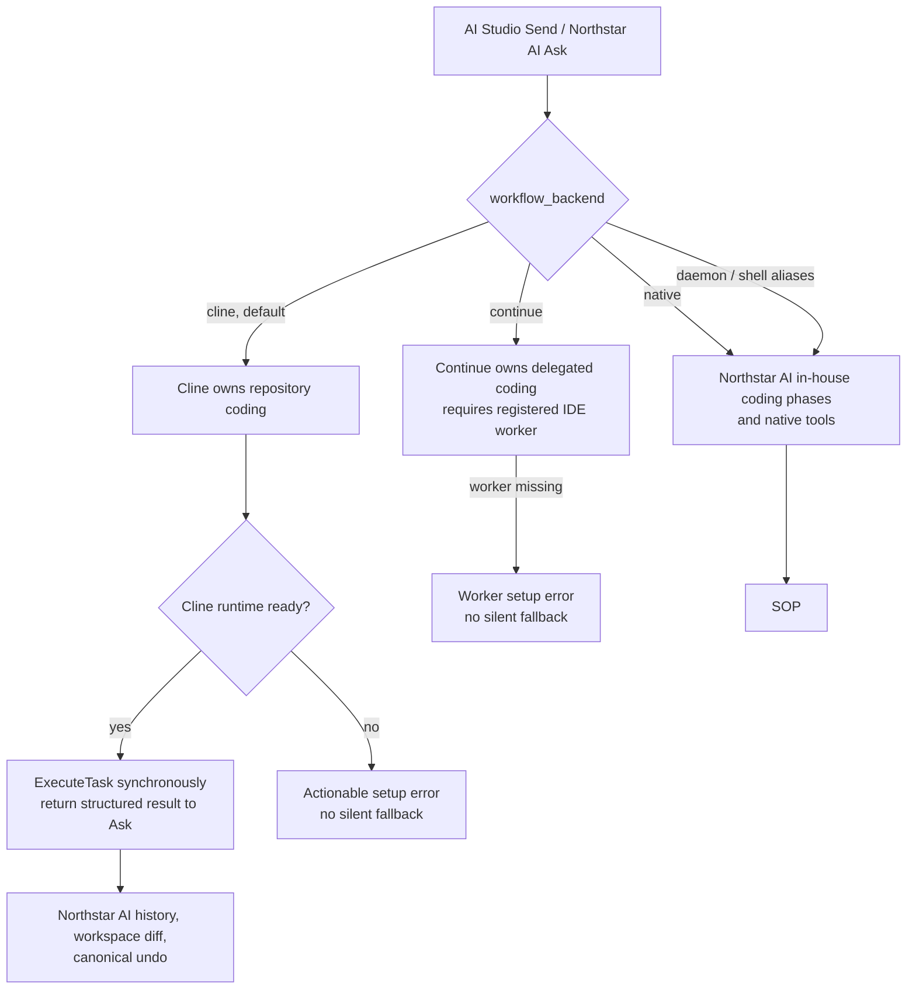
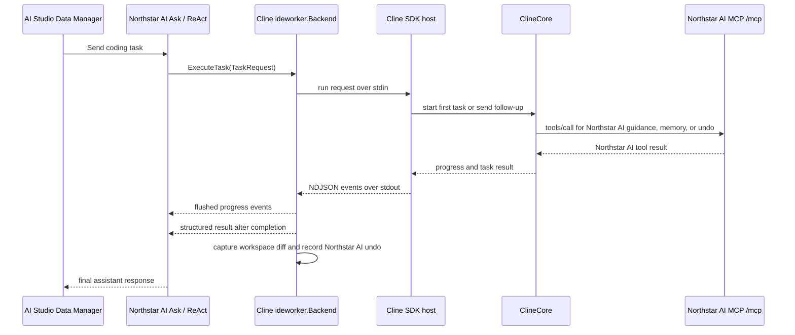
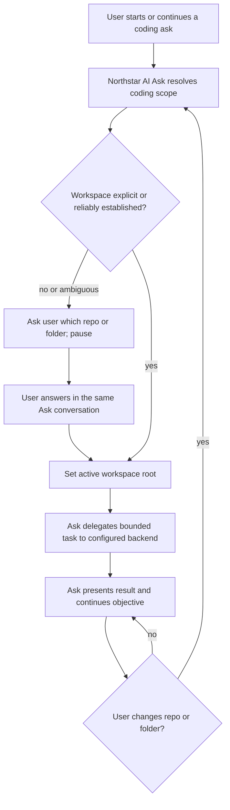

# Cline SDK Integration

**Status (2026-10-04):** The Northstar AI daemon-managed Cline backend, authenticated Northstar AI MCP tools, workspace diff capture, delegation lifecycle, live Ask NDJSON progress events, AI Studio preferred-LLM selector, opt-in same-provider in-session model escalation, and packaging checks are implemented. The full daemon package suite, focused race tests, SDK-host tests/build, docs build, and staged package install/syntax check pass. A real-provider, browser-driven end-to-end run and clean target-machine installation have not yet been validated; this is code-complete, not fully release-validated.

## Architecture

Northstar AI is the product/platform; AI Studio is its HTTPServer/daemon-served Data Manager UI, including the AI Chat window; Joltrin is the core SDK. The standard AI Studio Chat composer has one Send action. Requests go through Northstar AI Ask; Ask classifies the request and may delegate a bounded coding task through the `ideworker` capability. Cline owns the inner coding agent loop, while Northstar AI remains the outer controller.

Developers adding another worker backend should start with the [IDE copilot integration guide](IDE_COPILOT_INTEGRATION_GUIDE.md), then use this document for Cline-specific runtime, packaging, and validation details.

Select the coding executor with `workflow_backend` in daemon configuration:

| Value | Coding execution | Continue bridge routes |
|---|---|---|
| `cline` (default) | Cline SDK host exclusively owns repository coding. Missing runtime is an error, not a native fallback. | Disabled |
| `continue` | Continue backend exclusively owns delegated coding and requires a registered IDE worker; missing worker is an error, not a native fallback. | Enabled |
| `native` | Northstar AI's in-house coding phases and native tools own coding. | Disabled |

`daemon`, `daemon_shell`, and `shell` remain aliases for `native` for compatibility. The in-house phase implementation remains available for explicit native selection, not as an automatic fallback from Cline.

Coding implementation selection is registration-driven. Ask's phase planner remains the shared orchestrator. In Cline mode, the Capability registry contains the Cline-backed worker Capability; in Continue compatibility mode it contains the Continue-backed worker Capability; in native mode neither delegated worker is registered. Phase Capabilities are never stored globally: the Phase Factory creates the selected domain/phase implementation for each Ask turn, using native coding phases only when `workflow_backend=native`. The selected worker backend configuration must survive CopilotAgent cloning inside the shared Service.



The `Continue` branch also requires its callback routes, which are registered only in Continue mode. PostgreSQL and Splunk remain separate Northstar AI automation families; selecting a coding executor does not replace those capabilities.

The Cline coding call itself is synchronous within Ask. The daemon's `/api/cline/tasks` diagnostic API remains asynchronous and uses `StartTask`/status/cancel independently.



The current Ask-visible worker tool is still named `delegate_continue_task` for compatibility. Its backend is not Continue-specific: the daemon selects Cline by default. Treat that name as legacy API terminology, not the product direction.

When `workflow_backend=cline`, Cline exclusively owns repository coding execution for that Ask turn. Ask omits the overlapping Northstar AI coding phase tools, exposes the worker delegation tool, waits for Cline's structured result, and does not advance the native coding phase plan for that turn. If the selected Cline runtime is unavailable or misconfigured, delegation returns an actionable setup error; Ask does not silently switch executors. PostgreSQL and Splunk tool families remain separate Northstar AI automation capabilities. Git and generic file/shell mutation tools are suppressed on Cline-owned coding turns to avoid two executors editing the same workspace.

The legacy `/api/continue/*` bridge routes are mounted only when `workflow_backend=continue`. In Cline mode, Continue is not selected as a backend and its compatibility routes are not registered.

The React site is the account/onboarding surface. The Data Manager Chat UI is served by `httpserver` or the daemon from shared `sopbackend` templates. Direct Cline HTTP routes are for diagnostics and backend tests, not a second production chat controller or Send button.

### Ask-Owned Coding Workspace Intake

Ask owns the coding workspace context before it delegates. It uses a path explicitly supplied in the current request or a reliable workspace already established for the active session. If no unambiguous workspace is available, Ask asks the user which repository or folder to work in, records the answer in the active session, and pauses until the user responds. Ask then sends the resolved root on every delegated coding task. It does not expose a Cline button, ask the user to configure Cline, or let the worker choose the top-level project implicitly.

During a coding objective, the user may explicitly switch repositories or narrow the scope to a folder. Ask updates the active root before further delegated work. The Cline host scopes tactical sessions by workstream, workspace, and provider configuration, so switching repositories isolates agent history; a folder-level scope change is also passed explicitly to the next delegated task. An ambiguous switch must be clarified before edits. The path must be available to the daemon host.



## Implemented Components

| Component | Implementation |
|---|---|
| Shared worker contract | [`ideworker.Backend`](../lib/sop/ai/agent/domains/ideworker/capability.go) and canonical result types in [`result.go`](../lib/sop/ai/agent/domains/ideworker/result.go) |
| Cline backend | [`cline_worker_bridge.go`](../lib/sop/cmd/sop-daemon/cline_worker_bridge.go); SDK host is default, CLI fallback is selected with `SOP_CLINE_EXECUTION_MODE=cli` |
| SDK host | [`tools/cline-sdk-host`](../tools/cline-sdk-host); uses `@cline/core` and a JSON/NDJSON stdin/stdout protocol |
| Diagnostic task routes | `POST /api/cline/execute`, `POST /api/cline/tasks`, `GET /api/cline/tasks/{id}`, `POST /api/cline/tasks/{id}/cancel` |
| Northstar AI MCP route | Authenticated `POST /mcp` using JSON-RPC 2.0 |
| Production chat route | `/api/ask`; Ask decides whether to delegate |

The Joltrin SDK host currently exposes these Northstar AI tools through authenticated MCP calls:

- `get_task_guidance`
- `search_memory`
- `search_undo_history`
- `record_validation`
- `restore_undo_transaction`

This is the Cline-to-SOP tools channel. SOP-to-Cline task execution does not use MCP: the daemon calls `ideworker.Backend`, and its Cline adapter manages the SDK host over a private NDJSON stdin/stdout protocol. That host protocol is an implementation detail, not a general backend API.

For delegated coding tasks, the daemon keeps a bounded, 24-hour Cline task context keyed by workstream and verifies the SOP session identity on every read or mutation. The host injects those identities into each MCP call; Cline does not need to infer or supply them. Guidance and validation therefore work on the normal Cline `/api/ask` path without relying on a Continue snapshot.

Restore requires explicit confirmation, a matching workspace/session, backup and hash verification, and invalidates the associated Cline session after success. Workspace roots are checked before execution or workspace-scoped memory/undo actions.

## Result, Undo, and Activity

The daemon captures bounded before/after file contents and computes created/updated/deleted unified diffs. Git file enumeration is preferred; non-Git workspaces use a filesystem walk that does not follow symlinks and skips generated directories. Each snapshot is limited to 2,000 file entries, 1 MiB per file, and 16 MiB total, with Git's listing output capped at 2 MiB; skipped paths are excluded from change inference and a truncated snapshot suppresses diff inference entirely. Snapshot completeness is reported in result metadata. Inline diffs are bounded to 32 KiB; larger results carry truncation metadata while file-level change metadata remains available. Results are recorded through SOP's existing undo and execution-memory paths.

The SDK host also queries Cline's accumulated usage before and after each task. Result metadata includes per-task deltas and session totals for root usage and aggregate usage (including teammates/subagents), with input/output/cache token counts and total cost. Usage collection is best-effort and does not fail a coding task.

When same-provider escalation is configured, result metadata records the attempted transition, reason, outcome, and restoration status. A failed restoration invalidates the Cline session; see the provider-pool section below for the policy and configuration boundary.

SOP's `UndoManager` is the durable, searchable undo source of truth. Cline's task-local checkpoints remain a separate recovery layer. Do not import every Cline checkpoint into SOP.

The Chat surface shows one filtered activity message that updates in place and becomes the final result. Raw SDK/PTY output remains in the Terminal/daemon diagnostic surfaces. Structured status fields include phase, activity kind, label, and update time.

While `/api/ask` is active, synchronous Cline delegation emits flushed NDJSON `progress` events through completion, then returns its structured result to Ask's ReAct loop. Payloads include `source: "ide_worker"`, `backend: "cline"`, `event: "delegation_status"`, `delegation_id`, `status`, `progress`, `message`, `phase`, `activity_kind`, `activity_label`, and `updated_at`. Progress events do not suppress the final assistant response. Diagnostic `StartTask` routes remain asynchronous and require explicit task cancellation; they are detached from the short-lived HTTP request context and bounded by a 12-hour timeout.

The normal `/api/ask` delegation carries the selected provider/model credentials and an authenticated, loopback MCP endpoint to the host as request-scoped data; credentials are not placed in persistent session variables. An explicit `SOP_AI_STUDIO_MCP_URL` can override the default MCP endpoint, and `SOP_AI_STUDIO_MCP_TOKEN` supports daemon deployments that authenticate the request with a cookie rather than a bearer header.

## Northstar AI Provider Pool and Preferred LLM

The provider pool configures Northstar AI Ask's own generator. It is an availability fallback mechanism, not a quality-learning or task-complexity router. Cline receives one explicit provider/model configuration for its delegated session; it does not execute Northstar AI's pool fallback chain. The HTTPServer Data Manager UI that exposes chat and pool controls is AI Studio; Joltrin is the core SDK used to embed and extend Northstar AI.

When a request specifies a provider/model, that pair stays primary. When none is specified, Ask currently chooses the first configured provider in the fixed OpenAI, Anthropic, Gemini order. Alternatives are ordered using the configured `thinking_level` as a minimum eligibility floor, static provider preference, credential configuration recency, and model-catalog cost/capability. Cost preference remains manual; the system does not infer that a task needs a smarter model or automatically choose the globally cheapest model as primary.

The AI Studio Chat header's **Preferred LLM** selector shows the saved `brain_provider`/`brain_model` and marks it as **Preferred**. Choices are limited to configured pool providers; selecting one securely persists the new primary and applies it to subsequent chat requests. The final **Pool config** entry opens the existing provider-key settings. Pool fallback may still use another eligible provider after a recognized retryable failure, but provider outcome history never changes the preferred selection or fallback ranking.

`FallbackGenerator` retries only recognized availability errors such as timeouts, network failures, rate limits, capacity responses, and provider server errors. Authentication, invalid requests, cancellation, and unrecognized errors do not trigger fallback. Its circuit breaker skips providers with repeated availability failures. Persisted success/failure counters are diagnostic only and are not used to promote or demote providers; because successful fallback attribution is not reported today, the counters are coarse rather than per-provider usage accounting.

Provider availability failover is separate from answer-quality escalation. The Cline SDK host supports an opt-in, one-step, same-provider model escalation during a delegated task. An operator selects the target with `SOP_CLINE_ESCALATION_MODEL_ID`; Cline can request the switch only after concrete repeated reasoning or progress failure, never for transport/provider errors. The SDK's `updateSessionModel` preserves active session history, then the host restores the original model before returning. Provider outcome counters do not choose or rank the escalation target, and cross-provider switching is not enabled.

## Memory and Session Continuity

Use two persistence scopes rather than choosing one system for everything:

- **SOP is canonical across workstreams.** It owns semantic memory, team practices, validation history, and searchable undo transactions. Cline can consult relevant SOP context through MCP, and completed work is recorded back into SOP.
- **Cline is tactical within a workstream.** Its session history and checkpoints can preserve the active coding task's working context and recovery state. They should not become a global conversation shared by unrelated workstreams or a competing source of durable SOP memory.

Recommended policy: associate a Cline session with one SOP workstream and workspace; resume it only for follow-up work on that same objective. Start a fresh Cline session for an unrelated objective or materially different workspace. If SOP restores files to an earlier state, invalidate or fork the associated Cline session before further execution. Reuse concise SOP guidance across workstreams rather than carrying the full Cline transcript forward.

This is an ownership recommendation, not a claim that SOP retrieval has been proven more relevant than Cline's project memory. Measure recall and task outcomes before expanding cross-workstream Cline context.

**Current implementation:** the daemon keeps a supervised Node SDK host per SOP workstream and workspace/provider configuration, independent of the PTY shell. The host calls `core.start()` for the first delegated task and `core.send()` for follow-ups, serializing turns within that workstream. Unrelated workstreams and materially different provider/workspace settings use separate hosts and Cline sessions. Idle hosts expire after 30 minutes, the daemon caps the pool at 32, and daemon restart intentionally begins fresh tactical sessions rather than assuming disk reattachment is safe. A confirmed SOP restore retires the associated host before the next task. PTY remains available for interactive shell use and explicit CLI fallback; SDK requests use managed stdin/stdout pipes.

## Runtime and Packaging

- The SDK host requires Node.js 22 or newer.
- Build locally with `cd tools/cline-sdk-host && npm ci && npm run build`.
- `tools/cline-sdk-host/package-runtime.sh [output-directory]` runs the locked install and build and stages the package metadata, lockfile, TypeScript config, and compiled host.
- `SOP_CLINE_SDK_HOST_PATH` can point the daemon at a non-default compiled host path.
- `SOP_CLINE_API_KEY` and provider-specific environment variables are fallbacks; daemon requests pass provider credentials through the private host stdin pipe, not command-line arguments.
- The package script does not install Node itself. Release/deployment packaging must provide Node 22+ and the host's runtime dependencies on the target machine.

Continue is not a shipping dependency. Its retained code and documentation are compatibility/reference material only; see the Continue section of the [documentation index](INDEX.md).

## Automated Validation

From the repository root:

```sh
go test ./...
go test ./lib/sop/...
cd tools/cline-sdk-host && npm ci && npm run build
```

Focused Cline coverage lives in `lib/sop/cmd/sop-daemon/*cline*test.go`, `lib/sop/cmd/sop-daemon/mcp_server_test.go`, and the `ideworker` package tests.

## Remaining Release Validation

A human with configured provider credentials still needs to verify the end-to-end path in the actual Data Manager:

1. Start the daemon with the SDK host available and open the Data Manager in daemon mode.
2. Send a bounded coding task using the AI Studio Chat Send action; confirm Northstar AI Ask delegates and the task edits the selected workspace.
3. Confirm completion, changed-file reporting, undo history, and a validation result appear as expected.
4. Cancel a long-running task and confirm the daemon-managed worker stops.
5. With `SOP_CLINE_ESCALATION_MODEL_ID` configured to a valid same-provider model, induce a controlled reasoning stall and confirm exactly one in-session switch, continued task execution, original-model restoration, and escalation usage/result metadata. Confirm a provider/network error does not invoke the switch.
6. Send a non-coding question and confirm it remains a Northstar AI Ask response without Cline delegation.
7. Repeat from a clean target-machine installation with Node 22+ and packaged host dependencies.

The focused automated tests cover one-shot model-switch state, base-model restoration, same-workstream reuse, workstream/config isolation, cancellation, and restore invalidation. The remaining live validation should confirm same-workstream context continuity through the Data Manager, unrelated workstream isolation, daemon-restart reset, cancellation of a real provider task, that the escalation tool changes the active SDK session and then restores its base model, and that SOP restore prevents stale Cline context from editing reverted files.

The automated protocol, daemon lifecycle, workspace-diff, MCP, and host-build checks do not replace this live provider/UI/install validation. The full daemon package suite and a staged package installation passed locally. The staged install used Node 26, which emitted an engine-range warning for a dependency supporting Node 20, 22, and 24; repeat the clean target-machine check on the supported Node 22 runtime.