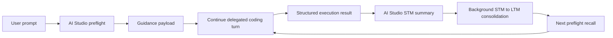

# Continue Copilot Integration Contract

**Status**: Active

## Purpose

This document defines the behavior and interfaces for integrating an IDE copilot such as Continue into the SOP / AI Studio workflow.

The contract is intentionally narrow:

- AI Studio owns orchestration, durable memory, KnowledgeBase guidance, approvals, and history recording.
- Continue owns the delegated coding workflow loop inside the IDE.
- The bridge should stay thin and return structured execution results rather than raw chat text whenever possible.

## Core behavior

The integration runs in two directions:

1. Preflight enrichment from AI Studio to Continue.
2. Post-execution consolidation from Continue back into AI Studio memory.

### Preflight enrichment

Before Continue starts the delegated coding turn, AI Studio should assemble a guidance payload that may include:

- KnowledgeBase / Space grounding for team practices and project conventions
- session memory continuity from the active STM trail
- LTM semantic recall or broader memory neighborhood recall
- phase intent, allowed tools, workflow profile, and result contract expectations

This guidance is not the user prompt itself. It is the contextual layer that AI Studio computes around the prompt before handing work to Continue.

### Post-execution consolidation

After Continue completes a delegated coding slice, AI Studio should record a compact memory summary that captures:

- what was attempted
- what changed
- what was validated
- what knowledge or team practice was applied
- what should be recalled next time

That summary should first land in STM, then be promoted to LTM by the background sleep-cycle / consolidation pipeline.

MRU is not part of the durable memory sync contract. MRU remains a runtime continuity aid, not the canonical record of coding outcomes.

## Memory lifecycle

The preferred memory lifecycle is:



### What gets recalled

AI Studio should recall from three places before a Continue turn:

- current session memory for continuity
- LTM semantic recall for durable facts and learned behavior
- KnowledgeBase / Space guidance for team practice and repository conventions

### What gets recorded

AI Studio should record into memory from Continue execution results:

- compact coding workflow summaries
- validation outcome
- file and diff metadata
- useful lessons or constraints
- references to applicable KnowledgeBase entries or memory facts

## Interface contract

The integration should be modeled as a backend contract rather than a direct one-off chat relay.

### Prompt service

The prompt service owns prompt capture, event recording, and completion history.

```go
type PromptService interface {
  RecordPrompt(request PromptRecord) error
  StartRun(ctx context.Context, request WorkflowRunRequest) (WorkflowRunHandle, error)
  AppendEvent(ctx context.Context, runID string, event WorkflowEvent) error
  CompleteRun(ctx context.Context, runID string, result WorkflowRunResult) error
}
```

### Coding workflow worker

The worker owns bounded IDE-native execution.

```go
type CodingWorkflowWorker interface {
  Capabilities() []string
  Run(ctx context.Context, request WorkflowRunRequest) (WorkflowRunResult, error)
  Cancel(ctx context.Context, runID string) error
}
```

### Workflow backend

The backend combines the prompt service and worker roles behind a small swappable boundary.

```go
type WorkflowBackend interface {
  Name() string
  PromptService
  CodingWorkflowWorker
}
```

## Continue request contract

Continue should receive a request that includes explicit context fields rather than hidden state.

Recommended request inputs:

- `request_id` for the current execution identity
- `root_request_id` for delegation lineage
- `session_id` for workstream identity
- `requested_phase` for phase-aware behavior
- `workflow_profile` for task shaping
- `task_type` for execution intent
- `allowed_tools` for bounded tool access
- `guidance` for memory, KB, and team-practice context
- `result_contract` for the structured result shape expected by AI Studio

Continue should return structured results containing at least:

- modified files
- diff summaries or deltas
- validation status
- execution metadata
- optional undo references
- optional memory or KnowledgeBase breadcrumbs

## Sync points

### AI Studio to Continue

This happens before coding time.

AI Studio should:

- query KB / Space guidance for team practice when relevant
- gather session-memory continuity
- gather LTM recall when relevant
- package those into the Continue guidance block
- forward the structured contract to Continue

### Continue to AI Studio

This happens after coding time.

Continue should:

- return structured file-change data
- return validation metadata
- preserve request and root request IDs
- emit enough information for AI Studio to write a memory summary

AI Studio should then:

- compact the execution result into STM
- let background consolidation promote important items into LTM
- expose the result in history and undo surfaces

## Practical rule set

- Keep the bridge thin.
- Do not reimplement Continue internals in the daemon.
- Do not use MRU as the durable memory record for coding outcomes.
- Use STM for immediate continuity and LTM for durable recall.
- Use KnowledgeBase / Spaces for team practice and repository conventions.
- Refill Continue guidance from AI Studio before the next delegated turn.

## Related docs

- [CONTINUE_FACADE_ARCHITECTURE.md](CONTINUE_FACADE_ARCHITECTURE.md)
- [CONTINUE_IDE_WORKFLOW_SURFACE.md](CONTINUE_IDE_WORKFLOW_SURFACE.md)
- [CONTINUE_BRIDGE_IMPLEMENTATION_PLAN.md](CONTINUE_BRIDGE_IMPLEMENTATION_PLAN.md)
- [LONG_TERM_MEMORY.md](LONG_TERM_MEMORY.md)
- [WORKFLOW_UNDO_SYSTEM.md](WORKFLOW_UNDO_SYSTEM.md)