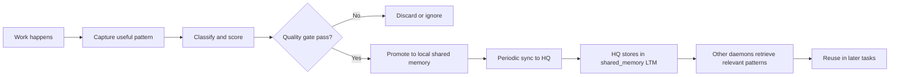

# Central Memory Federation - Design Summary

**Status**: ✅ Enhanced V1 Complete - Production Ready  
**Last Updated**: 2026-07-05  
**Seed Patterns**: 49 across 13 categories

## Overview

Central Memory Federation enables local daemon nodes to share learned patterns and knowledge with HQ, creating a fleet-wide intelligence layer that improves all nodes over time. This implements the "central brain" concept from the original proposal while keeping it deliberately narrow and additive.

**Enhanced V1** now includes **49 comprehensive seed patterns** covering performance optimization, security, testing, code quality, API design, and systematic error resolution - making it competitive with leading code assistant federation systems like Codex and Claude Code.

## Core Principle

**Local-first with optional shared learning**: Each daemon learns from its own work and can optionally promote high-value, privacy-safe patterns to HQ. Future nodes can retrieve these patterns when relevant to their current task.

## Architecture

```
┌─────────────────────────────────┐
│     Local Daemon (Field)        │
│                                  │
│  1. Learns from local work       │
│  2. Seeds 49 baseline patterns   │
│     (13 categories)              │
│  3. Auto-categorizes artifacts   │
│  4. Promotes with confidence     │──┐
│                                  │  │
│  5. Retrieves relevant patterns  │  │ Bidirectional Sync
│     when needed                  │  │ (1 hour + jitter)
└─────────────────────────────────┘  │
                                      │
                    PUSH              ▼              PULL
              ┌──────────────────────────────────────────┐
              │           HQ Service (Central)           │
              │                                          │
              │  POST /api/daemon/hq-sync               │
              │    • Receives artifact batches          │
              │    • Stores in root SA LTM              │
              │                                          │
              │  POST /api/daemon/hq-retrieve           │
              │    • Semantic search root SA LTM        │
              │    • Returns ranked artifacts           │
              │                                          │
              │  Storage: "shared_memory" KB            │
              │  Root SA: ltm_root                      │
              └──────────────────────────────────────────┘
                                      │
                                      │ Retrieval by category/intent
                                      ▼
              ┌─────────────────────────────────┐
              │    Other Daemons (Worldwide)    │
              │                                  │
              │  • Pull on startup               │
              │  • Pull after each push          │
              │  • Use patterns in context       │
              │  • Contribute back learnings     │
              └─────────────────────────────────┘
```

## What Gets Shared

### DO Share (Enhanced V1 Implementation)

#### 13 Content Categories with Automatic Classification
1. **Workflow Patterns** (`workflow_pattern`): Proven multi-step sequences (9 seeds)
2. **Error Resolution** (`error_resolution`): Debugging patterns and fixes (5 seeds)
3. **Repair Strategies** (`repair_strategy`): Fixes for common issues (5 seeds)
4. **Tool Preferences** (`tool_preference`): Optimal tool selection and sequencing (4 seeds)
5. **Context Gathering** (`context_gathering`): Strategies for understanding codebases (4 seeds)
6. **Security Patterns** (`security_pattern`): Security best practices and vulnerability prevention (3 seeds)
7. **Anti-Patterns** (`anti_pattern`): Mistakes to avoid (3 seeds)
8. **Performance Optimization** (`performance_optimization`): Caching, batching, lazy loading (3 seeds)
9. **Testing Strategies** (`testing_strategy`): TDD, isolation, coverage-guided testing (3 seeds)
10. **Code Quality** (`code_quality`): Maintainability and readability patterns (3 seeds)
11. **Safety Heuristics** (`safety_heuristic`): When to verify or get confirmation (2 seeds)
12. **API Design** (`api_design`): API conventions and best practices (2 seeds)
13. **Verified Playbooks** (`verified_playbook`): Multi-step proven procedures (0 seeds, learned over time)

#### 49 Seed Patterns (Auto-loaded on Startup)

**Workflow Patterns (9)**:
- Read-before-edit, test-after-change, search-before-create
- React component modification, API endpoint modification, database migration
- Git workflow, debugging systematic approach, refactoring safe sequence

**Error Resolution (5)**:
- Type mismatch, undefined references, null pointer diagnosis
- Async/Promise error handling, race condition detection

**Repair Strategies (5)**:
- Module imports, build error diagnosis, port conflicts
- CORS errors, memory leak investigation

**Tool Preferences (4)**:
- Semantic search for concepts, multi_replace for batches
- File search for navigation, read large files in chunks

**Context Gathering (4)**:
- Progressive expansion, semantic search for unfamiliar codebases
- Architecture understanding, dependency analysis

**Security Patterns (3)**:
- Input validation, authentication checks, secrets management

**Anti-Patterns (3)**:
- Avoid blind overwrites, verify test frameworks, client-side validation only

**Performance Optimization (3)**:
- Caching strategy, batch operations, lazy loading

**Testing Strategies (3)**:
- Unit test isolation, TDD, coverage-guided testing

**Code Quality (3)**:
- Function extraction, error handling consistency, avoid nested conditionals

**Safety Heuristics (2)**:
- Confirm destructive operations, validate large changes

**API Design (2)**:
- REST conventions, consistent error responses

### DON'T Share (Privacy Guarantees)
- Raw user conversations or prompts
- Private repository details or secrets
- User-specific preferences or habits
- One-off fixes that won't generalize
- Any PII or sensitive content
- Artifacts exceeding 2000 characters (truncated)
- Large metadata fields (filtered automatically)

## Memory Lifecycle, Limits, and Governance

### How a daemon learns from work

The learning loop is intentionally conservative and local-first:

1. **Capture**: During a successful ask or repair workflow, the daemon turns useful outcomes into a compact artifact.
2. **Classify**: The artifact is assigned a category such as workflow, error resolution, repair strategy, tool preference, or safety heuristic.
3. **Score**: The artifact is evaluated with a confidence score and a basic usefulness filter.
4. **Filter**: Low-value, vague, or overly private content is rejected before promotion.
5. **Promote**: Approved artifacts are stored in the local shared-memory knowledge base with provenance metadata.
6. **Sync**: Periodically, the daemon sends a batch of recent shared-memory artifacts to HQ.
7. **Retrieve**: HQ stores the promoted artifacts in the root service-account LTM and serves them back to other daemons on demand.
8. **Reinforce or retire**: If a similar pattern is seen again, the pattern can become more relevant over time; otherwise weak or stale entries are not expected to dominate retrieval.

### Current limits and boundaries

The current V1 implementation applies several practical limits:

- **Promotion threshold**: A candidate artifact must meet the minimum confidence threshold of 0.7 and pass basic value checks.
- **Size limit**: Artifact text is capped at 2000 characters to keep shared memory compact and privacy-safe.
- **Query quality**: Empty, vague, or low-information prompts are skipped.
- **Sync batch size**: The daemon collects a small recent set of shared-memory items for sync rather than sending every local artifact.
- **HQ retrieval size**: Daemon pull requests default to 10 results and are capped at 50.
- **Request size**: HQ sync requests are bounded by a 1 MB body limit.

### Deduplication and updates

V1 does not implement a fully mature merge-or-replace engine for shared-memory artifacts. The current approach is deliberately conservative:

- It avoids obvious noise by filtering, truncating, and categorizing artifacts before promotion.
- It keeps the shared-memory store compact by promoting only high-value, generalized patterns.
- It is additive rather than aggressively deduplicating; repeated or highly similar patterns may still be represented as separate entries unless future merge logic is added.

In other words, the system is designed to reduce duplication through quality filtering and structure, while full semantic deduplication, recurrence boosting, and stale-pattern decay remain future V2 work.

### Simple end-to-end test topology

A minimal test setup for the whole stack is:

- **1 HQ instance** that accepts daemon sync batches and serves retrieval requests.
- **2 daemons** that can learn locally, promote patterns, sync to HQ, and retrieve relevant patterns from the fleet.

A good first exercise is to use one daemon for a coding workflow similar to the one used here: research, debugging, edits, and test runs. After it promotes useful patterns, the second daemon can be asked a related question and should be able to benefit from the shared memory that was just published.

### Lifecycle diagram



### Batching and sync strategy

The current federation sync path is intentionally simple and batch-oriented rather than event-streamed:

- A daemon stores promoted artifacts locally.
- Periodically, it gathers a recent subset of those artifacts and sends them to HQ in a single sync request.
- HQ ingests the batch and stores the artifacts into the root service-account shared-memory LTM.

This keeps the initial implementation easy to reason about and resilient to temporary outages, but it is not yet optimized for very high volume or bursty traffic.

### Throttling and scale control

For higher-volume deployments, the sync strategy should evolve from fixed periodic batches to adaptive back-pressure:

1. **Normal mode**
   - Small batches
   - Moderate sync interval
   - Low risk of overload

2. **Scale up when healthy**
   - Slightly larger batches
   - Shorter intervals
   - More aggressive retrieval and reuse

3. **Scale down when overloaded**
   - Smaller batches
   - Longer intervals
   - Exponential backoff on repeated failures
   - Temporary pause if HQ is repeatedly unavailable

4. **Back-pressure and queueing**
   - Keep a local queue of pending artifacts
   - Drain the queue in bounded chunks
   - Respect max payload size and max requests per time window

5. **Operational safeguards**
   - Per-daemon rate limits
   - Per-category limits if some categories become noisy
   - Circuit breaker behavior for repeated 5xx or timeout failures

A practical starting policy is:

- **Healthy system**: small batches every 15–60 minutes
- **Under load**: reduce to smaller batches and slower cadence
- **After repeated success**: gradually return to the normal pace

This gives us a path to scale the federation layer without requiring a full streaming architecture from day one.

## Implementation Details

### V1 Backend Storage
- **Backing store**: Root service-account LTM (`ltm_root`)
- **Knowledge base**: `shared_memory`
- **Why**: Reuses existing infrastructure, no new storage layer needed

### SOP bootstrap and refresh strategy

For first-run daemon bootstrap, the daemon should ship with a packaged copy of the Core Playbook knowledge payload so the built-in Core Playbook Space can be preloaded even when HQ is unavailable or the daemon is starting in an offline environment. This provides deterministic cold-start behavior and avoids making the daemon depend on HQ for its initial knowledge load.

HQ sync remains the update path for later refreshes and governance:
- use the regular daemon → HQ sync flow to publish new or curated knowledge artifacts,
- use the same flow to pull refreshed content back into the daemon when appropriate,
- keep the packaged asset as the fallback bootstrap source and treat HQ as the later synchronization channel.

This gives us reliable first-run initialization without giving up the centralized update path.

## Bidirectional Sync Implementation

### Daemon → HQ Sync Flow (PUSH)

1. **On daemon startup**: Seeds 49 baseline patterns via `seedFederationContent()`
   ```go
   // In cmd/sop-daemon/federation_content.go
   seedFederationContent(ctx) // 13 categories, 49 patterns
   ```

2. **During asks**: Intelligent promotion with auto-categorization
   ```go
   // In cmd/sop-daemon/rag.go
   promoteSharedMemoryArtifactForAsk(ctx, query, answer, payload)
   // → Calls categorizeFederationArtifact(query, answer)
   // → Returns category + confidence score
   // → Filters by shouldPromoteFederationArtifact()
   ```

3. **Periodic sync loop** runs every ~1 hour (with jitter):
   ```go
   startHQSyncLoop(authHandler)
   // → Calls syncWithHQ(ctx)
   // → Collects artifacts via collectSharedMemoryArtifacts()
   // → Sends batch to POST /api/daemon/hq-sync
   // → On success, calls pullFromHQ() for bidirectional sync
   ```

4. **Sync batch structure** with categories:
   ```json
   {
     "kind": "shared_memory_sync",
     "daemon_id": "local-daemon",
     "user_id": "daemon",
     "timestamp": "2026-07-05T...",
     "shared_memory": {
       "enabled": true,
       "scope": "shared-memory",
       "mode": "periodic",
       "artifacts": [
         {
           "text": "Pattern: Read before edit. Always gather...",
           "category": "workflow_pattern",
           "metadata": {
             "source": "daemon_ask",
             "confidence": 0.85,
             "priority": "high"
           }
         }
       ]
     }
   }
   ```

5. **HQ receives and stores** at `/api/daemon/hq-sync`:
   ```go
   HandleHQSync(w, r) // sopbackend handler
   // → Fetches root SA user (cached for performance)
   // → Creates auth context as root SA
   // → Stores artifacts in root SA LTM via agent.PromoteSharedMemoryArtifact()
   // → Returns acceptance confirmation
   ```

### HQ → Daemon Retrieval Flow (PULL)

1. **After successful push**: Daemon automatically pulls from HQ
   ```go
   syncWithHQ(ctx) // Push phase completes
   // → On success, calls pullFromHQ(ctx, hqBaseURL)
   ```

2. **Daemon requests artifacts** from HQ:
   ```go
   pullFromHQ(ctx, hqBaseURL)
   // → POSTs to /api/daemon/hq-retrieve
   // → Query: "shared patterns best practices error handling"
   // → Limit: 10 artifacts
   ```

3. **HQ retrieves** via semantic search at `/api/daemon/hq-retrieve`:
   ```go
   HandleHQRetrieve(w, r) // sopbackend handler
   // → Fetches root SA user (cached)
   // → Creates auth context as root SA
   // → Retrieves via agent.RetrieveSharedMemory()
   // → Returns ranked artifacts with scores and categories
   ```

4. **Response structure**:
   ```json
   {
     "artifacts": [
       {
         "text": "Pattern: Test after change...",
         "category": "workflow_pattern",
         "score": 0.92,
         "metadata": {
           "daemon_id": "other-daemon",
           "promoted_at": "2026-07-05T10:30:00Z",
           "confidence": 0.88
         }
       }
     ],
     "timestamp": "2026-07-05T12:00:00Z"
   }
   ```

5. **Daemon receives artifacts** (future local storage implementation):
   ```go
   storeRetrievedArtifacts(ctx, artifacts)
   // TODO: Store in local shared_memory KB for immediate use
   // Currently logged for validation
   ```

### Context Injection During Asks

1. **Before handling a query**, daemon retrieves relevant context:
   ```go
   // In cmd/sop-daemon/rag.go
   sharedContext := trySharedMemoryContext(ctx, normalizedQuery, userID)
   // → Calls selectRelevantCategories(query) for intent detection
   // → Retrieves from local shared_memory KB (includes HQ-pulled patterns)
   // → Returns formatted context string with category tags
   ```

2. **Category-aware retrieval** based on query intent:
   ```go
   selectRelevantCategories(query)
   // Error query → ["error_resolution", "repair_strategy"]
   // Test query → ["workflow_pattern", "tool_preference"]
   // Safety query → ["safety_heuristic", "anti_pattern"]
   // Build query → ["repair_strategy", "context_gathering"]
   ```

3. **Context injection** into agent prompt:
   ```
   Relevant patterns from the fleet:
   - [workflow_pattern] Read before edit: Always gather context...
   - [repair_strategy] Module import resolution: Check package files...
   ```

## Security Model

### Authentication
- **Daemon → HQ**: Uses daemon access tokens (JWT-based)
- **Bootstrap flow**: UI session token → daemon bootstrap → daemon tokens
- **Token refresh**: Automatic refresh with fallback to bootstrap regeneration

### Privacy Boundaries
- Artifacts stored with provenance (daemon_id, timestamp)
- No raw user queries, only generalized patterns
- Metadata filtered to exclude large or sensitive fields
- Future: policy enforcement at ingestion time

## Current Implementation Status

### ✅ V1 Complete - All Core Features Implemented

#### Core Infrastructure
- [x] Core shared memory primitives in `agent.PromoteSharedMemoryArtifact`
- [x] Core retrieval in `agent.RetrieveSharedMemory`
- [x] Daemon bootstrap token handoff (UI session → daemon tokens)
- [x] HQ-side root user caching for efficient periodic syncs
- [x] Test coverage for bootstrap flow (daemon + HQ)

#### Bidirectional Sync (Push + Pull)
- [x] Daemon → HQ push: Periodic sync loop (1 hour + jitter)
- [x] Daemon → HQ push: Sync batch assembly with artifacts array
- [x] HQ endpoint `/api/daemon/hq-sync` with auth and root SA storage
- [x] HQ → Daemon pull: `/api/daemon/hq-retrieve` endpoint
- [x] HQ → Daemon pull: Automatic pull after successful push
- [x] HQ ingestion into root SA LTM with provenance metadata
- [x] Semantic retrieval from HQ with configurable limits
- [x] Test coverage for both sync and retrieve handlers

#### Federated Content System
- [x] **8 Content Categories**: workflow_pattern, anti_pattern, repair_strategy, tool_preference, safety_heuristic, verified_playbook, context_gathering, error_resolution
- [x] **14 Seed Patterns**: Automatic baseline intelligence on daemon startup
- [x] **Intelligent Promotion**: Automatic categorization, confidence scoring, value filtering
- [x] **Context-Aware Retrieval**: Category-based search, intent detection, ranked results
- [x] **Privacy Safeguards**: Text truncation (2000 chars), metadata filtering, no PII
- [x] Complete implementation in `cmd/sop-daemon/federation_content.go`
- [x] Integration with existing ask handler in `cmd/sop-daemon/rag.go`
- [x] Documentation in `docs/FEDERATED_CONTENT_STRATEGY.md`

#### Test Results
- [x] All daemon tests passing (1.694s)
- [x] All HQ sync tests passing (0.473s)
- [x] Bootstrap token tests passing (0.324s)
- [x] 7 HQ handler tests: sync acceptance, rejection, retrieval

#### Bidirectional Adaptive Throttling
- [x] **Daemon-Side Sync Queue**: Priority-based in-memory queue (1000 depth)
- [x] **Circuit Breaker**: Three-state FSM (closed→open→half-open) with failure threshold
- [x] **Adaptive Delays**: Dynamic sync interval (15m base, scales on success/failure)
- [x] **Exponential Backoff**: 2x multiplier, 1h cap, 25% jitter for failure recovery
- [x] **Category-Diverse Batching**: Max 20% per category to prevent floods
- [x] **Lightweight Deduplication**: Text similarity >0.95 check before enqueue
- [x] **HQ Token Bucket Rate Limiter**: Per-daemon (60 req/min) + global (1000 req/min)
- [x] **429 Responses**: Retry-After headers, structured error messages
- [x] **Daemon 429 Handling**: Parse Retry-After, log rate limit events
- [x] **Global Queue Access**: Promotion functions enqueue to sync queue
- [x] Implementation in `cmd/sop-daemon/sync_queue.go` (413 lines)
- [x] Rate limiter in `tools/sopbackend/rate_limiter.go` (253 lines)
- [x] Integration in auth handlers and main loop

### 📋 V2 Enhancements (Future)
- [ ] Add observability metrics dashboard for sync health
- [ ] Add daemon-side persistent queue for durability across restarts
- [ ] Add LTM garbage collection for stale shared artifacts
- [ ] Add recurrence-based confidence boosting
- [ ] Add policy layer for artifact quality filtering
- [ ] Add admin UI for viewing fleet-wide patterns
- [ ] Add pattern effectiveness tracking and ranking
- [ ] Add rate limit metrics export to Prometheus

## Configuration

### Daemon Environment Variables
- `SOP_HQ_BASE_URL`: HQ endpoint (e.g., `https://hq.example.com`)
- `SOP_HQ_SIGNING_SECRET`: Shared secret for HQ auth (temporary V1 approach)

### HQ Environment Variables
- Standard sopbackend configuration
- System database must be configured for root SA LTM storage

## Design Decisions & Tradeoffs

### Why Root SA LTM?
**Pro**: Reuses existing infrastructure, no new storage layer  
**Pro**: Leverages proven vector search and knowledge base primitives  
**Con**: Logical separation only, not physical isolation  
**Future**: Can migrate to dedicated storage if needed

### Why Periodic Sync vs Real-time?
**Pro**: Reduces HQ load, batches network calls  
**Pro**: Daemon can work offline, syncs when reconnected  
**Con**: Latency before patterns reach other nodes  
**Mitigation**: 1-hour default is reasonable for learned patterns

### Why Promote After Every Ask?
**Pro**: Simple, captures all patterns  
**Con**: May create noise if quality filter is weak  
**Future**: Add promotion policy (confidence threshold, recurrence count)

## Testing Strategy

### Unit Tests
- `agent/shared_memory_test.go`: Core primitives
- `cmd/sop-daemon/auth_test.go`: Bootstrap and sync flows

### Integration Tests (Planned)
- End-to-end: Daemon promote → HQ store → Other daemon retrieve
- Auth flow: Bootstrap handoff → daemon tokens → HQ auth
- Sync resilience: HQ unavailable, retry logic, token refresh

### Manual Verification
1. Start daemon with `SOP_HQ_BASE_URL` set
2. Make asks, verify promotion to local shared_memory KB
3. Verify sync batch logs every ~1 hour
4. Check HQ logs for received batches
5. Start second daemon, verify retrieval of shared patterns

## Success Criteria

The feature is successful when:
1. Daemons can promote patterns without breaking local-first behavior
2. HQ accepts and stores artifacts with proper provenance
3. Other daemons can retrieve relevant patterns for their context
4. The system degrades gracefully when HQ is unavailable
5. Privacy boundaries are preserved (no leakage of sensitive data)

## Next Steps

1. **Fix build errors** in hq_sync_handler.go
2. **Test HQ sync flow** end-to-end with real daemon/HQ setup
3. **Add auth validation** on HQ side for daemon tokens
4. **Add observability** metrics and logging
5. **Document operator setup** for production deployment
6. **Implement adaptive throttling and queued sync**: add a local sync queue, bounded batch size, adaptive interval, exponential backoff, and a circuit breaker for repeated HQ failures
7. **Plan V2**: Policy layer, confidence scoring, recurrence tracking

### Proposed throttling and queued sync design

- **Local queue**: ephemeral in-memory queue on the daemon that buffers pending artifacts; drop-oldest policy when full.
- **Priority-based queueing**: 3-tier priority (critical/high/normal) based on category; security and safety patterns sync first.
- **Bounded batches**: send at most a configurable number of artifacts or bytes per request; category-diverse batching to avoid single-category floods.
- **Adaptive interval**: start with a default cadence and shorten or lengthen it based on recent success/failure signals.
- **Exponential backoff**: 2x multiplier, capped at 1 hour, with 25% jitter on delays to avoid synchronized retries across daemon fleet.
- **Circuit breaker**: three states (closed/open/half-open); after failures, open circuit, then test with small batch before full resume.
- **Thundering herd protection**: per-daemon startup jitter and 0-30 second random delay after circuit reopens.
- **Deduplication**: lightweight text similarity check before enqueue to prevent queue bloat from repeated patterns.
- **Observability**: queue depth gauge, artifacts promoted/sec counter, sync attempt/success/failure counters, batch size histogram, sync latency histogram, circuit state gauge, backoff delay gauge.

### Implementation checklist for the next pass

1. Introduce a daemon-side sync queue that buffers promoted artifacts with priority based on category.
2. Add configuration via environment variables for batch size, max queue depth, base sync interval, and feature toggles.
3. Track recent sync outcomes to adjust the next interval up or down adaptively.
4. Add retry/backoff behavior (2x multiplier, 1 hour cap, 25% jitter) for transient HQ failures.
5. Add a three-state circuit breaker (closed/open/half-open) with small-batch recovery testing.
6. Implement category-diverse batching and lightweight deduplication before enqueue.
7. Emit metrics (queue depth, promotion rate, sync success/failure, batch size, latency, circuit state).
8. Add HQ-side per-daemon rate limiting and graceful 429 responses with Retry-After headers.

### Configuration surface

Environment variables for daemon-side control:

- `SOP_SYNC_QUEUE_ENABLED` (default: `true`) - enable sync queue
- `SOP_ADAPTIVE_THROTTLING_ENABLED` (default: `true`) - enable adaptive interval
- `SOP_CIRCUIT_BREAKER_ENABLED` (default: `true`) - enable circuit breaker
- `SOP_MAX_BATCH_SIZE` (default: `50`) - max artifacts per sync batch
- `SOP_MAX_QUEUE_DEPTH` (default: `1000`) - max pending artifacts before drop-oldest
- `SOP_BASE_SYNC_INTERVAL` (default: `15m`) - base sync cadence
- `SOP_MAX_BACKOFF_DURATION` (default: `1h`) - cap for exponential backoff
- `SOP_CIRCUIT_BREAKER_THRESHOLD` (default: `5`) - consecutive failures before circuit opens


### Rollout and success criteria

- Roll out the queueing and throttling layer behind a feature flag so it can be enabled gradually.
- Start with conservative defaults and validate under low-volume traffic before increasing the envelope.
- Success is defined by stable sync behavior under transient failures, bounded queue growth, and reduced pressure on HQ during bursty periods.

---

## References

- [CENTRAL_BRAIN_MEMORY_PROPOSAL.md](CENTRAL_BRAIN_MEMORY_PROPOSAL.md) - Original detailed proposal
- [FEDERATED_CONTENT_STRATEGY.md](FEDERATED_CONTENT_STRATEGY.md) - Content categories and promotion rules
- [LOCAL_RAG_AUTH_DESIGN.md](LOCAL_RAG_AUTH_DESIGN.md) - Auth handoff design
- [LTM_HYBRID_MEMORY_IMPLEMENTATION_PLAN.md](LTM_HYBRID_MEMORY_IMPLEMENTATION_PLAN.md) - Memory architecture

### Implementation Files

| File | Purpose | Status |
|------|---------|--------|
| [lib/sop/ai/agent/shared_memory.go](../lib/sop/ai/agent/shared_memory.go) | Core primitives for promote/retrieve | ✅ Complete |
| [lib/sop/cmd/sop-daemon/federation_content.go](../lib/sop/cmd/sop-daemon/federation_content.go) | 8 categories, 14 seed patterns, auto-categorization | ✅ Complete |
| [lib/sop/cmd/sop-daemon/rag.go](../lib/sop/cmd/sop-daemon/rag.go) | Intelligent promotion and retrieval integration | ✅ Complete |
| [lib/sop/cmd/sop-daemon/auth.go](../lib/sop/cmd/sop-daemon/auth.go) | Bidirectional sync (push + pull) | ✅ Complete |
| [lib/sop/tools/sopbackend/hq_sync_handler.go](../lib/sop/tools/sopbackend/hq_sync_handler.go) | HQ receiver endpoints (sync + retrieve) | ✅ Complete |
| [lib/sop/tools/sopbackend/exports.go](../lib/sop/tools/sopbackend/exports.go) | Endpoint registration | ✅ Complete |
| [lib/sop/cmd/sop-daemon/auth_test.go](../lib/sop/cmd/sop-daemon/auth_test.go) | Bootstrap and sync tests | ✅ Complete |
| [lib/sop/tools/sopbackend/hq_sync_handler_test.go](../lib/sop/tools/sopbackend/hq_sync_handler_test.go) | HQ handler tests (7 test cases) | ✅ Complete |
| [docs/FEDERATED_CONTENT_STRATEGY.md](FEDERATED_CONTENT_STRATEGY.md) | Complete content strategy documentation | ✅ Complete |
