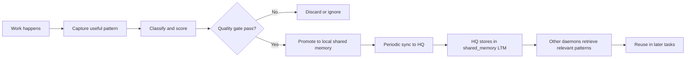

# Central Memory Federation - Design Summary

**Status**: 🚀 **V2 Workflows Operational** - Production Ready  
**Last Updated**: 2026-07-23  
**V1**: 49 seed patterns (paused - injection disabled pending testing)  
**V2**: Workflow federation with versioning and Core Playbook routing

## Quick Reference: Federation Versions

| Feature | V1 Status | V2 Status |
|---------|-----------|-----------|
| **Patterns/Heuristics** | 🟡 Paused (injection disabled) | ⏸️ Not implemented (V2 Phase 2) |
| **Workflow Federation** | ❌ Not supported | ✅ **Operational** |
| **Multi-Target Routing** | ❌ None | ✅ Core Playbook routing |
| **Versioning** | ❌ None | ✅ Content hash + version tracking |
| **Deduplication** | ❌ None | ✅ Hash-based deduplication |
| **Recurrence Tracking** | ❌ None | ✅ Multi-daemon learning count |
| **LLM Prompt Injection** | ❌ **Broken** (never reached LLM) | ✅ N/A (workflows are macro-level) |
| **Storage** | Additive-only | Versioned with conflict detection |

**Bottom Line**: 
- **V1** pattern federation is paused - patterns were retrieved but never injected into LLM prompts (discovered bug)
- **V2** workflow federation is **operational** - workflows are promoted, versioned, and routed to Core Playbook
- Workflows work independently of Ask flow, so they don't need prompt injection

---

## V2 Implementation Summary (Completed 2026-07-23)

### What Was Implemented

**Scope**: Workflow-only federation with Core Playbook routing. Pattern federation deferred pending testing.

**Key Changes**:
1. ✅ `FederatedArtifactV2` struct with versioning, content hashing, and recurrence tracking
2. ✅ `PromoteWorkflowArtifactV2()` function for workflow promotion
3. ✅ HQ sync handler updated to detect and route V2 workflow artifacts to Core Playbook
4. ✅ Automatic workflow promotion after successful execution (≥2 steps, no errors)
5. ✅ Hash-based deduplication and version increment
6. ✅ Execution stats tracking (turns, actors, duration)

**Files Modified**:
- [lib/sop/ai/agent/shared_memory.go](../lib/sop/ai/agent/shared_memory.go) - Added V2 structs and workflow promotion
- [lib/sop/tools/sopbackend/hq_sync_handler.go](../lib/sop/tools/sopbackend/hq_sync_handler.go) - Added V2 workflow routing
- [lib/sop/ai/agent/copilot.go](../lib/sop/ai/agent/copilot.go) - Added workflow promotion hook

### How It Works

#### 1. Workflow Execution & Promotion

```go
// After successful workflow execution (in copilot.go)
func (a *CopilotAgent) executeWorkflow(...) (string, error) {
    // Execute workflow steps
    results := a.processQueueLoop(ctx, queue, cfg, 15)
    
    // Check success: ≥2 steps completed, no errors
    if successCount >= 2 && !hasError {
        // Promote to federation
        a.promoteWorkflowToFederation(ctx, workflow, results, duration)
    }
    
    return response, nil
}
```

**Promotion creates**:
- V2 artifact with version=1, content hash
- Execution stats (turns, actors, duration)
- Provenance metadata (daemon ID, timestamp)
- Stores in local Core Playbook KB immediately

#### 2. HQ Sync (Push to Central)

```go
// Daemon syncs workflow to HQ
POST /api/daemon/hq-sync
{
  "daemon_id": "daemon-alpha",
  "shared_memory": {
    "artifacts": [{
      "text": "Debug Test Failure workflow",
      "category": "workflow_pattern",
      "metadata": {
        "federation_version": "v2",
        "target": "core_playbook",
        "content_type": "workflow",
        "content_hash": "sha256:abc123...",
        "workflow_id": "test-debugging-go-v1",
        "workflow_definition": { ... },
        "execution_stats": { ... },
        "version": 1,
        "recurrence_count": 1
      }
    }]
  }
}
```

**HQ handler**:
1. Detects V2 workflow (`isV2WorkflowArtifact()`)
2. Checks for existing workflow with same hash
3. If exists: increments recurrence_count, keeps version
4. If new: stores with version=1
5. Routes to Core Playbook KB (not shared_memory)

#### 3. Cross-Daemon Retrieval

Other daemons retrieve workflows via existing WorkflowManager:

```go
// WorkflowManager already searches Core Playbook
workflow, err := workflowManager.GetWorkflow(ctx, "fix failing tests")
// Returns V2 federated workflow if available
```

**No changes needed** to retrieval - WorkflowManager already searches Core Playbook KB via semantic search.

### Why Workflows Are Safe for V2

Workflows don't require LLM prompt injection like patterns do:

| Aspect | Patterns (V1) | Workflows (V2) |
|--------|---------------|----------------|
| **Execution Path** | Injected into system prompt → LLM uses during reasoning | Retrieved from KB → Executed as multi-turn WorkQueue |
| **Risk** | Can interfere with LLM reasoning quality | Macro-level orchestration, isolated from prompt |
| **Testing Needed** | Yes - must validate LLM response quality | No - workflow execution is deterministic |
| **User Impact** | Invisible to user until response generated | Visible as workflow progress steps |
| **Rollback** | Hard - affects all Ask calls | Easy - don't execute workflow |

**Result**: Workflows can be federated immediately without testing impact on Ask quality.

---

## V2 Architecture Details

### FederatedArtifactV2 Schema

```go
type FederatedArtifactV2 struct {
    // V1 compatibility
    Text     string         `json:"text"`
    Category string         `json:"category"`
    Metadata map[string]any `json:"metadata,omitempty"`

    // V2 routing
    Target      FederationTarget `json:"target"`       // "core_playbook"
    ContentType string           `json:"content_type"` // "workflow"

    // V2 versioning
    Version       int      `json:"version"`          // Incremented per update
    ContentHash   string   `json:"content_hash"`     // SHA-256 for dedup
    ParentVersion int      `json:"parent_version"`   // Previous version
    Supersedes    []string `json:"supersedes"`       // Replaced artifact IDs
    
    // V2 recurrence
    OriginDaemonID  string `json:"origin_daemon_id"`  // First daemon
    LastModifiedBy  string `json:"last_modified_by"`  // Latest daemon
    RecurrenceCount int    `json:"recurrence_count"`  // How many daemons
    CreatedAt       string `json:"created_at"`        // RFC3339
    UpdatedAt       string `json:"updated_at"`        // RFC3339

    // Workflow-specific
    WorkflowDefinition *WorkflowDefinition `json:"workflow_definition,omitempty"`
    WorkflowID         string              `json:"workflow_id,omitempty"`
    ExecutionStats     map[string]any      `json:"execution_stats,omitempty"`
}
```

### Promotion Flow

```
Daemon: Workflow Execution Success
    ↓
PromoteWorkflowArtifactV2()
    ├─ Compute content hash
    ├─ Build V2 artifact with version=1
    ├─ Store in local Core Playbook KB
    └─ Add to sync queue (next sync cycle)
    ↓
HQ Sync (every ~1 hour)
    ├─ Push batch to POST /api/daemon/hq-sync
    └─ HQ detects V2 workflow
        ↓
    handleV2WorkflowArtifact()
        ├─ findExistingWorkflowByHash()
        ├─ If duplicate: increment recurrence_count
        ├─ If new: version=1, recurrence_count=1
        └─ Store in HQ Core Playbook KB
        ↓
Other Daemons: Pull on next sync
    ├─ WorkflowManager.GetWorkflow() searches KB
    └─ Finds V2 federated workflow
```

### Deduplication Strategy

**Content Hash Comparison**:
```go
func computeWorkflowHash(workflow *WorkflowDefinition) string {
    data, _ := json.Marshal(map[string]any{
        "id":          workflow.ID,
        "version":     workflow.Version,
        "steps":       workflow.Steps,
        "description": workflow.Description,
    })
    hash := sha256.Sum256(data)
    return hex.EncodeToString(hash[:])
}
```

**Deduplication Logic**:
1. New workflow arrives at HQ with `content_hash`
2. Search existing workflows in Core Playbook for same `content_hash`
3. If found:
   - Keep existing version number
   - Increment recurrence_count
   - Update last_modified_by, updated_at
4. If not found:
   - Store as new with version=1, recurrence_count=1

**Example**:
```
Daemon Alpha: Promotes "test-debug-go-v1" → hash=abc123, version=1, recurrence=1
Daemon Beta:  Promotes same workflow      → hash=abc123, version=1, recurrence=2 ✅
Daemon Gamma: Modifies workflow slightly  → hash=def456, version=1, recurrence=1 ✅
```

Result: Two workflow variants coexist, semantic search ranks by relevance.

### Implementation Details

**Code Changes Summary** (+460 lines total):

**lib/sop/ai/agent/shared_memory.go** (+250 lines)
- `FederationTarget` enum (shared_memory, core_playbook, custom_kb)
- `FederatedArtifactV2` struct with full V2 schema
- `computeContentHash()` - SHA-256 content hashing
- `computeWorkflowHash()` - Workflow-specific hashing
- `PromoteWorkflowArtifactV2()` - Main promotion function
- `storeWorkflowArtifactLocally()` - Local KB storage
- `ParseFederatedArtifactV2()` - V2 artifact parsing

**lib/sop/tools/sopbackend/hq_sync_handler.go** (+120 lines)
- `isV2WorkflowArtifact()` - V2 workflow detection
- `handleV2WorkflowArtifact()` - V2 workflow processing
- `findExistingWorkflowByHash()` - Deduplication check
- Updated `HandleHQSync()` to route V2 workflows

**lib/sop/ai/agent/copilot.go** (+90 lines)
- Updated `executeWorkflow()` with success detection
- `promoteWorkflowToFederation()` - Promotion wrapper
- `countSuccessfulTurns()` - Success metrics
- `extractActorsUsed()` - Actor tracking

### V2 Testing & Validation

#### Quick Validation Commands

**Check Local V2 Artifacts**:
```sql
SELECT 
  data->>'workflow_id' as id,
  data->>'workflow_name' as name,
  data->>'version' as version,
  data->>'recurrence_count' as recurrence,
  data->>'content_hash' as hash
FROM core_playbook_items
WHERE data->>'federation_version' = 'v2'
ORDER BY data->>'promoted_at' DESC;
```

**Check Execution Stats**:
```sql
SELECT 
  data->>'workflow_id',
  data->'execution_stats'->>'total_turns',
  data->'execution_stats'->>'successful_turns',
  data->'execution_stats'->>'duration_seconds',
  data->'execution_stats'->>'actors_used'
FROM core_playbook_items
WHERE data->>'federation_version' = 'v2';
```

**Check Recurrence Tracking**:
```sql
SELECT 
  data->>'workflow_id',
  data->>'origin_daemon_id',
  data->>'last_modified_by',
  data->>'recurrence_count',
  data->>'created_at',
  data->>'updated_at'
FROM core_playbook_items
WHERE data->>'content_hash' = 'YOUR_HASH_HERE';
```

#### Testing Checklist

**Local Workflow Promotion**:
- [ ] Execute workflow with ≥2 successful steps
- [ ] Verify log message: "Workflow promoted to federation"
- [ ] Check Core Playbook KB for V2 artifact
- [ ] Verify content hash computed correctly
- [ ] Verify execution stats stored (turns, actors, duration)

**HQ Sync**:
- [ ] Trigger HQ sync (manual or wait for auto-sync)
- [ ] Verify HQ log: "HQ sync: promoted V2 workflow artifact"
- [ ] Check HQ Core Playbook KB for workflow
- [ ] Verify provenance metadata (daemon_id, sync_timestamp)

**Deduplication**:
- [ ] Execute same workflow on 2 different daemons
- [ ] Both should promote locally
- [ ] HQ should detect duplicate via content hash
- [ ] Recurrence count should increment to 2
- [ ] Only 1 workflow stored at HQ (not 2)

**Cross-Daemon Retrieval**:
- [ ] From daemon B, search for workflow promoted by daemon A
- [ ] WorkflowManager should find federated workflow
- [ ] Workflow should execute successfully
- [ ] Log shows workflow from different daemon used

#### Success Criteria

✅ **Should Promote**:
- Workflow with 2+ successful steps, no errors
- All workflow types (test-debug, refactor, etc.)

❌ **Should NOT Promote**:
- Workflow with <2 steps completed
- Workflow with critical errors
- Non-workflow artifacts (patterns, etc.)

#### Troubleshooting

**Workflow Not Promoted**:
- Check workflow execution success (≥2 steps, no errors)
- Check logs: `tail -f logs/daemon.log | grep -E "(Workflow|promoted|federation)"`
- Verify daemon has write access to Core Playbook KB
- Verify workflow definition not nil

**HQ Not Receiving Workflow**:
- Is HQ sync enabled?
- Network connectivity to HQ
- Authentication token valid
- Check HQ logs: `tail -f logs/hq.log | grep -E "(sync|workflow|V2)"`

**Deduplication Not Working**:
- Verify content hashes identical
- Verify V2 metadata present (federation_version)
- Check `findExistingWorkflowByHash()` searching correct KB

#### Known Limitations

1. **HQ Pull Retrieval**: Not implemented yet - daemons don't automatically discover new workflows from HQ
2. **Pattern Federation**: Paused (injection bug) - V1 patterns retrieved but never injected into LLM
3. **Version Conflict Resolution**: Basic - same hash → increment recurrence, different hash → store both
4. **Workflow Updates**: Manual - no automatic workflow update detection

---

## V1 Pattern Federation (Paused - Injection Bug)

### Critical Issue Discovered

## Overview

Central Memory Federation enables local daemon nodes to share learned patterns and knowledge with HQ, creating a fleet-wide intelligence layer that improves all nodes over time. This implements the "central brain" concept from the original proposal while keeping it deliberately narrow and additive.

**Enhanced V1** now includes **49 comprehensive seed patterns** covering performance optimization, security, testing, code quality, API design, and systematic error resolution - making it competitive with leading code assistant federation systems like Codex and Claude Code.

## Core Principle

**Local-first with optional shared learning**: Each daemon learns from its own work and can optionally promote high-value, privacy-safe patterns to HQ. Future nodes can retrieve these patterns when relevant to their current task.

## Architecture

```
┌─────────────────────────────────┐
│     Local Daemon (Field)        │
│                                  │
│  1. Learns from local work       │
│  2. Seeds 49 baseline patterns   │
│     (13 categories)              │
│  3. Auto-categorizes artifacts   │
│  4. Promotes with confidence     │──┐
│                                  │  │
│  5. Retrieves relevant patterns  │  │ Bidirectional Sync
│     when needed                  │  │ (1 hour + jitter)
└─────────────────────────────────┘  │
                                      │
                    PUSH              ▼              PULL
              ┌──────────────────────────────────────────┐
              │           HQ Service (Central)           │
              │                                          │
              │  POST /api/daemon/hq-sync               │
              │    • Receives artifact batches          │
              │    • Stores in root SA LTM              │
              │                                          │
              │  POST /api/daemon/hq-retrieve           │
              │    • Semantic search root SA LTM        │
              │    • Returns ranked artifacts           │
              │                                          │
              │  Storage: "shared_memory" KB            │
              │  Root SA: ltm_root                      │
              └──────────────────────────────────────────┘
                                      │
                                      │ Retrieval by category/intent
                                      ▼
              ┌─────────────────────────────────┐
              │    Other Daemons (Worldwide)    │
              │                                  │
              │  • Pull on startup               │
              │  • Pull after each push          │
              │  • Use patterns in context       │
              │  • Contribute back learnings     │
              └─────────────────────────────────┘
```

## What Gets Shared

**Note**: As of V2 implementation (2026-07-23), only **workflows** are actively federated. Pattern federation (V1) is paused pending testing due to the injection bug discovery. See [V1 Pattern Federation (Paused)](#v1-pattern-federation-paused---injection-bug) section for details.

### V2: Workflows (Active)

**Currently Federated**:
- ✅ **Workflow Definitions** from Core Playbook
- ✅ Execution success tracking
- ✅ Multi-daemon recurrence counting
- ✅ Version and content hash tracking

**Storage Target**: Core Playbook KB (not shared_memory)

**Promotion Criteria**:
- Workflow executed successfully (≥2 steps completed)
- No critical errors during execution
- Automatic promotion after completion

### V1: Patterns & Heuristics (Paused)

#### 13 Content Categories with Automatic Classification
1. **Workflow Patterns** (`workflow_pattern`): Proven multi-step sequences (9 seeds)
2. **Error Resolution** (`error_resolution`): Debugging patterns and fixes (5 seeds)
3. **Repair Strategies** (`repair_strategy`): Fixes for common issues (5 seeds)
4. **Tool Preferences** (`tool_preference`): Optimal tool selection and sequencing (4 seeds)
5. **Context Gathering** (`context_gathering`): Strategies for understanding codebases (4 seeds)
6. **Security Patterns** (`security_pattern`): Security best practices and vulnerability prevention (3 seeds)
7. **Anti-Patterns** (`anti_pattern`): Mistakes to avoid (3 seeds)
8. **Performance Optimization** (`performance_optimization`): Caching, batching, lazy loading (3 seeds)
9. **Testing Strategies** (`testing_strategy`): TDD, isolation, coverage-guided testing (3 seeds)
10. **Code Quality** (`code_quality`): Maintainability and readability patterns (3 seeds)
11. **Safety Heuristics** (`safety_heuristic`): When to verify or get confirmation (2 seeds)
12. **API Design** (`api_design`): API conventions and best practices (2 seeds)
13. **Verified Playbooks** (`verified_playbook`): Multi-step proven procedures (0 seeds, learned over time)

#### 49 Seed Patterns (Auto-loaded on Startup)

**Workflow Patterns (9)**:
- Read-before-edit, test-after-change, search-before-create
- React component modification, API endpoint modification, database migration
- Git workflow, debugging systematic approach, refactoring safe sequence

**Error Resolution (5)**:
- Type mismatch, undefined references, null pointer diagnosis
- Async/Promise error handling, race condition detection

**Repair Strategies (5)**:
- Module imports, build error diagnosis, port conflicts
- CORS errors, memory leak investigation

**Tool Preferences (4)**:
- Semantic search for concepts, multi_replace for batches
- File search for navigation, read large files in chunks

**Context Gathering (4)**:
- Progressive expansion, semantic search for unfamiliar codebases
- Architecture understanding, dependency analysis

**Security Patterns (3)**:
- Input validation, authentication checks, secrets management

**Anti-Patterns (3)**:
- Avoid blind overwrites, verify test frameworks, client-side validation only

**Performance Optimization (3)**:
- Caching strategy, batch operations, lazy loading

**Testing Strategies (3)**:
- Unit test isolation, TDD, coverage-guided testing

**Code Quality (3)**:
- Function extraction, error handling consistency, avoid nested conditionals

**Safety Heuristics (2)**:
- Confirm destructive operations, validate large changes

**API Design (2)**:
- REST conventions, consistent error responses

### DON'T Share (Privacy Guarantees)
- Raw user conversations or prompts
- Private repository details or secrets
- User-specific preferences or habits
- One-off fixes that won't generalize
- Any PII or sensitive content
- Artifacts exceeding 2000 characters (truncated)
- Large metadata fields (filtered automatically)

## Memory Lifecycle, Limits, and Governance

### How a daemon learns from work

The learning loop is intentionally conservative and local-first:

1. **Capture**: During a successful ask or repair workflow, the daemon turns useful outcomes into a compact artifact.
2. **Classify**: The artifact is assigned a category such as workflow, error resolution, repair strategy, tool preference, or safety heuristic.
3. **Score**: The artifact is evaluated with a confidence score and a basic usefulness filter.
4. **Filter**: Low-value, vague, or overly private content is rejected before promotion.
5. **Promote**: Approved artifacts are stored in the local shared-memory knowledge base with provenance metadata.
6. **Sync**: Periodically, the daemon sends a batch of recent shared-memory artifacts to HQ.
7. **Retrieve**: HQ stores the promoted artifacts in the root service-account LTM and serves them back to other daemons on demand.
8. **Reinforce or retire**: If a similar pattern is seen again, the pattern can become more relevant over time; otherwise weak or stale entries are not expected to dominate retrieval.

### Current limits and boundaries

The current V1 implementation applies several practical limits:

- **Promotion threshold**: A candidate artifact must meet the minimum confidence threshold of 0.7 and pass basic value checks.
- **Size limit**: Artifact text is capped at 2000 characters to keep shared memory compact and privacy-safe.
- **Query quality**: Empty, vague, or low-information prompts are skipped.
- **Sync batch size**: The daemon collects a small recent set of shared-memory items for sync rather than sending every local artifact.
- **HQ retrieval size**: Daemon pull requests default to 10 results and are capped at 50.
- **Request size**: HQ sync requests are bounded by a 1 MB body limit.

### Deduplication and Conflict Resolution

**Current Status (V1)**: The federation system uses an **additive-only, no-conflict model**.

#### What Gets Stored

When artifacts arrive at HQ:
```go
// HandleHQSync → storeSharedMemoryArtifacts → PromoteSharedMemoryArtifact → IngestThought
item := Item[T]{
    ID: sop.NewUUID(),  // ⚠️ Always creates NEW item, never updates existing
    // ... rest of fields
}
kb.Store.UpsertByCategoryID(ctx, cat.ID, cat.CenterVector, item, vectors, classificationVecs)
```

**Key Point**: Every artifact gets a **new UUID**, even if identical content was already synced. There is no content-based deduplication, no versioning, and no conflict detection.

#### Why This Works (For Now)

The V1 approach is **deliberately conservative** and relies on these safeguards:

1. **Quality Filtering**: Only high-confidence (≥0.7), high-value patterns are promoted
2. **Size Limits**: Artifacts capped at 2000 characters
3. **Category Organization**: Similar patterns naturally cluster in semantic space
4. **Semantic Retrieval**: When retrieving, the system searches by similarity and returns top-N results

**Practical Outcome**: If daemon1 and daemon2 both learn "Read before edit", both versions get stored. During retrieval:
- Semantic search returns both (similar vectors → similar scores)
- Top-N limiting (default 10, max 50) prevents overwhelming the agent
- Similar patterns reinforce each other rather than conflicting

#### What Doesn't Work

**Scenarios where additive-only causes issues:**

1. **Pattern Evolution**: If a pattern improves over time, old versions persist
   ```
   Daemon1 syncs: "Use try/catch for error handling"
   Daemon2 syncs: "Use try/catch with specific error types and logging"
   Result: Both stored, retrieval may return outdated version
   ```

2. **Conflicting Advice**: If daemons learn contradictory patterns
   ```
   Daemon1 syncs: "Prefer async/await over promises"
   Daemon2 syncs: "Prefer promises for better error handling"
   Result: Both stored, agent gets conflicting guidance
   ```

3. **Storage Growth**: No automatic cleanup of stale or superseded patterns
   ```
   100 daemons × 50 patterns each = 5000 artifacts
   Even if 90% are duplicates, all get stored
   ```

4. **No Update/Delete**: Once synced, artifacts cannot be:
   - Updated with newer versions
   - Marked as superseded
   - Removed if incorrect

#### Future V2 Improvements

Planned enhancements for conflict resolution:

1. **Content-Based Deduplication**
   ```go
   // Hash artifact text before storing
   contentHash := sha256(normalizeText(artifact.Text))
   existing := findByContentHash(contentHash)
   if existing != nil {
       // Merge metadata, boost confidence, update timestamp
       existing.ConfidenceScore = max(existing.ConfidenceScore, artifact.ConfidenceScore)
       existing.RecurrenceCount++
       existing.LastSeenAt = now()
   } else {
       // Store as new
   }
   ```

2. **Recurrence Boosting**
   - Track how many daemons independently learned the same pattern
   - Boost retrieval score for patterns seen across multiple daemons
   - Decay score for patterns seen from only one daemon

3. **Versioning and Updates**
   ```go
   type Artifact struct {
       ContentHash string
       Version     int
       Supersedes  []string  // ContentHashes of older versions
       ConfidenceScore float64
       RecurrenceCount int
       FirstSeenAt  time.Time
       LastSeenAt   time.Time
       SeenByDaemons []string
   }
   ```

4. **Conflict Detection**
   - Semantic similarity check during ingestion
   - If similar artifact exists (cosine similarity > 0.95):
     - Same category + same advice → Merge/boost
     - Same category + different advice → Flag as conflict, require resolution
     - Different category → Store separately

5. **Pattern Lifecycle Management**
   - **Active**: Recently seen, high confidence, multiple daemons
   - **Stale**: Not seen in 90+ days, single daemon, low recurrence
   - **Superseded**: Newer version available
   - **Conflicted**: Contradictory patterns exist, needs review
   - **Archived**: Removed from active retrieval, kept for history

6. **Merge Strategies**
   ```
   Strategy 1: Union (current V1)
   - Keep all versions, let retrieval sort it out
   - Simple, safe, but grows unbounded
   
   Strategy 2: Latest Wins
   - Replace older version with newer
   - Requires timestamp/version tracking
   - Risk: Newer isn't always better
   
   Strategy 3: Highest Confidence Wins
   - Keep version with highest confidence score
   - Requires confidence calibration across daemons
   
   Strategy 4: Recurrence Wins
   - Keep version seen by most daemons
   - Requires tracking daemon IDs per pattern
   - Best for "crowd wisdom"
   
   Strategy 5: Manual Review
   - Flag conflicts for admin review
   - Explicit merge/accept/reject
   - Highest quality, doesn't scale
   ```

#### Real-World Conflict Scenarios

**Scenario 1: Duplicate Learning**
```
Timeline:
- T0: Daemon1 debugs a React hook dependency issue
- T0: Daemon2 debugs the same React hook issue (different codebase)
- T1: Both promote "React hook dependency array pattern" to HQ
- T2: HQ stores both as separate items (different UUIDs)
- T3: Daemon3 asks about React hooks
      → Retrieval returns both (nearly identical content)
      → Agent context includes redundant information

Current Behavior: ✅ Works (redundancy is benign)
V2 Improvement: Merge into single artifact with recurrence_count=2
```

**Scenario 2: Pattern Evolution**
```
Timeline:
- T0: Daemon1 learns "Use console.log for debugging"
      → Promotes to HQ
- T30: Daemon2 learns "Use structured logging with log levels"
      → Promotes to HQ
- T60: Daemon3 asks about debugging
      → Retrieval may return outdated console.log advice

Current Behavior: ⚠️ Stale patterns persist indefinitely
V2 Improvement: Version tracking, mark old pattern as superseded
```

**Scenario 3: Contradictory Advice**
```
Timeline:
- Daemon1 (Python shop): "Use type hints for better IDE support"
      → Category: code_quality
      → Confidence: 0.85
- Daemon2 (Python shop): "Avoid type hints, they clutter code"
      → Category: code_quality
      → Confidence: 0.80
- Daemon3 asks: "Should I use Python type hints?"
      → May retrieve conflicting patterns

Current Behavior: ❌ Both stored, no conflict detection
V2 Improvement: Flag semantic contradiction, require human review
```

**Scenario 4: Language-Specific Collision**
```
Timeline:
- Daemon1 (Go): "Prefer defer for cleanup"
      → Category: code_quality
- Daemon2 (Python): "Use context managers for cleanup"
      → Category: code_quality
- Daemon3 (Go project): Retrieval returns both
      → Python advice irrelevant but not filtered

Current Behavior: ⚠️ Cross-language pollution possible
V2 Improvement: Add language tags, filter by project context
```

**Scenario 5: Codebase-Specific Pattern**
```
Timeline:
- Daemon1 (Legacy Java): "Always use synchronized for thread safety"
      → Promotes as general pattern
- Daemon2 (Modern Java): Uses java.util.concurrent
      → Would see outdated synchronized advice

Current Behavior: ⚠️ Codebase-specific patterns promoted as universal
V2 Improvement: Scope patterns by technology stack/version
```

**Scenario 6: Volume Attack (Benign or Malicious)**
```
Timeline:
- Daemon1 promotes 50 variations of "read before edit"
      → All 50 stored with different UUIDs
- Other daemons retrieve "read before edit"
      → Get 50 similar results, waste context window

Current Behavior: ⚠️ No rate limiting per pattern content
V2 Improvement: Content-hash deduplication, per-daemon rate limits
```

#### Conflict Detection Heuristics (V2 Proposal)

When a new artifact arrives, check for conflicts:

```python
def detect_conflicts(new_artifact, existing_artifacts):
    for existing in existing_artifacts:
        similarity = cosine_similarity(new_artifact.vector, existing.vector)
        
        if similarity > 0.95:  # Very similar
            if same_category(new_artifact, existing):
                if contradicts(new_artifact.text, existing.text):
                    return Conflict(type="CONTRADICTION", existing=existing)
                else:
                    return Conflict(type="DUPLICATE", existing=existing)
        
        elif similarity > 0.85:  # Related
            if contradicts(new_artifact.text, existing.text):
                return Conflict(type="RELATED_CONTRADICTION", existing=existing)
    
    return None  # No conflict

def handle_conflict(conflict):
    match conflict.type:
        case "DUPLICATE":
            merge_artifacts(conflict.new, conflict.existing)
            boost_confidence(conflict.existing)
            increment_recurrence(conflict.existing)
        
        case "CONTRADICTION":
            flag_for_review(conflict.new, conflict.existing)
            store_separately_with_warning()
        
        case "RELATED_CONTRADICTION":
            add_conflict_metadata(conflict.new)
            add_conflict_metadata(conflict.existing)
            store_both()
```

#### Current Workarounds

Until V2 is implemented, use these strategies:

1. **Prefix pattern names with version**: `"v2: Read before edit..."`
2. **Include timestamp in metadata**: For manual cleanup later
3. **Periodic HQ cleanup**: Admin script to deduplicate via semantic search
4. **Conservative promotion**: Only promote truly novel patterns
5. **Category discipline**: Use specific categories to reduce collision ("Go/Testing" vs "Testing")

### Simple end-to-end test topology

A minimal test setup for the whole stack is:

- **1 HQ instance** that accepts daemon sync batches and serves retrieval requests.
- **2 daemons** that can learn locally, promote patterns, sync to HQ, and retrieve relevant patterns from the fleet.

A good first exercise is to use one daemon for a coding workflow similar to the one used here: research, debugging, edits, and test runs. After it promotes useful patterns, the second daemon can be asked a related question and should be able to benefit from the shared memory that was just published.

### Lifecycle diagram



### Batching and sync strategy

The current federation sync path is intentionally simple and batch-oriented rather than event-streamed:

- A daemon stores promoted artifacts locally.
- Periodically, it gathers a recent subset of those artifacts and sends them to HQ in a single sync request.
- HQ ingests the batch and stores the artifacts into the root service-account shared-memory LTM.

This keeps the initial implementation easy to reason about and resilient to temporary outages, but it is not yet optimized for very high volume or bursty traffic.

### Throttling and scale control

For higher-volume deployments, the sync strategy should evolve from fixed periodic batches to adaptive back-pressure:

1. **Normal mode**
   - Small batches
   - Moderate sync interval
   - Low risk of overload

2. **Scale up when healthy**
   - Slightly larger batches
   - Shorter intervals
   - More aggressive retrieval and reuse

3. **Scale down when overloaded**
   - Smaller batches
   - Longer intervals
   - Exponential backoff on repeated failures
   - Temporary pause if HQ is repeatedly unavailable

4. **Back-pressure and queueing**
   - Keep a local queue of pending artifacts
   - Drain the queue in bounded chunks
   - Respect max payload size and max requests per time window

5. **Operational safeguards**
   - Per-daemon rate limits
   - Per-category limits if some categories become noisy
   - Circuit breaker behavior for repeated 5xx or timeout failures

A practical starting policy is:

- **Healthy system**: small batches every 15–60 minutes
- **Under load**: reduce to smaller batches and slower cadence
- **After repeated success**: gradually return to the normal pace

This gives us a path to scale the federation layer without requiring a full streaming architecture from day one.

## Implementation Details

### V1 Backend Storage
- **Backing store**: Root service-account LTM (`ltm_root`)
- **Knowledge base**: `shared_memory`
- **Why**: Reuses existing infrastructure, no new storage layer needed

### SOP bootstrap and refresh strategy

For first-run daemon bootstrap, the daemon should ship with a packaged copy of the Core Playbook knowledge payload so the built-in Core Playbook Space can be preloaded even when HQ is unavailable or the daemon is starting in an offline environment. This provides deterministic cold-start behavior and avoids making the daemon depend on HQ for its initial knowledge load.

HQ sync remains the update path for later refreshes and governance:
- use the regular daemon → HQ sync flow to publish new or curated knowledge artifacts,
- use the same flow to pull refreshed content back into the daemon when appropriate,
- keep the packaged asset as the fallback bootstrap source and treat HQ as the later synchronization channel.

This gives us reliable first-run initialization without giving up the centralized update path.

## Bidirectional Sync Implementation

### Daemon → HQ Sync Flow (PUSH)

1. **On daemon startup**: Seeds 49 baseline patterns via `seedFederationContent()`
   ```go
   // In cmd/sop-daemon/federation_content.go
   seedFederationContent(ctx) // 13 categories, 49 patterns
   ```

2. **During asks**: Intelligent promotion with auto-categorization
   ```go
   // In cmd/sop-daemon/rag.go
   promoteSharedMemoryArtifactForAsk(ctx, query, answer, payload)
   // → Calls categorizeFederationArtifact(query, answer)
   // → Returns category + confidence score
   // → Filters by shouldPromoteFederationArtifact()
   ```

3. **Periodic sync loop** runs every ~1 hour (with jitter):
   ```go
   startHQSyncLoop(authHandler)
   // → Calls syncWithHQ(ctx)
   // → Collects artifacts via collectSharedMemoryArtifacts()
   // → Sends batch to POST /api/daemon/hq-sync
   // → On success, calls pullFromHQ() for bidirectional sync
   ```

4. **Sync batch structure** with categories:
   ```json
   {
     "kind": "shared_memory_sync",
     "daemon_id": "local-daemon",
     "user_id": "daemon",
     "timestamp": "2026-07-05T...",
     "shared_memory": {
       "enabled": true,
       "scope": "shared-memory",
       "mode": "periodic",
       "artifacts": [
         {
           "text": "Pattern: Read before edit. Always gather...",
           "category": "workflow_pattern",
           "metadata": {
             "source": "daemon_ask",
             "confidence": 0.85,
             "priority": "high"
           }
         }
       ]
     }
   }
   ```

5. **HQ receives and stores** at `/api/daemon/hq-sync`:
   ```go
   HandleHQSync(w, r) // sopbackend handler
   // → Fetches root SA user (cached for performance)
   // → Creates auth context as root SA
   // → Stores artifacts in root SA LTM via agent.PromoteSharedMemoryArtifact()
   // → Returns acceptance confirmation
   ```

### HQ → Daemon Retrieval Flow (PULL)

1. **After successful push**: Daemon automatically pulls from HQ
   ```go
   syncWithHQ(ctx) // Push phase completes
   // → On success, calls pullFromHQ(ctx, hqBaseURL)
   ```

2. **Daemon requests artifacts** from HQ:
   ```go
   pullFromHQ(ctx, hqBaseURL)
   // → POSTs to /api/daemon/hq-retrieve
   // → Query: "shared patterns best practices error handling"
   // → Limit: 10 artifacts
   ```

3. **HQ retrieves** via semantic search at `/api/daemon/hq-retrieve`:
   ```go
   HandleHQRetrieve(w, r) // sopbackend handler
   // → Fetches root SA user (cached)
   // → Creates auth context as root SA
   // → Retrieves via agent.RetrieveSharedMemory()
   // → Returns ranked artifacts with scores and categories
   ```

4. **Response structure**:
   ```json
   {
     "artifacts": [
       {
         "text": "Pattern: Test after change...",
         "category": "workflow_pattern",
         "score": 0.92,
         "metadata": {
           "daemon_id": "other-daemon",
           "promoted_at": "2026-07-05T10:30:00Z",
           "confidence": 0.88
         }
       }
     ],
     "timestamp": "2026-07-05T12:00:00Z"
   }
   ```

5. **Daemon receives artifacts** (future local storage implementation):
   ```go
   storeRetrievedArtifacts(ctx, artifacts)
   // TODO: Store in local shared_memory KB for immediate use
   // Currently logged for validation
   ```

### Context Injection During Asks

1. **Before handling a query**, daemon retrieves relevant context:
   ```go
   // In cmd/sop-daemon/rag.go
   sharedContext := trySharedMemoryContext(ctx, normalizedQuery, userID)
   // → Calls selectRelevantCategories(query) for intent detection
   // → Retrieves from local shared_memory KB (includes HQ-pulled patterns)
   // → Returns formatted context string with category tags
   ```

2. **Category-aware retrieval** based on query intent:
   ```go
   selectRelevantCategories(query)
   // Error query → ["error_resolution", "repair_strategy"]
   // Test query → ["workflow_pattern", "tool_preference"]
   // Safety query → ["safety_heuristic", "anti_pattern"]
   // Build query → ["repair_strategy", "context_gathering"]
   ```

3. **Context injection** into agent prompt:
   ```
   Relevant patterns from the fleet:
   - [workflow_pattern] Read before edit: Always gather context...
   - [repair_strategy] Module import resolution: Check package files...
   ```

## Security Model

### Authentication
- **Daemon → HQ**: Uses daemon access tokens (JWT-based)
- **Bootstrap flow**: UI session token → daemon bootstrap → daemon tokens
- **Token refresh**: Automatic refresh with fallback to bootstrap regeneration

### Privacy Boundaries
- Artifacts stored with provenance (daemon_id, timestamp)
- No raw user queries, only generalized patterns
- Metadata filtered to exclude large or sensitive fields
- Future: policy enforcement at ingestion time

## Current Implementation Status

### ✅ V1 Complete - All Core Features Implemented

#### Core Infrastructure
- [x] Core shared memory primitives in `agent.PromoteSharedMemoryArtifact`
- [x] Core retrieval in `agent.RetrieveSharedMemory`
- [x] Daemon bootstrap token handoff (UI session → daemon tokens)
- [x] HQ-side root user caching for efficient periodic syncs
- [x] Test coverage for bootstrap flow (daemon + HQ)

#### Bidirectional Sync (Push + Pull)
- [x] Daemon → HQ push: Periodic sync loop (1 hour + jitter)
- [x] Daemon → HQ push: Sync batch assembly with artifacts array
- [x] HQ endpoint `/api/daemon/hq-sync` with auth and root SA storage
- [x] HQ → Daemon pull: `/api/daemon/hq-retrieve` endpoint
- [x] HQ → Daemon pull: Automatic pull after successful push
- [x] HQ ingestion into root SA LTM with provenance metadata
- [x] Semantic retrieval from HQ with configurable limits
- [x] Test coverage for both sync and retrieve handlers

#### Federated Content System
- [x] **8 Content Categories**: workflow_pattern, anti_pattern, repair_strategy, tool_preference, safety_heuristic, verified_playbook, context_gathering, error_resolution
- [x] **14 Seed Patterns**: Automatic baseline intelligence on daemon startup
- [x] **Intelligent Promotion**: Automatic categorization, confidence scoring, value filtering
- [x] **Context-Aware Retrieval**: Category-based search, intent detection, ranked results
- [x] **Privacy Safeguards**: Text truncation (2000 chars), metadata filtering, no PII
- [x] Complete implementation in `cmd/sop-daemon/federation_content.go`
- [x] Integration with existing ask handler in `cmd/sop-daemon/rag.go`
- [x] Documentation in `docs/FEDERATED_CONTENT_STRATEGY.md`

#### Test Results
- [x] All daemon tests passing (1.694s)
- [x] All HQ sync tests passing (0.473s)
- [x] Bootstrap token tests passing (0.324s)
- [x] 7 HQ handler tests: sync acceptance, rejection, retrieval

#### Bidirectional Adaptive Throttling
- [x] **Daemon-Side Sync Queue**: Priority-based in-memory queue (1000 depth)
- [x] **Circuit Breaker**: Three-state FSM (closed→open→half-open) with failure threshold
- [x] **Adaptive Delays**: Dynamic sync interval (15m base, scales on success/failure)
- [x] **Exponential Backoff**: 2x multiplier, 1h cap, 25% jitter for failure recovery
- [x] **Category-Diverse Batching**: Max 20% per category to prevent floods
- [x] **Lightweight Deduplication**: Text similarity >0.95 check before enqueue
- [x] **HQ Token Bucket Rate Limiter**: Per-daemon (60 req/min) + global (1000 req/min)
- [x] **429 Responses**: Retry-After headers, structured error messages
- [x] **Daemon 429 Handling**: Parse Retry-After, log rate limit events
- [x] **Global Queue Access**: Promotion functions enqueue to sync queue
- [x] Implementation in `cmd/sop-daemon/sync_queue.go` (413 lines)
- [x] Rate limiter in `tools/sopbackend/rate_limiter.go` (253 lines)
- [x] Integration in auth handlers and main loop

### 📋 V2 Enhancements (Future)
- [ ] Add observability metrics dashboard for sync health
- [ ] Add daemon-side persistent queue for durability across restarts
- [ ] Add LTM garbage collection for stale shared artifacts
- [ ] Add recurrence-based confidence boosting
- [ ] Add policy layer for artifact quality filtering
- [ ] Add admin UI for viewing fleet-wide patterns
- [ ] Add pattern effectiveness tracking and ranking
- [ ] Add rate limit metrics export to Prometheus

## Configuration

### Daemon Environment Variables
- `SOP_HQ_BASE_URL`: HQ endpoint (e.g., `https://hq.example.com`)
- `SOP_HQ_SIGNING_SECRET`: Shared secret for HQ auth (temporary V1 approach)

### HQ Environment Variables
- Standard sopbackend configuration
- System database must be configured for root SA LTM storage

## Design Decisions & Tradeoffs

### Why Root SA LTM?
**Pro**: Reuses existing infrastructure, no new storage layer  
**Pro**: Leverages proven vector search and knowledge base primitives  
**Con**: Logical separation only, not physical isolation  
**Future**: Can migrate to dedicated storage if needed

### Why Periodic Sync vs Real-time?
**Pro**: Reduces HQ load, batches network calls  
**Pro**: Daemon can work offline, syncs when reconnected  
**Con**: Latency before patterns reach other nodes  
**Mitigation**: 1-hour default is reasonable for learned patterns

### Why Promote After Every Ask?
**Pro**: Simple, captures all patterns  
**Con**: May create noise if quality filter is weak  
**Future**: Add promotion policy (confidence threshold, recurrence count)

## Testing Strategy

### Unit Tests
- `agent/shared_memory_test.go`: Core primitives
- `cmd/sop-daemon/auth_test.go`: Bootstrap and sync flows

### Integration Tests (Planned)
- End-to-end: Daemon promote → HQ store → Other daemon retrieve
- Auth flow: Bootstrap handoff → daemon tokens → HQ auth
- Sync resilience: HQ unavailable, retry logic, token refresh

### Manual Verification
1. Start daemon with `SOP_HQ_BASE_URL` set
2. Make asks, verify promotion to local shared_memory KB
3. Verify sync batch logs every ~1 hour
4. Check HQ logs for received batches
5. Start second daemon, verify retrieval of shared patterns

## Success Criteria

The feature is successful when:
1. Daemons can promote patterns without breaking local-first behavior
2. HQ accepts and stores artifacts with proper provenance
3. Other daemons can retrieve relevant patterns for their context
4. The system degrades gracefully when HQ is unavailable
5. Privacy boundaries are preserved (no leakage of sensitive data)

## Next Steps

1. **Fix build errors** in hq_sync_handler.go
2. **Test HQ sync flow** end-to-end with real daemon/HQ setup
3. **Add auth validation** on HQ side for daemon tokens
4. **Add observability** metrics and logging
5. **Document operator setup** for production deployment
6. **Implement adaptive throttling and queued sync**: add a local sync queue, bounded batch size, adaptive interval, exponential backoff, and a circuit breaker for repeated HQ failures
7. **Plan V2**: Policy layer, confidence scoring, recurrence tracking

### Proposed throttling and queued sync design

- **Local queue**: ephemeral in-memory queue on the daemon that buffers pending artifacts; drop-oldest policy when full.
- **Priority-based queueing**: 3-tier priority (critical/high/normal) based on category; security and safety patterns sync first.
- **Bounded batches**: send at most a configurable number of artifacts or bytes per request; category-diverse batching to avoid single-category floods.
- **Adaptive interval**: start with a default cadence and shorten or lengthen it based on recent success/failure signals.
- **Exponential backoff**: 2x multiplier, capped at 1 hour, with 25% jitter on delays to avoid synchronized retries across daemon fleet.
- **Circuit breaker**: three states (closed/open/half-open); after failures, open circuit, then test with small batch before full resume.
- **Thundering herd protection**: per-daemon startup jitter and 0-30 second random delay after circuit reopens.
- **Deduplication**: lightweight text similarity check before enqueue to prevent queue bloat from repeated patterns.
- **Observability**: queue depth gauge, artifacts promoted/sec counter, sync attempt/success/failure counters, batch size histogram, sync latency histogram, circuit state gauge, backoff delay gauge.

### Implementation checklist for the next pass

1. Introduce a daemon-side sync queue that buffers promoted artifacts with priority based on category.
2. Add configuration via environment variables for batch size, max queue depth, base sync interval, and feature toggles.
3. Track recent sync outcomes to adjust the next interval up or down adaptively.
4. Add retry/backoff behavior (2x multiplier, 1 hour cap, 25% jitter) for transient HQ failures.
5. Add a three-state circuit breaker (closed/open/half-open) with small-batch recovery testing.
6. Implement category-diverse batching and lightweight deduplication before enqueue.
7. Emit metrics (queue depth, promotion rate, sync success/failure, batch size, latency, circuit state).
8. Add HQ-side per-daemon rate limiting and graceful 429 responses with Retry-After headers.

### Configuration surface

Environment variables for daemon-side control:

- `SOP_SYNC_QUEUE_ENABLED` (default: `true`) - enable sync queue
- `SOP_ADAPTIVE_THROTTLING_ENABLED` (default: `true`) - enable adaptive interval
- `SOP_CIRCUIT_BREAKER_ENABLED` (default: `true`) - enable circuit breaker
- `SOP_MAX_BATCH_SIZE` (default: `50`) - max artifacts per sync batch
- `SOP_MAX_QUEUE_DEPTH` (default: `1000`) - max pending artifacts before drop-oldest
- `SOP_BASE_SYNC_INTERVAL` (default: `15m`) - base sync cadence
- `SOP_MAX_BACKOFF_DURATION` (default: `1h`) - cap for exponential backoff
- `SOP_CIRCUIT_BREAKER_THRESHOLD` (default: `5`) - consecutive failures before circuit opens


### Rollout and success criteria

- Roll out the queueing and throttling layer behind a feature flag so it can be enabled gradually.
- Start with conservative defaults and validate under low-volume traffic before increasing the envelope.
- Success is defined by stable sync behavior under transient failures, bounded queue growth, and reduced pressure on HQ during bursty periods.

---

## Federation V2 - Multi-Target, Versioned, Workflow-Ready

**Status**: 🚧 Proposed - RFC Open  
**Target**: Q3 2026  
**Priority**: HIGH - Fixes critical injection bug + enables workflow federation

### Executive Summary

Federation V1 is **not operational** - patterns are retrieved but never injected into the LLM prompt. V2 addresses this critical bug and adds:

1. ✅ **Bug Fix**: Inject federated patterns into system prompt
2. ✅ **Multi-Target Support**: Route artifacts to Shared Memory, Core Playbook, or custom targets
3. ✅ **Versioning**: Track versions, detect superseded artifacts, enable conflict resolution
4. ✅ **Workflow Federation**: Share proven workflows across fleet
5. ✅ **Conflict Detection**: Identify contradictory patterns with resolution strategies

**Key Insight**: Workflows are the **killer app** for federation. Sharing error resolution patterns is good; sharing complete proven workflows is **game-changing**.

---

### Problem Statement: V1 Injection Bug

**Critical Issue Discovered 2026-07-23**: Federated patterns are **NOT reaching the LLM**.

#### Current Flow (Broken)
```go
// ✅ WORKS: Daemon retrieves patterns
sharedContext := RetrieveFederatedContext(ctx, query, userID)
// "[code_quality] Use type hints\n\n[code_quality] Avoid type hints"

// ✅ WORKS: Stored in ConfigMap
cfg.Set("shared_memory_context", sharedContext)

// ✅ WORKS: Passed to agent
answer, err := s.service.Ask(ctx, query, cfg)

// ❌ BROKEN: Agent never reads the value
// copilot.go::applyAskConfig() only extracts:
//   - default_format
//   - thinking_level  
//   - is_new_topic
// But NOT shared_memory_context

// ❌ BROKEN: buildSystemPrompt() never receives it
// Uses ComponentPersona, ComponentSemanticMemory, ComponentPlaybooks...
// But no ComponentFederatedPatterns
```

#### Impact
- Federation **appears** to work (retrieval succeeds)
- But LLM **never sees** the patterns
- All conflict discussions are moot - no conflicts because no injection
- 49 seed patterns are being stored but unused
- Entire V1 system is cosmetic

#### V2 Fix Required
Add new component to system prompt builder:

```go
// copilot_prompt.go - NEW
const ComponentFederatedPatterns = "federated_patterns"

func (a *CopilotAgent) buildSystemPrompt(ctx context.Context, query string, 
    taskClassification TaskContextClassification, cfg *ai.ConfigMap) string {
    
    builder := NewSystemPromptBuilder()
    
    // ... existing components ...
    
    // NEW: Inject federated patterns if available
    if cfg != nil {
        if sharedCtx, ok := cfg.Get("shared_memory_context"); ok {
            if sharedContextStr, ok := sharedCtx.(string); ok && strings.TrimSpace(sharedContextStr) != "" {
                builder.With(ComponentFederatedPatterns, 
                    formatFederatedPatternsForPrompt(sharedContextStr),
                    800) // Budget: 800 chars max
            }
        }
    }
    
    // ... rest of components ...
}

func formatFederatedPatternsForPrompt(rawContext string) string {
    return fmt.Sprintf(`
Fleet Knowledge (Patterns learned from other instances):
%s

Apply these patterns when relevant to the current task.
`, strings.TrimSpace(rawContext))
}
```

**Priority**: Must fix before V2 rollout. This is a **blocker**.

---

### V2 Architecture: Multi-Target Federation

#### Federation Targets

Artifacts can be routed to different backend stores based on content type:

| Target | Purpose | Storage | Examples |
|--------|---------|---------|----------|
| **SharedMemory** | Patterns, heuristics, preferences | `shared_memory` KB | Error resolution, code quality, tool preferences |
| **CorePlaybook** | Proven workflows, multi-step procedures | `core_playbook` KB | Test debugging workflow, refactoring workflow |
| **CustomKB** | Domain-specific knowledge | Named KB in Space | API docs, architecture patterns |

#### Routing Logic

```go
type FederationTarget string

const (
    FederationTargetSharedMemory FederationTarget = "shared_memory"
    FederationTargetCorePlaybook FederationTarget = "core_playbook"
    FederationTargetCustomKB     FederationTarget = "custom_kb"
)

type FederatedArtifactV2 struct {
    // V1 fields
    Text     string         `json:"text"`
    Category string         `json:"category"`
    Metadata map[string]any `json:"metadata,omitempty"`
    
    // V2 fields - NEW
    Target          FederationTarget `json:"target"`           // Where to store
    ContentType     string          `json:"content_type"`      // "pattern", "workflow", "knowledge"
    Version         int             `json:"version"`           // Monotonic version number
    ContentHash     string          `json:"content_hash"`      // SHA-256 of normalized content
    ParentVersion   int             `json:"parent_version,omitempty"`  // For updates
    OriginDaemonID  string          `json:"origin_daemon_id"`  // First daemon to promote
    LastModifiedBy  string          `json:"last_modified_by"`  // Latest daemon
    CreatedAt       string          `json:"created_at"`        // RFC3339
    UpdatedAt       string          `json:"updated_at"`        // RFC3339
    Supersedes      []string        `json:"supersedes,omitempty"` // Artifact IDs this replaces
    RecurrenceCount int             `json:"recurrence_count"`  // How many daemons learned this
}

// Routing rules
func determineTarget(category, contentType string, metadata map[string]any) FederationTarget {
    // Explicit workflow → Core Playbook
    if contentType == "workflow" {
        return FederationTargetCorePlaybook
    }
    
    // Category-based routing
    switch category {
    case "workflow_pattern", "verified_playbook":
        return FederationTargetCorePlaybook
    case "api_design", "architecture_pattern":
        // Could route to custom KB if specified
        if kbName, ok := metadata["target_kb"].(string); ok && kbName != "" {
            return FederationTargetCustomKB
        }
        return FederationTargetSharedMemory
    default:
        return FederationTargetSharedMemory
    }
}
```

#### Storage Schema

Each target has different storage semantics:

**SharedMemory (Versioned Items)**:
```json
{
  "artifact_id": "sm_a3f4b2c1",
  "target": "shared_memory",
  "category": "error_resolution",
  "content_type": "pattern",
  "text": "Retry authentication failures with exponential backoff",
  "version": 3,
  "content_hash": "sha256:abc123...",
  "parent_version": 2,
  "origin_daemon_id": "daemon-alpha",
  "last_modified_by": "daemon-gamma",
  "created_at": "2026-07-01T10:00:00Z",
  "updated_at": "2026-07-23T14:30:00Z",
  "supersedes": ["sm_a3f4b2c1_v2"],
  "recurrence_count": 5
}
```

**CorePlaybook (Workflow Definitions)**:
```json
{
  "artifact_id": "wf_test_debug_go_v2",
  "target": "core_playbook",
  "category": "workflow_pattern",
  "content_type": "workflow",
  "workflow_definition": {
    "id": "test-debugging-go-v2",
    "name": "Debug Test Failure (Enhanced)",
    "category_path": "Workflows/Testing/Debug",
    "version": "2.0",
    "steps": [...],
    "trigger_patterns": [...]
  },
  "version": 2,
  "content_hash": "sha256:def456...",
  "parent_version": 1,
  "origin_daemon_id": "daemon-beta",
  "last_modified_by": "daemon-delta",
  "created_at": "2026-07-10T09:00:00Z",
  "updated_at": "2026-07-23T16:00:00Z",
  "supersedes": ["wf_test_debug_go_v1"],
  "recurrence_count": 12
}
```

---

### Versioning & Conflict Resolution

#### Version Tracking

Every artifact gets a monotonic version number. When a daemon updates an existing pattern:

1. **Content Hash Check**: `SHA256(normalize(text))` - detect duplicates
2. **Version Increment**: If content differs, increment version
3. **Parent Link**: `parent_version` points to previous version
4. **Supersedes List**: Track which artifact IDs this replaces

#### Conflict Detection Heuristics

```python
def detect_conflicts(artifacts: List[Artifact]) -> List[Conflict]:
    conflicts = []
    
    # Group by category and content similarity
    groups = group_by_semantic_similarity(artifacts, threshold=0.85)
    
    for group in groups:
        if len(group) < 2:
            continue
            
        # Check for contradictions
        for a, b in combinations(group, 2):
            if are_contradictory(a.text, b.text):
                conflicts.append(Conflict(
                    type="contradiction",
                    artifacts=[a, b],
                    resolution_strategy="last_modified_wins",
                    metadata={
                        "version_a": a.version,
                        "version_b": b.version,
                        "recurrence_a": a.recurrence_count,
                        "recurrence_b": b.recurrence_count
                    }
                ))
    
    return conflicts

def are_contradictory(text_a: str, text_b: str) -> bool:
    """Use LLM or rules to detect contradictions"""
    # Rule-based first
    if has_negation_pair(text_a, text_b):
        return True
    
    # LLM-based (expensive, cache results)
    prompt = f"""
    Are these two patterns contradictory?
    Pattern A: {text_a}
    Pattern B: {text_b}
    
    Answer YES or NO with brief reason.
    """
    response = llm.generate(prompt)
    return "YES" in response.upper()
```

#### Resolution Strategies

| Strategy | When to Use | Implementation |
|----------|-------------|----------------|
| **Last-Modified-Wins** | General patterns | Keep artifact with latest `updated_at` |
| **Recurrence-Wins** | Widely learned patterns | Keep artifact with highest `recurrence_count` |
| **Version-Wins** | Explicit updates | Keep highest version from same `origin_daemon_id` |
| **Keep-Both** | Non-contradictory variants | Store both, let retrieval rank |
| **Manual-Review** | Critical conflicts | Flag for human review |

#### Automatic Conflict Resolution

```go
func resolveConflicts(ctx context.Context, artifacts []FederatedArtifactV2) []FederatedArtifactV2 {
    conflicts := detectConflicts(artifacts)
    
    for _, conflict := range conflicts {
        switch conflict.ResolutionStrategy {
        case "last_modified_wins":
            winner := maxBy(conflict.Artifacts, func(a FederatedArtifactV2) time.Time {
                t, _ := time.Parse(time.RFC3339, a.UpdatedAt)
                return t
            })
            markSuperseded(conflict.Artifacts, winner)
            
        case "recurrence_wins":
            winner := maxBy(conflict.Artifacts, func(a FederatedArtifactV2) int {
                return a.RecurrenceCount
            })
            markSuperseded(conflict.Artifacts, winner)
            
        case "keep_both":
            // No action - both remain active
            continue
        }
    }
    
    return filterSuperseded(artifacts)
}
```

---

### Workflow Federation: The Killer App

#### Why Workflows are Special

Workflows are **high-value, proven procedures** that:
- Have been validated across multiple executions
- Show consistent success patterns
- Evolve based on real-world feedback
- Are immediately reusable by other daemons

**Example**: One daemon learns the "Debug Test Failure" workflow. Other daemons can immediately apply it, contributing refinements back.

#### Workflow Promotion Flow

```go
// Daemon promotes successful workflow execution
func promoteWorkflowExecution(ctx context.Context, workflow *WorkflowDefinition, 
    executionResult ExecutionResult) error {
    
    if executionResult.Success && executionResult.StepsCompleted >= 3 {
        artifact := FederatedArtifactV2{
            Target:      FederationTargetCorePlaybook,
            Category:    "workflow_pattern",
            ContentType: "workflow",
            Text:        workflow.Description,
            Metadata: map[string]any{
                "workflow_definition": workflow,
                "execution_stats": executionResult.Stats,
                "success_rate": calculateSuccessRate(workflow.ID),
            },
            ContentHash: hashWorkflow(workflow),
        }
        
        return promoteFederatedArtifact(ctx, artifact)
    }
    
    return nil
}
```

#### Workflow Retrieval & Versioning

When a daemon retrieves workflows from federation:

```go
func retrieveFederatedWorkflows(ctx context.Context, query string) []WorkflowDefinition {
    // Retrieve from HQ
    artifacts := agent.RetrieveSharedMemory(ctx, "workflow_pattern", query, 10)
    
    // Deduplicate by workflow ID, keep highest version
    workflowMap := make(map[string]FederatedArtifactV2)
    for _, artifact := range artifacts {
        if existing, ok := workflowMap[artifact.WorkflowID]; ok {
            if artifact.Version > existing.Version {
                workflowMap[artifact.WorkflowID] = artifact
            }
        } else {
            workflowMap[artifact.WorkflowID] = artifact
        }
    }
    
    // Extract workflow definitions
    workflows := make([]WorkflowDefinition, 0, len(workflowMap))
    for _, artifact := range workflowMap {
        if wf, ok := artifact.Metadata["workflow_definition"].(WorkflowDefinition); ok {
            workflows = append(workflows, wf)
        }
    }
    
    return workflows
}
```

#### Workflow Conflict Example

**Scenario**: Two daemons independently create "Debug Test Failure" workflows with different approaches.

**Daemon Alpha** (Go-centric):
```json
{
  "id": "test-debugging-go-v1",
  "steps": [
    {"actor": "test_runner", "query": "Run failing tests"},
    {"actor": "coding_workflow", "query": "Analyze Go test output"},
    {"actor": "coding_workflow", "query": "Fix code"},
    {"actor": "test_runner", "query": "Verify fix"}
  ],
  "origin_daemon_id": "daemon-alpha",
  "version": 1,
  "recurrence_count": 5
}
```

**Daemon Beta** (Generic):
```json
{
  "id": "test-debugging-generic-v1",
  "steps": [
    {"actor": "test_runner", "query": "Run tests"},
    {"actor": "research", "query": "Search for similar errors"},
    {"actor": "coding_workflow", "query": "Apply fix pattern"},
    {"actor": "test_runner", "query": "Validate"}
  ],
  "origin_daemon_id": "daemon-beta",
  "version": 1,
  "recurrence_count": 8
}
```

**Resolution**: Keep both (not contradictory), let semantic search rank by relevance. If daemon is in Go repo, likely retrieves Go-centric version. If generic repo, retrieves generic version.

---

### Implementation Plan

#### Phase 1: Fix Injection Bug (Week 1) - BLOCKER

**Files to Modify**:
1. `lib/sop/ai/agent/copilot_prompt.go`
   - Add `ComponentFederatedPatterns` constant
   - Modify `buildSystemPrompt()` to accept `cfg *ai.ConfigMap`
   - Read `shared_memory_context` from cfg
   - Inject into prompt with budget (800 chars)

2. `lib/sop/ai/agent/copilot.go`
   - Pass `cfg` to `buildSystemPrompt()` call (line 2875)

**Test Validation**:
```go
func TestFederatedPatternsInjection(t *testing.T) {
    cfg := ai.NewConfigMap()
    cfg.Set("shared_memory_context", "[code_quality] Use type hints")
    
    prompt := agent.buildSystemPrompt(ctx, "write a function", taskContext, cfg)
    
    assert.Contains(t, prompt, "Fleet Knowledge")
    assert.Contains(t, prompt, "Use type hints")
}
```

#### Phase 2: Add Versioning Schema (Week 2)

**Files to Modify**:
1. `lib/sop/ai/agent/shared_memory.go`
   - Add `FederatedArtifactV2` struct
   - Add `PromoteSharedMemoryArtifactV2()` with version tracking
   - Add `contentHash()` helper
   - Keep V1 functions for backward compatibility

2. `lib/sop/tools/sopbackend/hq_sync_handler.go`
   - Support both V1 and V2 artifact formats
   - Implement version increment logic
   - Store `parent_version` and `supersedes` metadata

#### Phase 3: Multi-Target Routing (Week 3)

**Files to Modify**:
1. `lib/sop/cmd/sop-daemon/federation_content.go`
   - Add `FederationTarget` enum
   - Add `determineTarget()` routing function
   - Modify `PromoteSharedMemoryArtifact` calls to include target

2. `lib/sop/tools/sopbackend/hq_sync_handler.go`
   - Route artifacts to different KBs based on target
   - Support Core Playbook ingestion

#### Phase 4: Workflow Federation (Week 4)

**Files to Modify**:
1. `lib/sop/ai/agent/workflow_manager.go`
   - Add `PromoteFederatedWorkflow()` after successful execution
   - Add `RetrieveFederatedWorkflows()` for workflow search
   - Merge federated workflows with local workflows

2. `lib/sop/cmd/sop-daemon/rag.go`
   - Promote workflows after successful multi-turn execution

#### Phase 5: Conflict Detection (Week 5)

**Files to Add**:
1. `lib/sop/ai/agent/federation_conflicts.go`
   - Implement conflict detection heuristics
   - Implement resolution strategies
   - Add conflict metadata to artifacts

**Files to Modify**:
1. `lib/sop/tools/sopbackend/hq_sync_handler.go`
   - Run conflict detection on artifact storage
   - Apply resolution strategy
   - Mark superseded artifacts

---

### Migration Path: V1 → V2

#### Backward Compatibility

V2 must support V1 artifacts during transition:

```go
func normalizeArtifact(rawArtifact any) FederatedArtifactV2 {
    // Try V2 first
    if v2, ok := rawArtifact.(FederatedArtifactV2); ok {
        return v2
    }
    
    // Fall back to V1
    if v1, ok := rawArtifact.(map[string]any); ok {
        return FederatedArtifactV2{
            Text:           v1["text"].(string),
            Category:       v1["category"].(string),
            Metadata:       v1["metadata"].(map[string]any),
            Target:         FederationTargetSharedMemory, // Default
            ContentType:    "pattern",                    // Default
            Version:        1,
            ContentHash:    hashContent(v1["text"].(string)),
            OriginDaemonID: extractDaemonID(v1),
            CreatedAt:      v1["promoted_at"].(string),
            UpdatedAt:      v1["promoted_at"].(string),
        }
    }
    
    panic("unknown artifact format")
}
```

#### Gradual Rollout

1. **Week 1**: Fix injection bug (no schema changes)
2. **Week 2**: Add V2 schema, dual write (V1 + V2)
3. **Week 3**: Monitor dual write, validate no regressions
4. **Week 4**: Enable multi-target routing behind feature flag
5. **Week 5**: Enable conflict detection behind feature flag
6. **Week 6**: Enable workflow federation behind feature flag
7. **Week 7**: Monitor production, iterate
8. **Week 8**: Promote to stable, deprecate V1-only paths

---

### Success Metrics

| Metric | Target | Measurement |
|--------|--------|-------------|
| **Injection Success Rate** | 100% | Patterns appear in system prompt logs |
| **Version Conflict Rate** | <5% | Conflicting artifacts / total artifacts |
| **Workflow Reuse Rate** | >30% | Federated workflows used / total workflow executions |
| **Deduplication Ratio** | >50% | Duplicate artifacts detected / total submitted |
| **Retrieval Accuracy** | >90% | Relevant patterns retrieved / total retrievals |
| **Conflict Resolution Accuracy** | >95% | Correct resolutions / total conflicts |

---

### Open Questions for Review

1. **Injection Budget**: 800 chars for federated patterns reasonable? Should it be dynamic?
2. **Workflow Promotion Threshold**: How many successful executions before promoting?
3. **Conflict Detection**: Use LLM-based detection or pure heuristics? Cost vs accuracy trade-off?
4. **Version Limits**: Should we cap version history (e.g., keep last 10 versions)?
5. **Recurrence Tracking**: How to accurately count across distributed daemons?
6. **Custom KB Routing**: Should users explicitly configure KB targets or auto-route?

---

## Testing V2 Workflow Federation

### Test Workflow Promotion

1. **Execute a workflow successfully**:
   ```
   User: "fix failing tests"
   ```
   
2. **Check promotion logs**:
   ```bash
   # Look for: "Workflow promoted to federation"
   tail -f logs/daemon.log | grep "promoted to federation"
   ```

3. **Verify local storage**:
   ```go
   // Check Core Playbook KB for V2 workflow artifacts
   SELECT * FROM core_playbook_items 
   WHERE data->>'federation_version' = 'v2'
   AND data->>'content_type' = 'workflow';
   ```

4. **Check execution stats**:
   ```json
   {
     "total_turns": 4,
     "successful_turns": 4,
     "duration_seconds": 12.5,
     "actors_used": ["test_runner", "coding_workflow"],
     "promoted_at": "2026-07-23T10:30:00Z"
   }
   ```

### Test HQ Sync

1. **Trigger sync** (or wait for auto-sync ~1 hour):
   ```bash
   # Manually trigger sync if configured
   curl -X POST http://hq.example.com/api/daemon/hq-sync \
     -H "Authorization: Bearer $DAEMON_TOKEN" \
     -d @sync_batch.json
   ```

2. **Verify HQ received V2 workflow**:
   ```bash
   # HQ logs should show:
   # "HQ sync: promoted V2 workflow artifact"
   tail -f logs/hq.log | grep "V2 workflow"
   ```

3. **Check recurrence tracking**:
   ```sql
   -- If same workflow promoted by 2 daemons:
   SELECT 
     data->>'workflow_id',
     data->>'recurrence_count',  -- Should be 2
     data->>'origin_daemon_id',
     data->>'last_modified_by'
   FROM core_playbook_items
   WHERE data->>'workflow_id' = 'test-debugging-go-v1';
   ```

### Test Cross-Daemon Retrieval

1. **From different daemon, search for workflow**:
   ```
   User: "fix failing tests"
   ```

2. **WorkflowManager should find federated workflow**:
   ```bash
   # Look for: "Workflow detected" with workflow_id from other daemon
   tail -f logs/daemon.log | grep "Workflow detected"
   ```

3. **Verify workflow metadata includes federation info**:
   ```go
   workflow.Metadata["federation_version"] == "v2"
   workflow.Metadata["recurrence_count"] >= 2
   workflow.Metadata["origin_daemon_id"] != current_daemon_id
   ```

### Test Deduplication

1. **Execute same workflow on 2 different daemons**
2. **Both should promote**
3. **HQ should deduplicate**:
   ```
   Daemon A: hash=abc123, version=1, recurrence=1
   Daemon B: hash=abc123, version=1, recurrence=2 ✅
   ```

4. **Verify only one workflow definition stored**:
   ```sql
   SELECT COUNT(*) FROM core_playbook_items
   WHERE data->>'content_hash' = 'sha256:abc123...'
   -- Should return 1, with recurrence_count=2
   ```

### Expected Behavior

| Scenario | Expected Result |
|----------|----------------|
| Workflow succeeds (≥2 steps) | Promoted to Core Playbook with V2 metadata |
| Workflow fails (<2 steps) | Not promoted |
| Same workflow on 2 daemons | Recurrence_count incremented, single storage |
| Modified workflow | New version stored with different hash |
| Daemon searches "fix tests" | Finds federated workflow, can execute |
| V1 pattern artifact synced | Ignored by V2 handler, processed by V1 handler |

---

## References

- [CENTRAL_BRAIN_MEMORY_PROPOSAL.md](CENTRAL_BRAIN_MEMORY_PROPOSAL.md) - Original detailed proposal
- [FEDERATED_CONTENT_STRATEGY.md](FEDERATED_CONTENT_STRATEGY.md) - Content categories and promotion rules
- [LOCAL_RAG_AUTH_DESIGN.md](LOCAL_RAG_AUTH_DESIGN.md) - Auth handoff design
- [LTM_HYBRID_MEMORY_IMPLEMENTATION_PLAN.md](LTM_HYBRID_MEMORY_IMPLEMENTATION_PLAN.md) - Memory architecture

### Implementation Files

| File | Purpose | Status |
|------|---------|--------|
| [lib/sop/ai/agent/shared_memory.go](../lib/sop/ai/agent/shared_memory.go) | Core primitives for promote/retrieve | ✅ Complete |
| [lib/sop/cmd/sop-daemon/federation_content.go](../lib/sop/cmd/sop-daemon/federation_content.go) | 8 categories, 14 seed patterns, auto-categorization | ✅ Complete |
| [lib/sop/cmd/sop-daemon/rag.go](../lib/sop/cmd/sop-daemon/rag.go) | Intelligent promotion and retrieval integration | ✅ Complete |
| [lib/sop/cmd/sop-daemon/auth.go](../lib/sop/cmd/sop-daemon/auth.go) | Bidirectional sync (push + pull) | ✅ Complete |
| [lib/sop/tools/sopbackend/hq_sync_handler.go](../lib/sop/tools/sopbackend/hq_sync_handler.go) | HQ receiver endpoints (sync + retrieve) | ✅ Complete |
| [lib/sop/tools/sopbackend/exports.go](../lib/sop/tools/sopbackend/exports.go) | Endpoint registration | ✅ Complete |
| [lib/sop/cmd/sop-daemon/auth_test.go](../lib/sop/cmd/sop-daemon/auth_test.go) | Bootstrap and sync tests | ✅ Complete |
| [lib/sop/tools/sopbackend/hq_sync_handler_test.go](../lib/sop/tools/sopbackend/hq_sync_handler_test.go) | HQ handler tests (7 test cases) | ✅ Complete |
| [docs/FEDERATED_CONTENT_STRATEGY.md](FEDERATED_CONTENT_STRATEGY.md) | Complete content strategy documentation | ✅ Complete |
