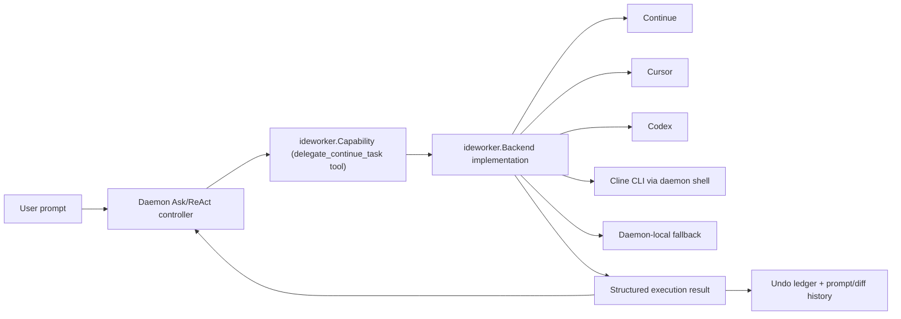
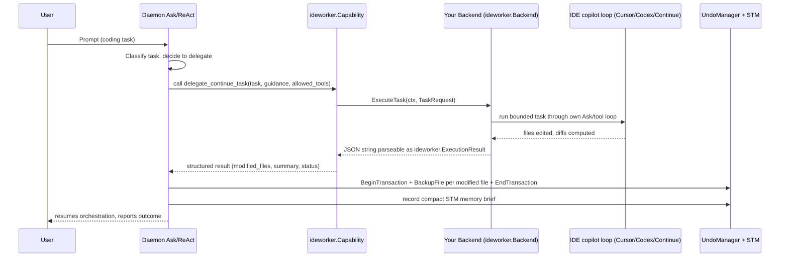
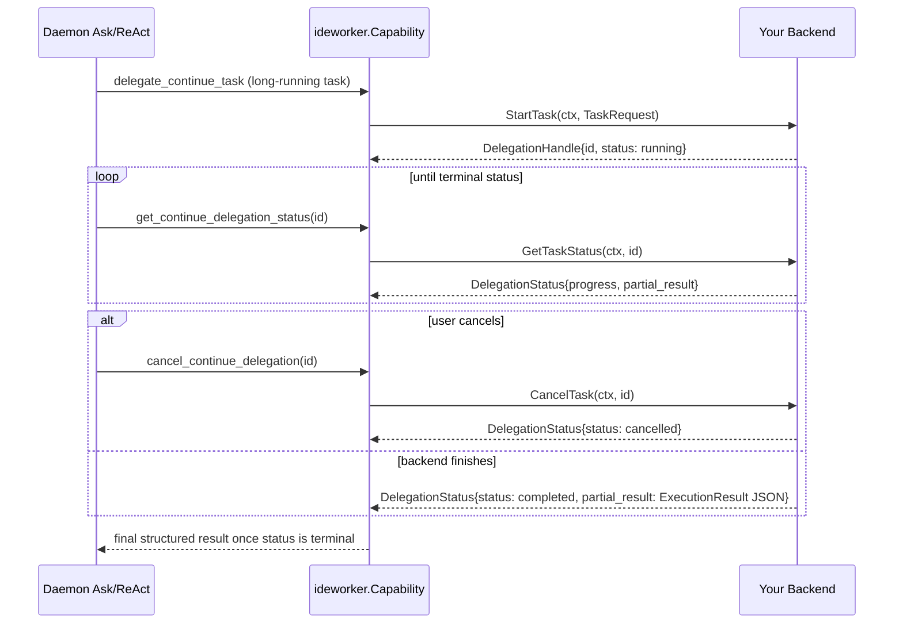
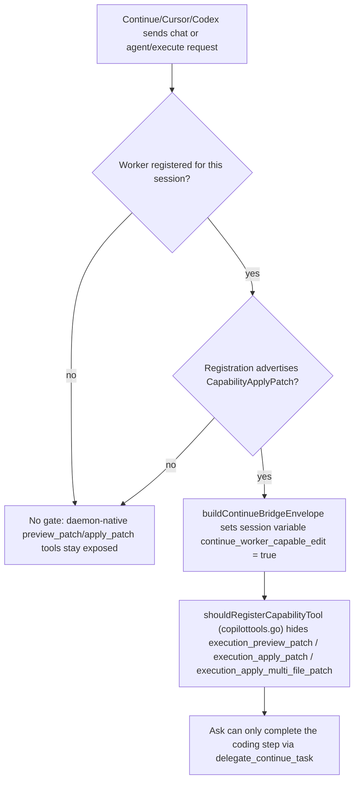
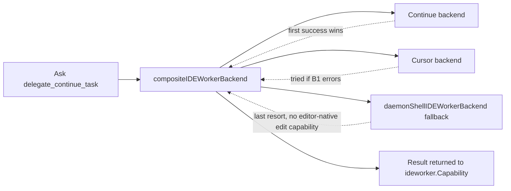

# IDE Copilot Backend SDK

**Status**: Active
**Audience**: Developers integrating a new IDE copilot (Cursor, Codex, Windsurf, JetBrains AI, or a custom in-house agent) as a delegated coding executor for AI Studio / the SOP daemon.

## Purpose

AI Studio is not trying to replace IDE copilots. It is designed to be an **enhancer layer** that sits above them: durable memory, KnowledgeBase/team-practice guidance, approvals, prompt history, and undo/checkpoint tracking, while the connected IDE copilot does the actual coding work inside the editor.

Continue is retained as a non-shipping reference implementation of this pattern. Cline is the target shipping backend and default. The target product surface is the AI Studio floating window, which can be used while the developer works in VS Code, IntelliJ, or another IDE. The integration uses Cline's TypeScript SDK plus an AI Studio MCP server, hosted behind a small daemon-managed Node/TypeScript process. The existing headless `cline` CLI adapter remains a validated fallback/prototype path. No Cline IDE extension is required. This document describes the stable interface boundary so another IDE copilot can be plugged in without changing the Ask/ReAct controller, capability system, or undo/history pipeline.

If you only need to understand *whether* Continue fully services prompts today, see [CONTINUE_IDE_WORKFLOW_SURFACE.md](CONTINUE_IDE_WORKFLOW_SURFACE.md) and [CONTINUE_FACADE_ARCHITECTURE.md](CONTINUE_FACADE_ARCHITECTURE.md). This document is the implementation-facing SDK contract for adding another backend.

This document covers the **daemon/AI Studio side** only. For the **IDE-extension side** (what Continue itself implements to talk to this daemon — the LLM provider adapter, auth session handling, and model catalog sync), see [IDE_COPILOT_CLIENT_INTEGRATION.md](IDE_COPILOT_CLIENT_INTEGRATION.md). Read both to get the full picture of the integration.

## Architectural Position



Rules that do not change when you add a backend:

- Ask remains the only controller (participant pattern — see `.github/copilot-instructions.md`).
- The daemon LLM decides *when* to delegate by calling the `delegate_continue_task` tool exposed by `ideworker.Capability`. Your backend does not call back into Ask; it receives one bounded task and returns one structured result.
- AI Studio owns memory, KnowledgeBase guidance, approvals, prompt/diff history, and undo checkpoints regardless of which backend executed the work.

## Cline Memory and Checkpoint Boundary

Cline brings its own local persistence and recovery features:

- **Memory Bank** is a documented Markdown convention for project context and
    resumption, commonly stored under `memory-bank/`.
- **`.clinerules` and skills** provide persistent project instructions and
    reusable operational guidance.
- **Task history** stores Cline sessions and task metadata in Cline's local
    storage.
- **Checkpoints** use a shadow Git repository to snapshot workspace state after
    edits and commands, then support compare/restore operations.
- **MCP** lets Cline call external tools and data providers over local STDIO or
    remote HTTP/SSE transports.

These systems complement, but do not replace, AI Studio services. Cline owns its
task-local conversation context and checkpoint rollback. AI Studio owns semantic
memory, KnowledgeBase/team-practice guidance, validation history, and the
searchable `UndoManager` ledger. A backend integration should pass context into
Cline and import canonical execution results back into AI Studio; it should not
merge Cline's shadow Git repository into the user's Git history.

### Canonical ownership principle

AI Studio/SOP is the authoritative memory and undo system for integrated Cline
workflows. Its semantic memory can combine KnowledgeBase content, team-practice
recall, session memory, validation outcomes, and cross-task experience. Its
`UndoManager` records structured transactions and searchable code artifacts,
rather than only maintaining a local rollback snapshot.

Cline's Memory Bank, task history, and checkpoints remain valuable local aids for
the Cline agent itself. They provide project-document context, conversation
continuity, and fast task-local recovery. They are intentionally subordinate to
AI Studio's canonical memory and undo ledger and should not be synchronized as a
second source of truth.

## Floating Window Product Model

The user-facing copilot is the AI Studio floating window, not a Cline-specific
VS Code or IntelliJ extension. The developer keeps the preferred IDE focused on
editing and navigation while the floater provides the consistent AI workflow:

```text
AI Studio floater
    -> Ask/RAG, memory, approvals, and task orchestration
    -> Cline SDK host for agentic coding execution
    -> files, terminal, tests, and checkpoints
    -> SOP diff capture, UndoManager, and durable history
```

This makes the copilot portable across VS Code, IntelliJ, terminal sessions, and
other applications. IDE-specific integrations can be optional enhancements for
opening files or showing diffs, but the core workflow must remain functional
without an IDE extension.

### Interaction levels

The daemon-side Cline backend currently supports bounded delegation: AI Studio
sends one task plus workspace/provider/model context, Cline runs its internal
multi-turn agent loop, and the daemon receives a terminal NDJSON result. The
daemon can poll and cancel the delegated task, but the current headless adapter
does not expose individual Cline tool approvals or mid-run conversational turns.

The next integration level is bidirectional MCP participation. An authenticated
AI Studio MCP server could expose narrowly scoped tools such as:

```text
search_memory
get_task_guidance
search_undo_history
list_undo_transactions
restore_undo_transaction
record_validation
```

Cline would then remain the agentic controller for its task while consulting AI
Studio's memory and undo systems during execution. This is complementary to the
daemon-to-Cline backend, not a replacement for it.

The final result boundary remains `ideworker.ExecutionResult`. To activate
automatic AI Studio undo and memory capture for Cline, the backend must populate
`ModifiedFiles` (or the daemon must compute a before/after workspace diff) and
return validation metadata. Cline's own checkpoint history should remain an
internal recovery mechanism.

## Target SDK Host Architecture

Cline's SDK is TypeScript, so the Go daemon should not attempt to import it
directly. A daemon-managed Node/TypeScript host should own the SDK session and
expose a narrow JSON/NDJSON bridge implementing the daemon-side backend boundary:

```text
Go daemon -> SDK host -> Cline Agent/ClineCore -> MCP -> AI Studio services
```

The host can use the SDK's `Agent.run`/`continue` or `ClineCore.start` APIs,
custom tools, MCP configuration, and runtime hooks (`beforeRun`, `beforeTool`,
`afterTool`, `afterRun`). It should translate SDK lifecycle events into bounded
daemon progress events and translate the final workspace state into
`ideworker.ExecutionResult`.

The first SDK prototype is considered feasible with these testable boundaries:

1. Start a host session with workspace, provider/model, task, and correlation id.
2. Configure one authenticated AI Studio MCP tool, such as `search_memory`.
3. Stream progress and tool events over NDJSON.
4. Cancel the host session from the daemon.
5. Capture a before/after workspace diff as `ModifiedFiles`.
6. Verify the existing AI Studio undo and memory pipeline consumes the result.

This approach gives Cline an actual multi-turn SDK session and bidirectional MCP
access without making MCP responsible for RAG orchestration. AI Studio remains
the owner of semantic retrieval, policy, and canonical undo history.

## Complementary Memory and Undo Responsibilities

Cline is strongest at immediate execution context: its current conversation,
workspace files, tool results, `.clinerules`, skills, Memory Bank documents, and
frequent task checkpoints. SOP is strongest at durable semantic context:
KnowledgeBase retrieval, team-practice recall, STM/LTM, validation history, and
structured searchable undo transactions.

The backend contract should therefore use this lifecycle:

```text
SOP preflight guidance
        + Cline workspace/session context
                -> Cline multi-turn agent execution
                        -> Cline local checkpoints
                        -> final workspace diff and validation
                                -> SOP canonical undo transaction and memory brief
```

The two undo systems have different scopes:

- Cline checkpoints are tactical, frequent, task-local recovery points. They
    remain owned by Cline and are not copied wholesale into SOP.
- SOP `UndoManager` transactions are logical task/phase records. They contain
    modified files, diff artifacts, validation results, rationale, and searchable
    history, and remain the canonical project undo layer.

If a completed SOP transaction is restored, the Cline session that produced it
must be marked stale or refreshed before another turn is allowed. Otherwise Cline
could continue from a file state that no longer matches its conversation.

The imported transaction should preserve correlation metadata including
`delegation_id`, Cline session/task ID, checkpoint reference when available,
workspace root, requested phase, and validation outcome. This provides a link
between both histories without creating two competing sources of truth.

## The Interface You Implement

The SDK boundary is a single Go interface in `lib/sop/ai/agent/domains/ideworker/capability.go`:

```go
type Backend interface {
    InspectSession(ctx context.Context, sessionID string) (SessionState, error)
    ExecuteTask(ctx context.Context, req TaskRequest) (string, error)
    StartTask(ctx context.Context, req TaskRequest) (DelegationHandle, error)
    GetTaskStatus(ctx context.Context, delegationID string) (DelegationStatus, error)
    CancelTask(ctx context.Context, delegationID string) (DelegationStatus, error)
}
```

You do not need to implement all five as active behavior on day one — `ExecuteTask` (synchronous) is the minimum viable path; `StartTask`/`GetTaskStatus`/`CancelTask` support async/polling delegation once your IDE integration supports long-running background execution.

### `TaskRequest` — what Ask sends you

```go
type TaskRequest struct {
    RequestID, TraceID, RootRequestID string // participant correlation ids, propagate as-is
    SessionID      string
    Task           string // the bounded coding objective, written as natural-language instructions
    Mode           string // hint: plan | edit | apply | review | test
    Provider       string // preserve the user's selected LLM family if your backend proxies model calls
    Model          string
    RequestedPhase string // investigation | planning | execution | review | delivery
    AvailableTools []string
    PhaseTools     []string
    AllowedTools   []string // bound your own tool loop to this subset when possible
    ToolChoice     string
    WorkspaceRoot, ActiveFile, SelectedText string
    OpenFiles      []string
    Guidance       DelegationGuidance
}

type DelegationGuidance struct {
    TeamPractices        []string // KnowledgeBase/team-practice recall from AI Studio LTM
    SuccessCriteria      []string
    Constraints          []string
    ImplementationNotes  []string
    ExpectedResultFormat string
    ReferenceContext     []DelegationReference
    Metadata             map[string]any
}
```

Treat `Task` + `Guidance` as everything you need to run your own internal Ask/tool loop for that one bounded objective. Do not expect follow-up turns of daemon-side conversation context — Continue-style delegation is intentionally single-turn per call (see `docs/CONTINUE_BRIDGE_API_SPEC.md`).

### `SessionState` — what you report back on inspection

```go
type SessionState struct {
    SessionID           string
    Connected           bool
    IDE                 string   // "vscode", "cursor", "jetbrains", etc.
    WorkerCapabilities  []string // use the exported ideworker capability constants below
    Mode, WorkflowProfile, RequestedPhase string
    SupportedPhases     []PhaseDefinition
    AvailableTools, PhaseTools, PhaseAvailableTools []string
    ToolChoice          string
    WorkspaceRoot, ActiveFile, SelectedText string
    OpenFiles           []string
}
```

`WorkerCapabilities` is the capability catalog your backend advertises. Use the exported constants and helpers in `lib/sop/ai/agent/domains/ideworker/result.go` rather than inventing your own strings:

```go
const (
    CapabilityReadContext = "read_context"
    CapabilityApplyPatch  = "apply_patch"
    CapabilityEditCode    = "edit_code"
    CapabilityDiffReview  = "diff_review"
    CapabilityPlanChanges = "plan_changes"
)

var StandardCapabilities = []string{CapabilityReadContext, CapabilityApplyPatch, CapabilityEditCode, CapabilityDiffReview, CapabilityPlanChanges}

func NormalizeCapabilities(caps []string) []string
func SupportsCapabilities(available []string, required ...string) bool
```

Advertise `CapabilityApplyPatch` only when your backend can actually mutate files end to end — this is the flag that forces mandatory delegation (see below). The daemon's Continue reference implementation and its capability-matching logic (`continueWorkerCapabilityCatalog`, `continueWorkerSupportsCapabilities` in `lib/sop/cmd/sop-daemon/client_bridge.go`) are themselves thin aliases over these exported helpers, so there is exactly one capability contract, not a daemon-private copy plus an SDK copy.

### The result contract your backend must return

`ExecuteTask`/`StartTask` results are plain strings on the Go interface for transport simplicity (they cross an HTTP/NDJSON boundary for out-of-process backends like Continue), but that string must parse into the exported `ideworker.ExecutionResult` shape so history/undo tracking works automatically:

```go
// lib/sop/ai/agent/domains/ideworker/result.go
type ExecutionResult struct {
    Status        string         // "completed" | "failed" | ...
    Summary       string
    ModifiedFiles []ModifiedFile
    Artifacts     []Artifact
    Metadata      map[string]any
}

type ModifiedFile struct {
    FilePath        string
    CRUDOperation   string // create | update | delete
    DiffSummary     string
    DiffDelta       string
    DiffFormat      string
    DiffArtifactRef string // for large diffs, reference an artifact instead of inlining
    Metadata        map[string]any
}

type ResultContract struct {
    StreamProgress, IncludeModifiedFiles, IncludeDiffDeltas, IncludeMetadata, PreferArtifactRefs bool
    MaxInlineDiffBytes int
}

func DefaultResultContract() ResultContract // recommended defaults for new integrations
func ParseExecutionResult(raw string) (ExecutionResult, bool) // parse a returned string or NDJSON "done" event
```

These are exported SDK types, not daemon-internal ones: `lib/sop/cmd/sop-daemon/client_bridge.go`'s `continueExecutionResult`, `continueExecutionModifiedFile`, `continueExecutionArtifact`, and `continueExecutionResultContract` are now plain Go type aliases (`type continueExecutionResult = ideworker.ExecutionResult`) of these SDK types — the Continue reference implementation consumes the exact same contract a Cursor/Codex backend would.

If your backend returns JSON matching `ExecutionResult` (directly, or as NDJSON progress events terminated by a `{"type":"done","result": {...}}` event — see `captureContinueWorkerResult` / `ideworker.ParseExecutionResult`), the daemon will automatically:

1. Open an undo transaction, back up each modified file, and close the transaction (`recordContinueDelegatedUndoTransaction`).
2. Record a compact STM memory brief of what changed and what was validated (`recordContinueExecutionMemoryBrief`), which later promotes to LTM.

If your backend returns free-form text instead, you lose automatic undo/history capture — you would need to bring your own tracking, which defeats the purpose of using AI Studio as the enhancer layer.

## Wiring a New Backend

1. Implement `ideworker.Backend` (own package, e.g. `lib/sop/cmd/sop-daemon/cursor_worker_bridge.go`, following the shape of `continueIDEWorkerBackend` in `ide_worker_bridge.go`).
2. Register it on the agent:

   ```go
   agent.InjectIDEWorkerBackend(myCursorBackend)
   ```

   (`CopilotAgent.InjectIDEWorkerBackend` in `lib/sop/ai/agent/copilot_capabilities.go` finds the registered `ideworker.Capability` and calls `SetBackend`.)

3. If you need to support multiple IDE backends simultaneously (e.g. Continue AND Cursor connected in different sessions, or a daemon-local fallback), wrap them in `compositeIDEWorkerBackend` (`lib/sop/cmd/sop-daemon/ide_worker_bridge.go`), which fans out `InspectSession`/`ExecuteTask`/etc. across backends and returns the first capable/connected result.
4. `ideworker.Capability.HasBackend()` gates whether the capability and its `delegate_continue_task` tool are even exposed at all (`capabilityRuntimeAvailable` in `lib/sop/ai/agent/copilottools.go`). No backend registered → no delegation tool surfaced → Ask falls back to daemon-native tools.

## Forcing Delegation Instead of Daemon-Local Execution

By default, delegation is advisory: the daemon LLM may call `delegate_continue_task`, or it may just use its own coding-execution tools (`preview_patch`, `apply_patch`, `apply_multi_file_patch`) if no capable worker is registered.

To make delegation **mandatory** once a capable worker is connected (so AI Studio never patches files itself while your IDE copilot is servicing the session), the daemon sets a session variable before invoking Ask:

- `lib/sop/cmd/sop-daemon/client_bridge.go`: `continueSessionWorkerCapableOfEdit(sessionID)` checks the registered worker's advertised capabilities for `apply_patch`, and `buildContinueBridgeEnvelope(req, workerCapableEdit)` sets `variables["continue_worker_capable_edit"] = true` when so.
- `lib/sop/ai/agent/copilottools.go`: `shouldRegisterCapabilityTool` checks `continueWorkerCapableOfEdit(ctx)` and, when true, skips registering `execution_preview_patch`, `execution_apply_patch`, and `execution_apply_multi_file_patch` (`continueDelegatedCodingExecutionTools`) into the Ask tool surface for that turn.

If you add a second/alternate backend (Cursor, Codex), reuse this same `continue_worker_capable_edit` session variable and capability-catalog convention (advertise `apply_patch` in `SessionState.WorkerCapabilities` / `TaskRequest`-side registration) rather than inventing a parallel gate — the variable name is IDE-agnostic in effect even though it originated from the Continue integration. If the naming becomes confusing once a second real backend ships, renaming it to something like `ide_worker_capable_edit` is a pure rename with no behavior change (update both the setter in `client_bridge.go` and the reader in `copilottools.go`).

## Flow: Synchronous Delegation (`ExecuteTask`)



## Flow: Asynchronous Delegation (`StartTask` / poll / `CancelTask`)



## Flow: Mandatory-Delegation Gating

This is the decision that prevents AI Studio from patching files itself once a capable IDE copilot is connected:



## Flow: Multiple Backends / Fallback Composition



`compositeIDEWorkerBackend` (`lib/sop/cmd/sop-daemon/ide_worker_bridge.go`) tries each backend's `ExecuteTask`/`StartTask`/`GetTaskStatus`/`CancelTask` in order and returns the first successful result, merging `InspectSession` state across all of them. This is how Continue, a future Cursor backend, and the daemon-shell fallback can coexist without Ask needing to know which one is active.

## Step-by-Step: Adding Cursor or Codex

1. Add a registration/session-tracking surface analogous to `continueBridgeWorkerStore` so the daemon knows a Cursor/Codex worker is connected for a given session, and what it advertises (`Capabilities []string`, ideally built from `ideworker.StandardCapabilities`).
2. Implement `ideworker.Backend.ExecuteTask` (and `StartTask`/`GetTaskStatus`/`CancelTask` if you support async execution) to forward `TaskRequest` into your IDE's own agent loop (its own AST/navigation/edit tools), and return an `ideworker.ExecutionResult`-shaped JSON payload (use `ideworker.DefaultResultContract()` as your target shape, and `ideworker.ParseExecutionResult` to validate it round-trips).
3. Compute and set the capability-derived session variable so mandatory delegation kicks in when your worker is capable of edits (mirror `continueSessionWorkerCapableOfEdit`, checking `ideworker.SupportsCapabilities(registration.Capabilities, ideworker.CapabilityApplyPatch)`).
4. Register your backend via `InjectIDEWorkerBackend`, optionally composed with the existing Continue/daemon-shell backends via `compositeIDEWorkerBackend` if more than one worker type can be active.
5. Confirm undo/history capture end to end: modify a file through your backend, confirm an undo transaction with backed-up files appears, and confirm a compact memory brief lands in STM.

## What Stays Owned By AI Studio (Never Reimplement)

- Ask/ReAct orchestration, phase progression, retry/clarification policy.
- Provider routing, approvals, and policy rails.
- Prompt capture, prompt ledger, and visible change-history storage.
- Memory (STM/LTM) and KnowledgeBase/Space retrieval.
- Undo checkpoints and restore (`codingworkflow.UndoManager`, `BeginTransaction`/`BackupFile`/`EndTransaction`).

Your backend's only job is: accept one bounded `TaskRequest`, run your IDE's own coding loop against it, and return a structured result AI Studio can track and let the user undo.

## Related Docs

- [CONTINUE_COPILOT_INTEGRATION_CONTRACT.md](CONTINUE_COPILOT_INTEGRATION_CONTRACT.md) — behavior contract and memory lifecycle for the reference Continue integration.
- [CONTINUE_BRIDGE_API_SPEC.md](CONTINUE_BRIDGE_API_SPEC.md) — HTTP transport, auth, and role-mode details for the native `/api/continue/*` surface.
- [CONTINUE_FACADE_ARCHITECTURE.md](CONTINUE_FACADE_ARCHITECTURE.md) — why Continue is treated as a capability adapter, not a controller.
- [WORKFLOW_UNDO_SYSTEM.md](WORKFLOW_UNDO_SYSTEM.md) — undo/checkpoint semantics that delegated results feed into.
