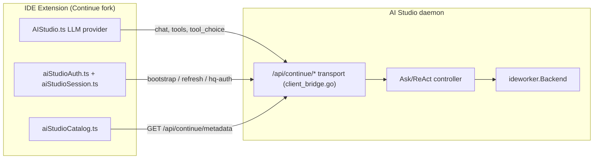
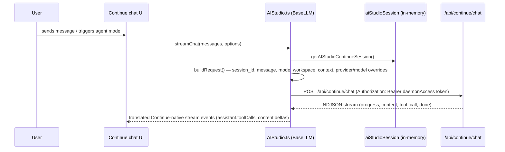
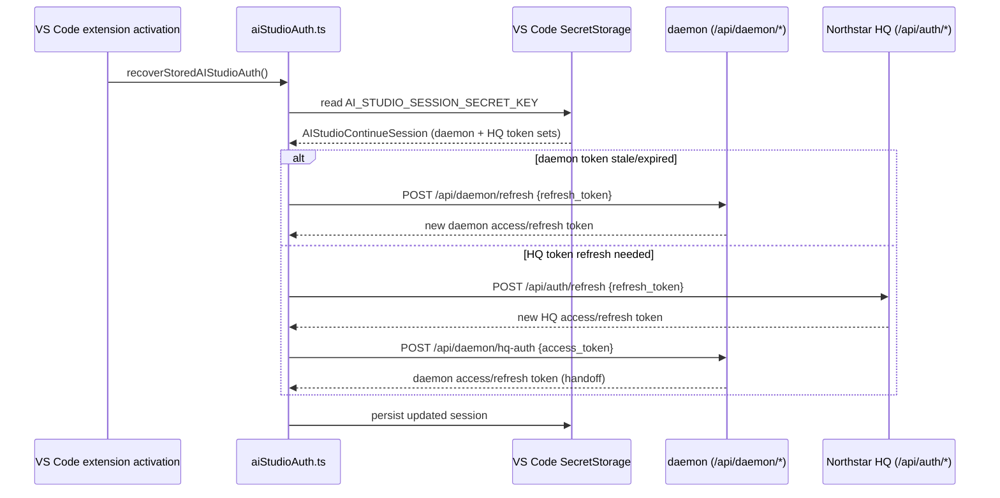
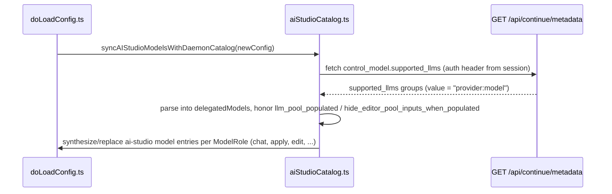

# IDE Copilot Client Integration (Continue Reference)

**Status**: Active — paused 2026-09-28 (2nd pause), safe to resume from "Resume Here" below.
**⚠️ Strategic note (2026-09-29)**: Continue was acquired by Cursor and independent open-source development/support is winding down. Further investment in this Continue fork should be weighed against that risk — [CLINE_COPILOT_INTEGRATION_PLAN.md](CLINE_COPILOT_INTEGRATION_PLAN.md) (Cline, still independently and actively maintained) is now the favored path going forward. This document remains accurate as a reference implementation and for the `ideworker.Backend` SDK lessons learned, but treat Continue as a secondary/at-risk target, not the primary one.
**Audience**: Developers building or maintaining the IDE-extension side of an AI Studio integration (Continue today; a Cursor/Codex/JetBrains-AI client tomorrow).

## Resume Here (paused 2026-09-28)

**Current pause reason**: user wants to manually test the real product first — AI Studio (`sop-daemon` + `httpserver`/SOP Data Manager Web UI) together with the repackaged Continue extension (`northstar.ai-studio`) actually running in VS Code — before continuing further build-out. Nothing below has been done yet; this is documentation only per that request.

Do these in order when picking this back up:

0. **New, not started \u2014 release packaging for GitHub Releases**: bundle `sop-daemon` + a built Continue `.vsix` into one per-OS downloadable installer package, separate from the hosted Northstar Web UI (which needs no install). Concrete plan:
   - `sop-daemon` already self-installs the extension on startup via `lib/sop/cmd/sop-daemon/continue_extension_installer.go` (`ensureContinueExtensionInstalledAsync()`), verified working by actually running the binary. It looks for `continue-ai-studio.vsix` next to its own executable path (or `SOP_CONTINUE_VSIX_PATH` env override).
   - Still needed: a build/release script (mirror `lib/sop/scripts/build-systemd-release.sh`'s pattern) that: (a) builds `sop-daemon` for each target OS/arch, (b) builds the Continue `.vsix` via `.continue-repo/extensions/vscode/scripts/package.js` (`npm run package` in that dir), (c) copies the vsix next to the `sop-daemon` binary as `continue-ai-studio.vsix`, (d) zips/tars them together per OS into a GitHub Release asset.
   - Still needed: persistent background service registration for `sop-daemon` itself (launchd on macOS, a Windows service/Scheduled Task, systemd on Linux \u2014 the existing `lib/sop/scripts/install-systemd-service.sh` already covers Linux) so it survives reboots without the user manually starting it every time.
   - Still needed: a `.github/workflows/release.yml` (none exists yet outside the SOP database bindings' own release process) triggered on tag push, matrix-building the above per OS, uploading to GitHub Releases.
1. **Install deps and compile-check first.** `.continue-repo` has no `node_modules` installed; none of the TypeScript added/edited across this work (`aiStudioWorker.ts`, `aiStudioWorkerServer.ts`, `aiStudioAuth.ts`, `VsCodeExtension.ts`, `ideWebview.ts`, `useMainEditorWebviewListeners.ts`) has ever been compiled or run. Run `npm install` in the relevant workspaces (`core/`, `extensions/vscode/`, `gui/`) and fix whatever `tsc`/lint surfaces before trusting any of it.
2. **Close the completion-detection gap** — replace `waitForDiffToStabilize()` with the precise signal. Exact plan is in the checklist below (add `aiStudio/delegatedTaskComplete` webview→IDE message, fire it from `streamThunkWrapper.tsx`, tag sessions with `delegationRequestId`).
3. **End-to-end validate**: run the extension in the Extension Development Host, trigger a real delegated task, confirm a file edit lands, confirm an undo transaction appears on the daemon side.
4. **Only then** flip `AI_STUDIO_WORKER_CAPABILITIES` in `aiStudioWorker.ts` to include `apply_patch` — this is what activates the daemon's mandatory-delegation gate (`continue_worker_capable_edit`). Do not do this before step 3 passes, or AI Studio will stop offering its own patch tools with nothing reliable to replace them.
5. **Known remaining limitation, not urgent**: registration uses one fixed session id (`AI_STUDIO_DEFAULT_SESSION_ID`); multiple concurrent AI Studio model entries in one workspace aren't each individually registered.
6. **Not started**: a second `ideworker.Backend` implementation (Cursor/Codex, or Cline) to prove the SDK is reusable beyond Continue. A Cline-specific plan now exists at [CLINE_COPILOT_INTEGRATION_PLAN.md](CLINE_COPILOT_INTEGRATION_PLAN.md) (documentation only, not started).

## Purpose

[docs/IDE_COPILOT_BACKEND_SDK.md](IDE_COPILOT_BACKEND_SDK.md) documents the **daemon/AI Studio side**: the `ideworker.Backend` Go interface a backend implements so Ask can delegate coding work to an IDE copilot.

This document is the other half: what the **IDE extension itself** (the Continue fork under `.continue-repo/`) implements to talk to that daemon. Read both together to get the full picture — daemon-side interface plus IDE-side client.

## What Lives Where (Today)

The current Continue fork implements the **chat/completion transport, auth session management, and (as of 2026-09-28) a first-pass worker-registration/callback receiver**. Keep the distinction below in mind: the mechanical plumbing (registration call, local callback server, result shaping) is real and wired; the actual task-execution bridge has two known reliability limitations that are not yet closed.

## Implementation Tracker: Worker Registration + Callback Receiver

**Status**: First pass implemented, not yet validated end to end. `apply_patch` capability is deliberately NOT advertised yet, so the mandatory-delegation gate stays dormant until validation closes the remaining gaps below.

**Why this matters**: Without a registered worker, `delegate_continue_task` fails on every call (`lib/sop/cmd/sop-daemon/ide_worker_bridge.go`'s `executeDelegatedTask` returns `"no IDE worker is registered for session %s"` when `continueBridgeWorkerStore.Get(sessionID)` misses), and the mandatory-delegation gate (`continue_worker_capable_edit` in `client_bridge.go`/`copilottools.go`) can never trigger, since it only activates when a worker registration advertises `apply_patch`.

**Implemented 2026-09-28**: `.continue-repo/extensions/vscode/src/aiStudioWorker.ts` (registration call, delegated-task runner, git-diff-based result shaping), `aiStudioWorkerServer.ts` (loopback-only NDJSON callback HTTP server), wired into `aiStudioAuth.ts`'s `persistSession()` so registration happens on initial sign-in and every token refresh/handoff. `VsCodeExtension.ts` gained `runDelegatedPrompt()` and `getWorkspaceDiff()` to support this.

**Updated 2026-09-28 (later)**: Investigated actually triggering a Continue turn from the extension host. Found that `newSessionWithPrompt` — the message the first pass used — has **no GUI-side listener at all** (verified via repo-wide grep across `gui/src`); it would have silently done nothing. Replaced it with a sequence of three protocol messages that do have real, verified listeners: `focusContinueInputWithNewSession` (`gui/src/components/mainInput/TipTapEditor/useMainEditorWebviewListeners.ts`, no-ops when there's no existing history), a new `aiStudio/forceMode` message (added to `core/protocol/ideWebview.ts`, handled by a new listener in the same file that dispatches `sessionSlice`'s `setMode`), then `userInput` (already existed, inserts text and submits exactly like typing in the chat box). This closes the Agent-mode limitation for real, backed by verified code paths rather than assumption.

### Checklist to resume

- [x] **Registration call**: `registerContinueWorker()` posts `{session_id, callback_url, capabilities, ide}` to `/api/continue/worker/register`, called from `persistSession()`.
- [x] **Local callback HTTP server**: `aiStudioWorkerServer.ts` binds `127.0.0.1` (matches daemon's loopback-only `validateContinueWorkerCallbackURL` requirement), parses the `continueAgentExecuteRequest` JSON body, and streams `{"type":"progress",...}` / `{"type":"done","result":...}` NDJSON lines.
- [x] **Local agent-loop bridge — mode limitation closed**: `runDelegatedTask()` now injects the task via `focusContinueInputWithNewSession` → `aiStudio/forceMode` → `userInput`, all three with verified GUI-side listeners. Agent mode is force-set before submission, not assumed.
- [ ] **Result shaping — KNOWN GAP (heuristic), concrete fix identified**: completion detection still uses `waitForDiffToStabilize()` (polls `ide.getDiff(true)` until stable for 3 checks or a 5-minute timeout). The precise fix: `gui/src/redux/thunks/streamThunkWrapper.tsx` is the verified true top-level completion point — `await runStream()` only resolves after the entire recursive tool-call loop (`streamNormalInput` → `streamResponseAfterToolCall` → ...) finishes, right before it dispatches `saveCurrentSession`. To close this gap: (1) add a webview→IDE message, e.g. `aiStudio/delegatedTaskComplete: [{ requestId: string }, void]`, to `ToIdeFromWebviewProtocol` in `ideWebview.ts`; (2) tag the session as delegation-originated (e.g. a `delegationRequestId` field threaded through `userInput`'s payload into session state) so `streamThunkWrapper.tsx` knows when to fire it; (3) call `extra.ideMessenger.post("aiStudio/delegatedTaskComplete", { requestId })` right after the successful `saveCurrentSession` dispatch; (4) on the extension side, replace `waitForDiffToStabilize` with a promise resolved by a webview→IDE listener keyed on `requestId`, falling back to the diff heuristic only as a timeout safety net.
- [x] **Capability accuracy**: `AI_STUDIO_WORKER_CAPABILITIES` in `aiStudioWorker.ts` intentionally omits `apply_patch` until the result-shaping gap above is closed and validated.
- [x] **Re-registration on reconnect**: registration is re-sent from `persistSession()`, which every refresh/handoff path (`tryRefreshDaemonSession`, `tryRefreshHQSession` + `exchangeDaemonSession`, `signInToHQ`) already calls.
- [ ] **Multi-session limitation**: registration currently uses a single fixed session id (`AI_STUDIO_DEFAULT_SESSION_ID = "ai-studio-daemon-controller"`) mirroring `AIStudio.ts`'s default fallback session id. Multiple concurrent AI Studio model entries/distinct Continue `uniqueId` values in the same workspace are not yet each individually registered.
- [ ] **End-to-end validation**: with Agent mode manually selected, modify a file through the new callback path, confirm an undo transaction with backed-up files appears, and only then consider advertising `apply_patch` to enable the mandatory-delegation gate.

### Resume pointers

- Daemon side reference for what the callback contract must satisfy: `lib/sop/cmd/sop-daemon/ide_worker_bridge.go` (`executeContinueWorkerCallback`, `proxyAgentExecuteToWorker`, `validateContinueWorkerCallbackURL`).
- SDK types to target: `lib/sop/ai/agent/domains/ideworker/result.go` (`ExecutionResult`, `ModifiedFile`, capability constants).
- IDE-side files to add to: new files under `.continue-repo/extensions/vscode/src/` (registration + local server) alongside existing `aiStudioAuth.ts`.

| Concern | File | Role |
|---|---|---|
| LLM provider / chat transport | `.continue-repo/core/llm/llms/AIStudio.ts` | Implements Continue's `BaseLLM` so AI Studio appears as a normal model provider (`providerName = "ai-studio"`) |
| Session token storage | `.continue-repo/core/util/aiStudioSession.ts` | In-memory session shape (`AIStudioContinueSession`) shared across the extension process |
| Auth bootstrap/refresh/handoff | `.continue-repo/extensions/vscode/src/aiStudioAuth.ts` | VS Code secret-storage persistence, daemon token refresh, HQ token refresh, HQ→daemon handoff, interactive login recovery |
| Model catalog sync | `.continue-repo/core/config/aiStudioCatalog.ts` | Reads daemon-advertised `control_model.supported_llms` and synthesizes/filters `ai-studio` model entries in Continue's config |
| HQ login dialog UI | `.continue-repo/gui/src/components/dialogs/AIStudioHQLoginDialog.tsx` | Interactive credential prompt when silent token refresh fails |

## Flow: Chat Request (`AIStudio.ts` → `/api/continue/chat`)

Key `AIStudio.ts` behaviors worth knowing when porting this to a new IDE client:

- `providerName = "ai-studio"`, default `apiBase = http://127.0.0.1:9090/`, default `model = "daemon-controller"` — the model name itself is a placeholder; the real provider/model pair travels in `extraBodyProperties.provider`/request `model` and is validated against the daemon's advertised catalog (`validateDelegatedModelAgainstCatalog`, calling `GET /api/continue/metadata`) before every delegated request that pins a provider/model explicitly.
- Session id defaults to Continue's own `uniqueId`, falling back to `ai-studio-<model>` — this is the same `session_id` the daemon uses for worker registration lookups (`continueBridgeWorkerStore.Get(sessionID)`), so a new IDE client must keep a stable, reusable session id per workspace/tab if it wants worker delegation state to line up.
- Request body carries `workspace.root`, `workspace.active_file`, `context.open_files`, `context.selected_text` — these map directly onto the daemon's `TaskRequest.WorkspaceRoot/ActiveFile/OpenFiles/SelectedText` fields documented in the backend SDK doc.
- Auth header is only injected when the caller didn't already set one, from `getAIStudioContinueSession()?.daemonAccessToken` — a new IDE client should follow the same "explicit header wins, otherwise fall back to stored session token" precedence.

## Flow: Auth Bootstrap, Refresh, and HQ→Daemon Handoff

On a hard `401`/`403` from any daemon endpoint mid-session, `recoverAIStudioAuth()` runs the same refresh chain (daemon refresh → HQ refresh + handoff → interactive `AIStudioHQLoginDialog` as last resort) and then calls `extension.reloadContinueConfig(...)` so the model catalog and any pending request retry with fresh credentials. A new IDE client should implement this same three-tier recovery order rather than immediately forcing an interactive login on the first `401`.

Two independent token sets are kept — never substitute one for the other:

- **Daemon token set**: `daemonAccessToken` / `daemonRefreshToken` / `daemonTokenExpiry` — authenticates the extension to the local daemon (`/api/continue/*`, `/api/daemon/*`).
- **HQ token set**: `hqAccessToken` / `hqRefreshToken` / `hqUserID` / `hqSessionID` — authenticates the extension to Northstar HQ (`/api/auth/*`) independently, and can be exchanged for a daemon token via `/api/daemon/hq-auth`.

See [CONTINUE_BRIDGE_API_SPEC.md](CONTINUE_BRIDGE_API_SPEC.md) for the full dual-token wire contract this implements.

## Flow: Model Catalog Sync

This is the client-side half of the rule documented in `client-bridge-transports` memory: **the daemon-owned `control_model.supported_llms` is the single source of truth for AI Studio model choices** — the IDE client must not hardcode a second provider/model list. `llm_pool_populated` and `hide_editor_pool_inputs_when_populated` let the daemon tell the client whether to suppress its own API-key entry UI when the daemon already has a usable provider pool configured.

## Building a New IDE Client (Cursor, Codex, etc.)

If you are porting this integration to a different IDE's extension model instead of forking Continue, replicate these pieces:

1. **LLM/provider adapter** — a thin HTTP client equivalent to `AIStudio.ts`: POST to `/api/continue/chat` with `session_id`, `message`, `mode`, `workspace`, `context`, optional `provider`/`model`/`tools`/`tool_choice`, and consume the NDJSON response stream (`progress`, `content`, `tool_call`, `error`, `done`).
2. **Session/token store** — mirror `aiStudioSession.ts`'s two-token-set model (daemon vs HQ), persisted in your IDE's secret-storage equivalent, not just in memory.
3. **Auth bootstrap/refresh chain** — mirror `aiStudioAuth.ts`'s three-tier recovery: stored daemon token → HQ refresh + `/api/daemon/hq-auth` handoff → interactive login, and re-run it on any `401`/`403` from a daemon endpoint.
4. **Model catalog sync** — call `GET /api/continue/metadata` and treat `control_model.supported_llms` as canonical; do not maintain your own hardcoded provider/model list.
5. **(Gap — implement if you want inbound delegation)** Worker registration and callback receiver: `POST /api/continue/worker/register` with a `callback_url` and a `Capabilities` list (use `ideworker.StandardCapabilities` values from the backend SDK doc — advertise `apply_patch` only if your client can truly mutate files end to end), then expose an HTTP endpoint that accepts the daemon's `continueAgentExecuteRequest`-shaped callback and streams back NDJSON progress plus a final `ideworker.ExecutionResult`-shaped `done` event. This is what turns your IDE client from "chat consumer" into a full delegated coding-workflow executor per [IDE_COPILOT_BACKEND_SDK.md](IDE_COPILOT_BACKEND_SDK.md).

## Related Docs

- [IDE_COPILOT_BACKEND_SDK.md](IDE_COPILOT_BACKEND_SDK.md) — the daemon-side `ideworker.Backend` interface, result contract, and delegation flows this client talks to.
- [CONTINUE_BRIDGE_API_SPEC.md](CONTINUE_BRIDGE_API_SPEC.md) — wire-level request/response and dual-token auth spec.
- [CONTINUE_NATIVE_SETUP.md](CONTINUE_NATIVE_SETUP.md) — supported transport routes and example request payloads.
- [CONTINUE_COPILOT_INTEGRATION_CONTRACT.md](CONTINUE_COPILOT_INTEGRATION_CONTRACT.md) — memory/preflight/consolidation lifecycle around delegated execution.
