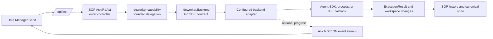
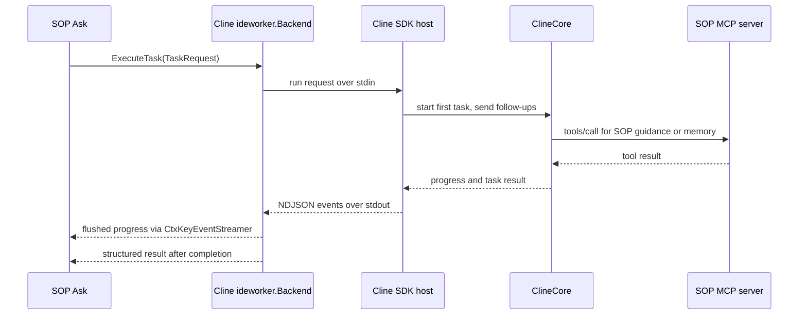
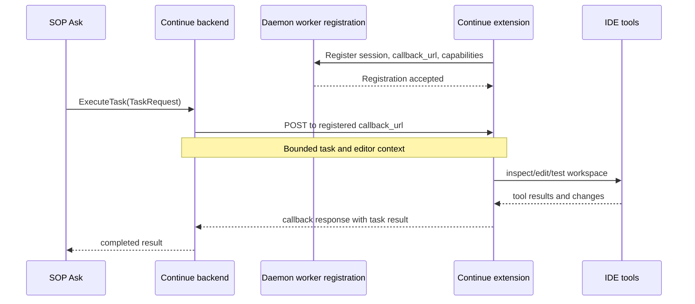

# Integrating a Coding Backend

**Status:** Current developer guide. Cline SDK is the shipping daemon backend; Continue is retained as a compatibility reference. The shared contract and live source are authoritative if details change.

This guide shows how to add another coding agent without replacing SOP Ask or creating a second chat path. For the exact Go types, see [IDE_COPILOT_BACKEND_SDK.md](IDE_COPILOT_BACKEND_SDK.md). For the current Cline runtime setup, see [CLINE_COPILOT_INTEGRATION_PLAN.md](CLINE_COPILOT_INTEGRATION_PLAN.md).

## Runtime Shape



Keep one production Send action. Ask decides whether and when to delegate; a backend executes one bounded coding task and returns control to Ask. Do not move multi-step workflow orchestration into the backend.

The Ask-visible tool name `delegate_continue_task` is a legacy compatibility name. A new backend does not need a Continue dependency or a new UI action.

For the daemon, `workflow_backend=cline` makes Cline the exclusive repository-coding executor: Ask exposes delegation instead of overlapping in-house coding phases/file-shell-Git mutation tools, waits for the bounded Cline result, and does not advance the native coding phase plan for the same turn. If Cline is unavailable or misconfigured, Ask reports a setup error instead of silently switching executors. Specialized PostgreSQL and Splunk tool families remain independent and are not hidden by the coding ownership policy. Choose another backend setting explicitly to opt into an alternate execution path.

Continue's legacy `/api/continue/*` routes are registered only when `workflow_backend=continue`; they are absent in Cline mode.

Daemon selection is mutually exclusive: `workflow_backend=cline` (default), `continue`, or `native` for SOP's in-house coding phases. The old `daemon`/`shell` values alias `native`. Cline and Continue are fail-closed when their runtime/worker is unavailable; choose `native` explicitly to use the in-house executor.

## SDK Extension Boundary

The SDK extension point is the exported Go `ideworker.Backend` interface. In an embedded Go runtime, implement that interface and inject it into the copilot:

```go
copilot := agent.NewCopilotAgent(cfg, databases, systemDB)
copilot.InjectIDEWorkerBackend(myBackend)
```

`newConfiguredIDEWorkerBackend` is daemon deployment wiring that chooses the shipped backend; it is not a public plugin-discovery API. The Cline host's stdin/stdout NDJSON and Continue's callback routes are adapter transports, not stable wire contracts that third-party backends must implement. External agents still need a Go adapter that maps their protocol to `ideworker.Backend`.

MCP has a narrower role in the current Cline integration: the Cline host is an MCP client of SOP's authenticated `/mcp` server for guidance, memory, undo, validation, and restore tools. SOP does not invoke Cline through MCP, and MCP is not the backend registration or delegation protocol here.

### Contract Tradeoffs

- The backend interface is an in-process Go API. It is not a cross-language plugin protocol, and the daemon does not discover arbitrary external backends at runtime.
- `ExecutionResult` is the canonical result shape, but `ExecuteTask` currently returns it as JSON text for compatibility with existing tool and adapter boundaries. New backends should serialize that schema rather than inventing backend-specific result formats; a typed return would require a deliberate contract migration.
- Live progress is optional infrastructure supplied through `ai.CtxKeyEventStreamer`. An embedding without that context should still implement status retrieval and cancellation; it must not assume an HTTP stream exists.
- Cline's child-process NDJSON is private to its adapter. Only the Go backend contract and Ask event contract are shared integration surfaces.

## Existing Patterns

| Integration | Status and transport | Source map |
|---|---|---|
| Cline SDK | Current. Daemon-managed Node host; newline-delimited JSON over stdin/stdout; `core.start()` followed by `core.send()` for same-workstream follow-ups. | [Backend selection](../lib/sop/cmd/sop-daemon/ide_worker_bridge.go), [Go adapter](../lib/sop/cmd/sop-daemon/cline_worker_bridge.go), [host manager](../lib/sop/cmd/sop-daemon/cline_sdk_host_manager.go), [TypeScript host](../tools/cline-sdk-host/src/host.ts) |
| Continue | Retained compatibility implementation. IDE extension registers a callback endpoint and the daemon delegates to the IDE-resident worker. | [Continue adapter](../lib/sop/cmd/sop-daemon/ide_worker_bridge.go), [bridge routes](../lib/sop/cmd/sop-daemon/client_bridge.go), [compatibility reference](CONTINUE_REFERENCE.md) |

Use Cline as the current end-to-end example. Continue is useful when studying an IDE-resident callback, auth handoff, and IDE context flow, but its routes and extension code are not the shipping product path. The detailed historical wire notes are in [CONTINUE_BRIDGE_API_SPEC.md](CONTINUE_BRIDGE_API_SPEC.md) and [IDE_COPILOT_CLIENT_INTEGRATION.md](IDE_COPILOT_CLIENT_INTEGRATION.md); verify those against source before relying on them.

### Cline: SDK Execution and MCP Tools

The task lifecycle and SOP tool access are separate channels. SOP delegates through the Go backend contract and private host pipes; Cline uses MCP only when it calls SOP-provided tools.



### Continue: IDE Callback (Compatibility)

This retained path executes inside the IDE extension. It is useful as a callback pattern, not the default backend or a protocol new integrations need to copy.



## Integration Steps

1. **Choose the execution boundary.** Use an SDK or supervised process when the embedding owns the agent runtime. Use an IDE callback when execution must access editor-only state or tools. Keep transport, authentication, and provider-specific code behind the backend adapter.
2. **Implement `ideworker.Backend`.** Provide `InspectSession`, `ExecuteTask`, `StartTask`, `GetTaskStatus`, and `CancelTask`. Return only capabilities the backend can actually complete, including changed-file reporting when advertising mutation support. The contract and canonical result types are in [capability.go](../lib/sop/ai/agent/domains/ideworker/capability.go) and [result.go](../lib/sop/ai/agent/domains/ideworker/result.go).
3. **Keep identity explicit.** Use `WorkstreamID` to scope tactical continuity, `SessionID` for SOP session association, and `RequestID` for one delegated operation. Do not key long-lived agent state by request ID. Pass application state on `TaskRequest`; use `context.Context` for cancellation and request-scoped infrastructure.
4. **Inject or select the backend.** Embedded Go applications use `CopilotAgent.InjectIDEWorkerBackend`. Daemon maintainers select deployment defaults through `newConfiguredIDEWorkerBackend` in [ide_worker_bridge.go](../lib/sop/cmd/sop-daemon/ide_worker_bridge.go). Keep the `ideworker.Capability` as the Ask-facing adapter; it should not know provider APIs or transport details.
5. **Preserve security boundaries.** Validate workspace roots, pass credentials through protected request channels rather than command arguments, avoid logging secrets, and keep daemon credentials distinct from provider credentials. For callback transports, validate callback URLs and authenticate every request.
6. **Forward progress through Ask.** If the backend produces progress, emit it through `ai.CtxKeyEventStreamer`; do not write to `http.ResponseWriter` from the backend. The `/api/ask` stream uses flushed NDJSON records shaped as `{ "type": "progress", "payload": ... }`. Keep payloads bounded and include stable identifiers so clients can correlate updates. Cline's event payload includes `source`, `backend`, `delegation_id`, `status`, `phase`, `activity_kind`, `activity_label`, `message`, and `updated_at`.
7. **Return structured results and preserve SOP ownership.** Return an `ideworker.ExecutionResult` with status, summary, modified files, diffs or artifact references, and metadata. Capture workspace changes and let SOP own durable history and undo; backend checkpoints remain tactical recovery state.
8. **Test the whole lifecycle.** Cover unavailable runtime, workspace validation, explicit request mapping, capability reporting, progress, terminal result, cancellation, unrelated-session isolation, and restore/stale-context behavior. Add an adapter-level fake process or fake callback test so no provider key is needed for routine validation.

For an asynchronous Cline delegation, a progress event looks like:

```json
{
  "type": "progress",
  "payload": {
    "source": "ide_worker",
    "backend": "cline",
    "event": "delegation_status",
    "delegation_id": "request-id",
    "status": "running",
    "phase": "execution",
    "activity_kind": "investigating",
    "activity_label": "Investigating workspace...",
    "message": "Reading the relevant files",
    "updated_at": "2026-10-04T12:00:00Z"
  }
}
```

`progress` records do not replace or suppress the final assistant response. The shared `SetupStream` serializes event writes because backend progress may arrive from a worker goroutine while Ask is streaming model output.

## Validation

Run focused checks from the repository root:

```sh
go test ./lib/sop/ai/agent/domains/ideworker/...
go test ./lib/sop/cmd/sop-daemon -run 'TestCline|TestContinue'
go test ./lib/sop/tools/sopbackend -run 'TestSetupStream'
npm --prefix tools/cline-sdk-host run build
```

These checks do not replace a live provider and Data Manager validation. The Cline guide lists the remaining release checks. Continue-specific validation is compatibility work, not a Cline release prerequisite.

## Related Documentation

- [Backend contract](IDE_COPILOT_BACKEND_SDK.md)
- [Current Cline integration and packaging](CLINE_COPILOT_INTEGRATION_PLAN.md)
- [Continue compatibility reference](CONTINUE_REFERENCE.md)
- [Ask/ReAct architecture](ASK_V2_ARCHITECTURE.md)
- [Participant pattern](WORKFLOWS.md)