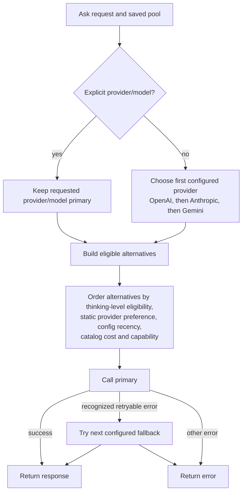

# LLM Provider Pool Behavior

**Status:** Current daemon behavior. Source of truth: `lib/sop/cmd/sop-daemon/rag.go`, `main.go`, and `lib/sop/ai/generator/fallback.go`.

## What the Pool Does

The daemon's LLM credential pool builds a provider chain for SOP-owned Ask generation. It is an availability fallback mechanism, not a quality-learning or task-complexity router.

An explicit provider/model stays first. When no provider is specified, the daemon currently chooses the first configured entry in the fixed OpenAI, Anthropic, Gemini order as primary. Remaining candidates are ordered using the user's configured `thinking_level` as a minimum intelligence eligibility constraint, a static provider preference, credential configuration recency, then model-catalog cost/capability. This is not a classifier that analyzes each ask and labels it “simple” or “needs a smarter model”; task-shape and phase classification happen later in Ask.

Cost preference is manual today: if a user wants a cheaper model to lead, they select it as the primary. SOP does not automatically choose the globally cheapest model as primary. `thinking_level` is an explicit preference/eligibility floor, not an inferred complexity score for the current prompt.

## When Fallback Happens

`FallbackGenerator` tries the primary first. It tries alternatives only when the generation error matches a recognized retryable condition such as a timeout, network failure, rate limit, capacity response, or provider availability/server error. Authentication, invalid-request, cancellation, and unrecognized errors do not trigger fallback. A per-generator circuit breaker skips providers with repeated retryable failures; it is runtime availability state, not pool quality ranking.

Fallback is request-generation failover. It does not retry a coding task merely because its result seems weak, and it does not constitute workstream-level model escalation.

## Outcome History

The daemon persists success/failure counters and timestamps as provider telemetry. Those values are deliberately excluded from provider-chain ordering. Recording an outcome also does not modify the credential configuration timestamp used by ordering. Providers do not get demoted or promoted based on historical failures.

The current outcome recorder attributes the whole Ask turn to `provider_details`, which represents the configured primary. `FallbackGenerator` does not currently report which alternative actually produced the successful response, so these counters are not authoritative per-provider usage attribution when fallback occurred. Treat them as coarse diagnostic history only.

## Cline Boundary

The pool chain configures SOP Ask's generator. The Cline SDK adapter receives one provider ID, model ID, API key, and base URL from the active Ask context; it does not receive or execute the SOP pool's fallback chain. Cline provider failure therefore does not automatically try another SOP pool entry. See the [Cline integration guide](CLINE_COPILOT_INTEGRATION_PLAN.md) for the delegated coding path.

If workstream-level escalation is added later, it should be an explicit reasoning-tier policy driven by task requirements or clear user feedback—not by provider failure counters. Provider availability failover and answer-quality escalation are separate concerns.

No automatic “upgrade this workstream to a smarter model” policy is currently implemented. Although the Cline SDK exposes a live connection-update API, this adapter does not call it; provider/model changes are not currently made mid-workstream by SOP.

## Validation

Pool ordering and outcome recording tests are in `lib/sop/cmd/sop-daemon/main_test.go`. Retry classification and fallback tests are in `lib/sop/ai/generator/fallback_test.go`.