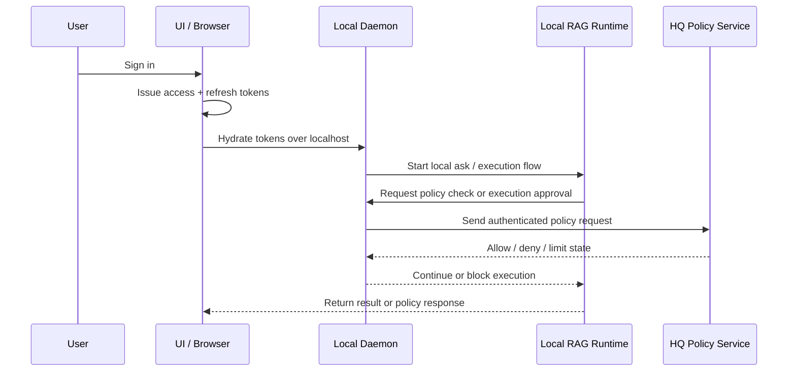

# Local RAG and HQ Authentication Design

## Overview

The UI remains the root controller for user identity. The user logs in through the UI, and that authenticated session is then used to bootstrap the local runtime. The local daemon and the local RAG process are not treated as independent clients with their own login flow; instead, they inherit the UI session through hydrated authentication material.

This keeps the local experience aligned with the existing product model while preserving a secure boundary for policy enforcement and limits.

## Goals

- Keep the UI as the single entry point for authentication.
- Let the local daemon and local RAG runtime operate under the same authenticated identity as the UI.
- Reuse the existing bearer-token and refresh-token model rather than introducing a separate trust model.
- Allow HQ to enforce policy, quotas, and revocation without becoming a second runtime.

## Core Trust Model

1. The user authenticates in the UI.
2. The UI receives an access token and a refresh token.
3. The UI hydrates the local daemon with those tokens over localhost.
4. The local daemon uses the access token when calling HQ for policy or enforcement checks.
5. If the access token is near expiry, the daemon uses the refresh token to obtain a new access token.
6. HQ validates the token and returns policy decisions, limit state, or revocation signals.

This makes the local runtime a delegated extension of the UI session rather than an autonomous client.

## Architecture

### Components

- UI / HTTP server
  - Owns login, session issuance, and refresh handling.
  - Acts as the root controller for user identity.

- Local daemon
  - Runs locally on the user host.
  - Exposes local execution and local ask endpoints.
  - Receives the UI-hydrated access and refresh tokens.
  - Uses those tokens when communicating with HQ.

- Local RAG runtime
  - Uses the shared agent runtime and local configuration.
  - Executes local asks and tool-mediated work on the host.
  - Does not need its own independent user login.

- HQ / policy control plane
  - Receives authenticated requests from the local daemon.
  - Enforces policy, budget limits, and revocation decisions.
  - Does not replace the local runtime; it only governs it.

## Request Flow

## Security Properties

- No independent local login path is required.
- The local daemon inherits the UI session identity.
- Tokens remain short-lived and refreshable.
- HQ can revoke or deny access centrally.
- Communication remains local-first for the agent runtime, with HQ only used for policy coordination.

## Practical API Shape

The initial HQ boundary can remain minimal:

- POST /api/policy/check
  - Validate the supplied access token.
  - Return allow/deny and current policy state.

- POST /api/policy/heartbeat
  - Report local runtime activity and usage.
  - Let HQ update enforcement state.

- POST /api/policy/refresh
  - Exchange a refresh token for a new access token when needed.

These endpoints can reuse the same bearer-token semantics already used by the UI session layer.

## Implementation Notes

- The local daemon should accept hydrated tokens from the UI through a local bootstrap channel such as headers, environment variables, or a small local config payload.
- The daemon should not create a second identity model; it should reuse the same session-token validation logic already present in the UI auth layer.
- HQ should treat the local daemon as a delegated authenticated client, not as a standalone user.
- The UI remains the root of trust for authentication and renewal.

## Planned Product Workflow

The intended product flow is intentionally simple and host-centric:

1. The user signs in through the HQ UI and completes self-registration or onboarding.
2. The UI keeps the default path simple: the HQ experience remains the default until the user explicitly switches to local mode.
3. When local mode is selected, the UI uses the configured local agent URL as the active endpoint when HQ is offline or unavailable.
4. The local daemon is treated as a manually startable host process: the user or installer starts it explicitly, and the UI connects to it once it is available.
5. If the daemon is not reachable, the UI notifies the user that the local agent is unavailable and offers a "Reconnect to local agent" action so the user can retry the connection after fixing the local installation or starting the daemon manually.
6. The UI passes the signed access token, refresh token, and HQ connection context to the daemon over localhost so the daemon can continue using the same authenticated identity without requiring a separate login flow.
7. In the simple/default mode, the daemon does not create its own session lifecycle; it relies on the client-supplied token and renewal metadata.
8. The long-term host integration can optionally let the daemon be registered with the host OS so it can auto-start on login or boot, but the first version only needs reliable manual startup, explicit configuration, and graceful recovery.

This keeps the product straightforward for everyday users while leaving room for richer host-to-HQ integrations later.

## Current Status

The current implementation already has the essential building blocks:

- the UI auth layer supports signed access tokens and refresh tokens,
- the local daemon already exposes local execution and local ask endpoints,
- and the shared agent runtime can be used as the common execution substrate for both the UI and the local host experience.

The remaining work is to wire the UI-hydrated tokens through the daemon and add the authenticated HQ policy boundary.

## New Site / httpserver / local daemon handoff (2026-06-30)

This section captures the current implementation intent for the next pass: the new site experience should allow self-registration, subscription, payment, and onboarding, and then hand the user into the httpserver UI with a compatible, reusable auth session that continues to work with the local daemon on the host.

### Goals

- Reuse the shared sopbackend auth/session/token model rather than introduce a separate identity stack.
- Allow the new site to issue a compatible bearer token and access cookie that httpserver can consume.
- Preserve the user identity, role, subscription plan, and feature list as the session continues from the site into httpserver and then into the local daemon.
- Keep the site backend focused on product onboarding and account state while preserving shared auth and session handling in sopbackend.

### Current state

- The new site accounting and billing state is implemented in [src/backend/siteaccount/account.go](../src/backend/siteaccount/account.go).
- The site endpoints are registered in [src/backend/siteaccount/handlers.go](../src/backend/siteaccount/handlers.go).
- The standalone site backend is served from [src/backend/site/main.go](../src/backend/site/main.go).
- Shared auth/session/token handling remains in [lib/sop/tools/sopbackend/auth.go](../lib/sop/tools/sopbackend/auth.go) and [lib/sop/tools/sopbackend/scripts.go](../lib/sop/tools/sopbackend/scripts.go).

### Required implementation contract

1. Site registration and login create or reuse the same shared session token model used by sopbackend.
2. The token is exposed through the same bearer-token and cookie contract that httpserver expects.
3. When the site redirects to httpserver, the target app receives the same authenticated identity and entitlement context.
4. The httpserver runtime uses the same auth context and feature list to decide which UI and backend capabilities are available.
5. The local daemon receives the same token material over localhost and uses it to continue the authenticated session with the host-side runtime.

### Implementation sequence for the next pass

1. Add a site login path that issues a sopbackend-compatible access token.
2. Return the access token and refresh token through the same response structure expected by the existing session layer.
3. Add a redirect bridge from the site onboarding flow into the httpserver UI with the token preserved in the URL, cookie, or local storage handshake.
4. Ensure httpserver accepts the token through the existing auth middleware without a second login.
5. Add a simple local bootstrap path for the daemon to receive the same token context and continue the session on the host.
6. Add end-to-end tests for registration, login, redirect, httpserver access, and daemon bootstrap.

### Open questions to resolve before implementation

- Should the redirect handoff use a short-lived one-time token or the same long-lived access token?
- Should the daemon bootstrap be header-based, cookie-based, or environment-based for the first implementation?
- Should the site maintain a separate onboarding session state or rely entirely on the shared sopbackend session state?

### Pause/resume notes

When work pauses, the implementation should resume from the auth-handoff boundary described above. The expected shape is:

- site registration/login → shared session token issued,
- site → httpserver redirect with same auth context,
- httpserver → daemon bootstrap with same token material,
- all using the shared sopbackend auth/session and entitlement model.
