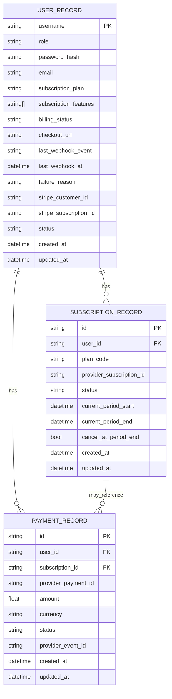
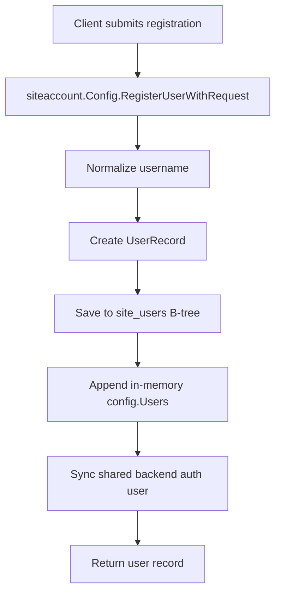
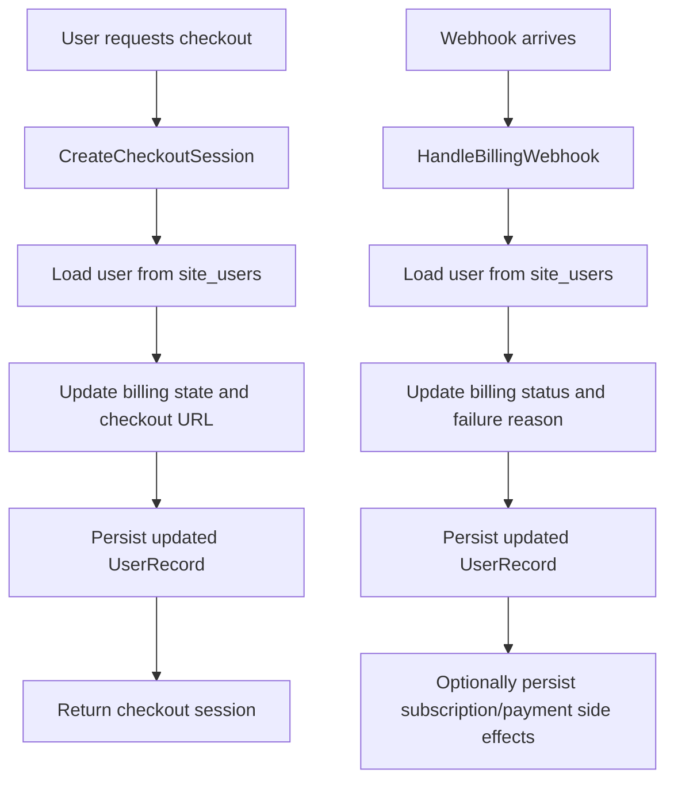

# Site Account Storage Review

This note documents the current site-account persistence model for review. It focuses on the key/value structures, the B-tree-backed stores, and the relationships between them.

## Summary

The site account backend persists three independent SOP B-tree stores:

- Users store: string key -> UserRecord
- Subscriptions store: string key -> SubscriptionRecord
- Payments store: string key -> PaymentRecord

Each store is backed by a string key and a typed value record. The stores are created and opened through the shared SOP database layer using the site-specific store names.

## Store Map

| Store | Key type | Value type | Store name | Purpose |
| --- | --- | --- | --- | --- |
| Users | string | UserRecord | site_users | Stores account identity and billing state |
| Subscriptions | string | SubscriptionRecord | site_subscriptions | Stores billing subscription rows |
| Payments | string | PaymentRecord | site_payments | Stores payment events and outcomes |

## Key / Value Structures

### UserRecord

Key: normalized username string

Value fields:

- Username
- Role
- PasswordHash
- Email
- SubscriptionPlan
- SubscriptionFeatures
- BillingStatus
- CheckoutURL
- LastWebhookEvent
- LastWebhookAt
- FailureReason
- StripeCustomerID
- StripeSubID
- Status
- CreatedAt
- UpdatedAt

This is the primary identity record used by login, registration, status lookup, and checkout/billing updates.

### SubscriptionRecord

Key: subscription ID string

Value fields:

- ID
- UserID
- PlanCode
- ProviderSubscription
- Status
- CurrentPeriodStart
- CurrentPeriodEnd
- CancelAtPeriodEnd
- CreatedAt
- UpdatedAt

This stores one subscription row per billing subscription.

### PaymentRecord

Key: payment ID string

Value fields:

- ID
- UserID
- SubscriptionID
- ProviderPaymentID
- Amount
- Currency
- Status
- ProviderEventID
- CreatedAt
- UpdatedAt

This stores one payment row per billing/payment event.

## Relationships

The three stores are related by business identity rather than by a single shared parent object:

- A user can have zero or more subscriptions.
- A user can have zero or more payments.
- A payment may optionally reference a subscription.
- Subscription and payment rows are discovered by user-scoped list methods using the UserID field.
- For bridge-style relationship stores, developers can call `StoreOptions.SetRelation(...)` to attach relation metadata and AI-oriented hints directly from the store configuration layer.

## ERD

## Flow: Registration and Persistence

## Flow: Checkout and Billing Update

## Notes for Review

- The model is intentionally simple: each record is persisted independently and looked up by a string key.
- The current implementation uses the user name as the primary lookup key for the user store and the record ID for subscription/payment stores.
- The relationships are currently enforced by application logic rather than by a relational database schema.
- The site account store is currently a key/value persistence layer, not a fully normalized relational model.
