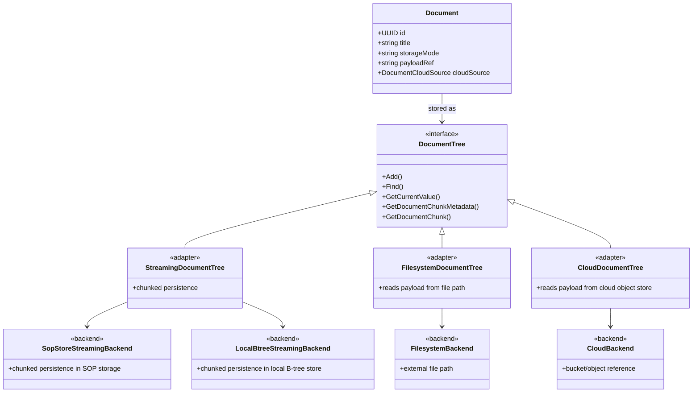

# Streaming document storage for space items

This document describes the private overlay behavior for document storage in spaces. It is focused on the additional document semantics and storage modes that this repository adds on top of the shared public SOP engine.

## Document backend architecture

The document model should be organized around a common abstraction, with different backends implementing the same document semantics.

The important design point is that the chunked document strategy should be shared across the local streaming implementations, while the storage backend differs:

- SOP Store Streaming: chunk persistence in the SOP storage layer
- Local B-tree Streaming: chunk persistence in a local B-tree-backed store
- Filesystem Reference: payload read from an external filesystem path
- Cloud Reference: payload resolved from a cloud object reference

## Summary

Space items can now be modeled with three document-storage modes:

1. Streaming store persisted file with DocID reference
   - The file payload is stored through the streaming store and is addressed through a stable document ID.
   - This allows SOP to treat the content as a first-class streamed object while still exposing a DocID-based reference path.
   - It is ideal for large files that should be persisted in a chunked local or embedded store but also referenced by ID.

2. Local streaming document persisted in Space
   - The payload is stored natively in the knowledge-base document store.
   - Content is persisted as ordered chunks so small files and very large uploads can use the same path.
   - The document is owned by the space item and should be removed when the item is deleted.

3. Externally stored file with metadata persistence
   - The physical file remains in external storage such as Apple Cloud, Google Cloud Storage, or another object store.
   - SOP processes the file, extracts metadata, indexes it, and persists the derived knowledge and reference information.
   - The external store remains the source of truth for the physical bytes.

## Product framing

Cloud object storage such as Google Cloud Storage or Apple Cloud Storage can be used as a thin payload backend for raw document bytes. SOP continues to provide the differentiating value layer:

- document indexing,
- chunking and segmentation,
- vectorization,
- semantic search,
- retrieval and grounding,
- document-to-item provenance and lifecycle management.

In other words, object storage is the cheap persistence layer for the asset, while SOP remains the intelligent retrieval and knowledge layer.

This also supports a lean commercial model for Spaces:

- users bring their own LLM credentials (BYOK),
- users bring their own cloud asset storage (BYOC),
- SOP provides the rich Space intelligence layer and can be offered at a modest subscription price such as $5–$10 per month for the platform experience.

That keeps infrastructure costs low while preserving a strong value proposition around semantic memory, retrieval, and knowledge-work workflows.

## UI and cloud-storage experience

From a product perspective, this model enables a richer file experience in the UI:

- the user can select a file from cloud storage directly from the Space experience,
- the system can detect that the file is cloud-backed and classify it as an external or streaming-backed document,
- SOP can process the file to generate metadata, chunk information, previews, and indexing signals,
- the same document abstraction can power a more immersive experience for media and large assets,
- because the content is chunked and stream-friendly, the UI can support progressive loading, resumable playback, and better streaming behavior for video, audio, and large documents.

This is especially valuable for media workflows. A user could open a large video or audio file and receive a smoother experience because the client can fetch and play content in a chunked fashion instead of waiting for the entire payload to be downloaded. If the stream is interrupted, the system can resume from the last known offset more naturally. That creates a stronger product story around intelligent media handling, not just raw storage.

## Competitive positioning

There is some competition in the general document-storage and media-asset space, but much of it focuses on raw storage, indexing, or file hosting rather than the higher-order knowledge layer that SOP provides.

Where SOP is differentiated is in the combination of:

- semantic search across documents and media assets,
- nested-category understanding and retrieval,
- document-to-item provenance,
- chunk-aware intelligence over large content,
- and a knowledge graph style experience for organizing and grounding work.

In other words, the value is not just "where the file lives," but "how the file becomes part of an intelligent, searchable, semantically organized workspace." That makes the offering more akin to a knowledge operating layer than a simple cloud storage product.

## Implementation notes

The same document abstraction can support both internal streaming payloads and external cloud-backed payloads:

> Design rule: keep document chunk access APIs explicit. Do not use context.Context as a generic parameter bucket for ordinary values such as document IDs or chunk indexes; pass those values directly and keep the API readable.

### Apple Cloud upload flow

A first-class Apple Cloud upload path can be represented as an external metadata-only document with an Apple Cloud provider hint:

- create a document with `storage_mode: external_metadata_only`,
- populate `payload_ref` with an Apple Cloud-style reference such as `applecloud://container/object-key`,
- populate `cloud_source.provider` as `apple_cloud`, and
- preserve the object key, bucket/container, and access hint so the caller can resolve the asset later.

This lets SOP treat the upload as a semantic document reference while keeping the physical bytes in Apple Cloud. The rest of the pipeline can continue indexing, summarizing, and searching the document without needing to duplicate the payload locally.

- document indexing,
- chunking and segmentation,
- vectorization,
- semantic search,
- retrieval and grounding,
- document-to-item provenance and lifecycle management.

In other words, object storage is the cheap persistence layer for the asset, while SOP remains the intelligent retrieval and knowledge layer.

## Why this model

This keeps the document flow flexible while preserving the current external-document experience:

- Simple inline documents can be stored directly and retrieved through the internal viewer.
- Large uploads and blobs can be streamed into chunked storage without special casing.
- External documents continue to work as references without being implicitly owned or deleted by the space item.

## Storage semantics

The document path should be selected by a storage-mode flag or equivalent field, for example:

- `internal_streaming`
- `external_ref`

The item should carry the document identifier/reference and the storage mode so the persistence layer can decide whether to:

- create or update a streaming-backed internal document,
- or treat the document as an external reference only.

## Lifecycle rules

- Internal streaming document
  - created when the user uploads or saves internal document content,
  - updated when the content changes,
  - deleted when the owning space item is deleted.

- External document reference
  - created from an existing document identifier or URL,
  - not copied into the internal chunked store,
  - not deleted when the owning item is deleted unless the caller explicitly requests it.

## Future-facing capability: chunk-aware mutation semantics

A longer-term extension is to let SOP expose richer chunk-level mutation semantics for documents that are backed by cloud object storage. In other words, the system could eventually support operations such as updating a specific logical chunk (for example, chunk 4) while still using a cloud-backed payload as the underlying storage mechanism.

This would be a meaningful differentiator versus raw object storage because SOP would maintain a higher-level document lifecycle model with chunk-aware update semantics, versioning, and selective reassembly rather than treating every document as a single opaque blob. Cloud providers may only expose whole-object upload or byte-range operations, but SOP can still provide a cleaner abstraction for document editing and incremental updates.

For now, this is intentionally documented as a future capability rather than an immediate requirement. The near-term focus remains on:

- creating canonical document references from space items,
- indexing and searching document content,
- supporting internal streaming persistence,
- and establishing the base abstraction for external metadata-only documents.

## Design plan

### Goal
Use a streaming-backed B-tree for document payloads so SOP can support small files and very large assets through the same local persistence path. At the same time, support two reference-oriented modes:

- a DocID-backed streaming store path for persisted files, and
- an external metadata-only path for files that stay in cloud storage while SOP preserves their semantic value.

### Core architecture

1. Streaming store with DocID reference
- The document payload is written into a streaming B-tree as ordered chunks.
- The content is addressed through a stable DocID reference that can be used by the Space and the document model.
- Chunks are stored with stable indices and metadata so they can be read back deterministically.
- This path is ideal for large files that should be persisted locally or in a streaming-aware store but still referenced through SOP’s document ID system.

2. Local streaming document persisted in Space
- The payload is stored natively in the knowledge-base document store.
- The document is owned by the Space item and participates in the same document lifecycle as other local documents.
- This path is ideal for uploaded content that should remain fully managed inside the Space.

3. External metadata-only cloud document
- SOP stores the file’s metadata, provenance, indexing state, and optional chunk summaries.
- The actual bytes remain in cloud storage such as object storage or a user-managed bucket.
- SOP still adds value through semantic search, nested-category retrieval, previews, metadata extraction, and knowledge-layer organization.
- This path is ideal for files that already live in cloud storage and should be surfaced in Spaces without duplicating payloads.

4. Shared document abstraction
- Every document has a stable SOP document ID.
- The storage mode decides whether the payload is persisted locally, referenced through a streaming store, or only represented by external metadata.
- The higher-level document model remains unchanged for indexing, search, and UI consumption.

### Data model
Add a storage-mode field and a cloud-reference block to the document model:

- `storage_mode`: `streaming_store_docid`, `space_local_streaming`, or `external_metadata_only`
- `payload_ref`: DocID or external object reference depending on the selected mode
- `cloud_source`: provider, bucket/container, object key or URL, optional access hint
- `content_metadata`: MIME type, file size, checksum, duration, preview state, extracted text, chunk metadata
- `ownership`: whether the document is owned by the current Space item or just referenced

### Persistence plan

- Introduce a small storage adapter interface for documents:
  - `Write(payload)`
  - `Read(offset, length)`
  - `Delete()`
  - `Stat()`
- Expose chunk metadata through the API so a client can reference a specific chunk by document ID and chunk index when needed.
- Keep the chunk-index semantics internal for simple callers, but make them available for advanced use cases such as selective retrieval, resume points, and partial streaming.
- Implement one adapter for the local streaming B-tree path.
- Implement one adapter for the metadata-only cloud path that stores metadata and references without copying the payload.
- Keep the rest of the system unaware of the storage detail by routing all document access through the same document API.

### API and UX flow

- Streaming-store import: create a document in `streaming_store_docid` mode, persist the payload through the streaming store, and expose it through a DocID-based reference.
- Local upload: create a document in `space_local_streaming` mode and write chunks into the streaming B-tree.
- Cloud import: create a document in `external_metadata_only` mode and store the source reference plus metadata.
- Apple Cloud upload: create a document in `external_metadata_only` mode with `cloud_source.provider=apple_cloud` and keep the Apple object reference in `payload_ref` for downstream resolution.
- Retrieval: if the payload is local or stream-backed, reconstruct from chunks; if it is cloud-backed, resolve the cloud object and stream or proxy it as needed.
- UI: present all three paths through the same document experience, with richer metadata and indexing regardless of where the bytes live.

### Lifecycle and governance

- Streaming-store documents are owned by the Space item only if the caller chooses that semantics; otherwise they remain as DocID-backed references.
- Local streaming documents are owned by the Space item and should be removed when the item is deleted.
- External metadata-only documents remain as references unless explicitly removed.
- Access control and credentials for cloud storage should be handled outside the core document model, but the document should carry enough metadata to resolve the source safely.

### Rollout phases

- Phase 1: Implement the streaming-store DocID path and the local Space streaming path on top of the streaming B-tree.
- Phase 2: Add external metadata-only references and indexing for cloud-backed files.
- Phase 3: Expose the storage mode in the UI and support previews, chunk-aware streaming, and resumable access.
- Phase 4: Add authentication, policy controls, and richer media playback experiences.

## Expected outcome

This gives the space-document feature a single flexible foundation:

- the same document ID can represent either an owned internal stream or an external reference,
- the storage path remains simple for small files,
- and large binary or text payloads can grow into chunked storage without changing the higher-level document model.
