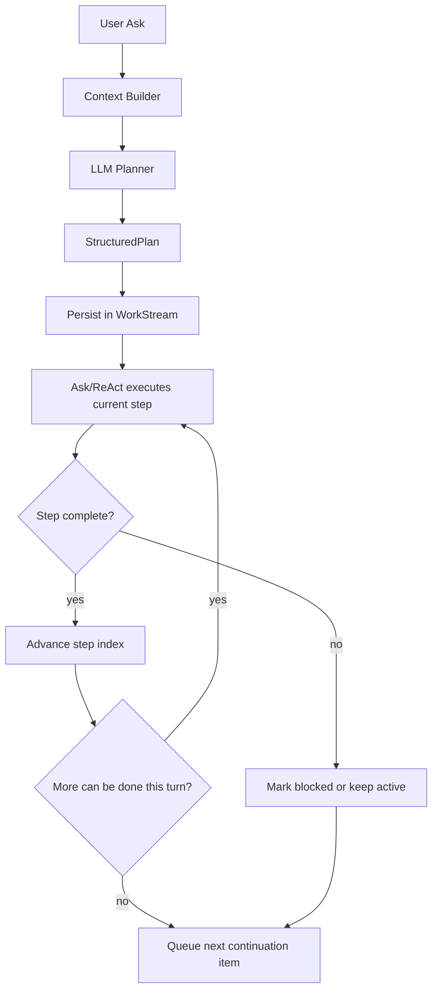

# Structured Planner Execution Design

**Status**: Proposed and ready for implementation  
**Priority**: High  
**Last Updated**: 2026-08-16

---

## Purpose

This document defines the next structured planning and execution milestone across ALL domains:

1. The planner must use the LLM to generate a strong, structured execution plan.
2. The workstream must persist that plan and execute it from step 1 through completion.
3. Ask/ReAct should complete as much of the current plan as possible in one turn.
4. The queue should continue the plan only when a later turn is genuinely needed.

This is the missing layer between retained phase/workstream artifacts and high-quality architect/fixer/coder/operator behavior.

---

## Problem

The current system already retains most phase-era infrastructure:

- `PhasePlan` persists in workstream state.
- phase artifacts persist in workstream and workflow memory.
- Ask remains the controller.
- coding prompts can now render an execution brief.

However, the current planner path still has two core limitations:

1. The planner contract returns `[]string`, which is too weak for architectural or repair-quality execution.
2. The runtime does not yet execute a persisted plan step-by-step with explicit step state.

As a result:

- the LLM sees helpful plan text, but not a fully operational plan artifact,
- the plan does not yet carry rich structural context,
- and the workstream does not yet advance explicit step state from tool outcomes.

---

## Goal

For substantial asks across Coding, Stores, Spaces, and Desktop:

1. Build a domain-aware context pack.
2. Ask the LLM planner to generate a typed structured plan.
3. Persist that plan in the active workstream.
4. Render the current step into the Ask prompt.
5. Execute, validate, and advance the current step.
6. Continue in the same Ask/ReAct turn when possible.
7. Persist and queue only the next meaningful continuation when another turn is needed.

---

## Non-Goals

- Do not enqueue the full plan up front.
- Do not reintroduce a controller loop that executes all steps outside Ask.
- Do not replace code-aware context building with naive vector-only retrieval.
- Do not rely on heuristic workflow templates as the main source of step semantics.

---

## Design Principles

### 1. LLM authors semantics, runtime authors state

The LLM should decide:

- subsystem and file focus
- contracts and invariants
- evidence to collect
- decision rules
- allowed change scope
- validation and exit criteria

The runtime should decide:

- current step index
- step status transitions
- whether current turn should continue
- whether to enqueue continuation

### 2. Structural context over workflow labels

The plan must carry structural context instructions, not only workflow sequencing.

Examples:

- coding: primary files vs supporting files, symbols, interfaces
- stores: target stores, schema assumptions, relation boundaries
- spaces: target spaces, content scope, retrieval and mutation boundaries
- desktop: working directory, command environment, filesystem scope
- contracts and invariants that must remain true
- decision rules for the current domain task
- allowed scope for the current step

### 3. Ask is still the controller

The plan is executed through Ask/ReAct, not outside it.

- One Ask turn should solve the task when possible.
- Multi-turn plans should continue through the queue one continuation item at a time.

### 4. Phase state is internal execution context, not transport ceremony

Phase state is still useful, but it should be treated as internal orchestration context rather than a required conversational transport protocol.

- Keep phases as durable internal state for continuity, tool shaping, and guidance.
- Let Ask move through investigation, planning, and execution emphasis internally when the current turn can keep going.
- Do not force explicit phase hops when the next local step is still actionable in the current Ask/ReAct loop.
- Only externalize a phase or step continuation when a real later-turn boundary exists.

This means the runtime should optimize for plan-following execution, not workflow ceremony.

---

## Target Architecture



---

## Planner Output Schema

The planner should stop returning plain `[]string` and return a typed `StructuredPlan`.

### Top-Level Shape

```json
{
  "objective": "string",
  "workflow_shape": "repair|feature|refactor|migration|design_implementation|other",
  "domain": "coding_workflow|stores|spaces|desktop|cross_domain",
  "system_context": {
    "subsystem": "string",
    "primary_targets": ["string"],
    "supporting_targets": ["string"],
    "interfaces": ["string"],
    "contracts": ["string"],
    "invariants": ["string"],
    "domain_constraints": ["string"]
  },
  "steps": [
    {
      "step_id": "string",
      "goal": "string",
      "files": ["string"],
      "evidence_to_collect": ["string"],
      "decision_rule": "string",
      "allowed_change_scope": "string",
      "action_instruction": "string",
      "validation": ["string"],
      "exit_criteria": ["string"],
      "escalate_if": ["string"],
      "status": "pending|active|complete|blocked",
      "notes": ["string"]
    }
  ],
  "completion_gate": {
    "requirements": ["string"]
  }
}
```

### Why this shape

- `system_context` makes the planner act like an architect, not just a step sequencer.
- `decision_rule` lets the LLM express problem-specific judgment explicitly.
- `allowed_change_scope` narrows editing behavior.
- `validation` and `exit_criteria` let runtime evaluate progression later.
- `domain` plus generic targets allow the same schema to drive Coding, Stores, Spaces, and Desktop.

---

## Domain-Agnostic Execution Model

The planner and workstream execution model should be shared across domains. Only the context pack, tool surface, and domain constraints differ.

### Shared mechanics

All domains should use the same core loop:

1. Build grounded domain context.
2. Ask the LLM planner for a structured master plan.
3. Persist the plan in the active workstream.
4. Execute the current step through Ask/ReAct.
5. Advance step state from tool outcomes.
6. Continue in-turn when possible, otherwise queue one continuation item.

The important constraint is that the loop above does not require explicit user-visible phase hopping. Phase state can remain internal while Ask executes through the current step and adjacent local work.

### Domain adapters

Each domain should provide a narrow adapter that fills the shared schema from domain-specific evidence.

#### Coding adapter

- primary targets: files and symbols
- supporting targets: tests, dependencies, interfaces
- constraints: patch scope, contracts, invariants, validation seams

#### Stores adapter

- primary targets: database and stores
- supporting targets: related stores, schema paths, relations
- constraints: read/write intent, transaction boundaries, query safety, result verification

#### Spaces adapter

- primary targets: spaces, categories, content scope
- supporting targets: retrieved items, semantic neighbors, mutation destinations
- constraints: retrieval quality, mutation boundaries, semantic integrity, verification strategy

#### Desktop adapter

- primary targets: working directory, files, commands
- supporting targets: environment, toolchain, shell context
- constraints: safety boundaries, command scope, OS/runtime assumptions, validation commands

### Cross-domain asks

For multi-domain tasks, the plan should still be a single `StructuredPlan` with:

- `domain: cross_domain`
- a shared objective
- per-step domain ownership encoded in step notes or future explicit `step_domain`
- continuation coordinated by Ask as the single controller

---

## Context Supplied to the Planner

The LLM planner should receive a grounded planning prompt assembled from `Task + RunState + ContextPack`.

Minimum inputs:

- task description
- active target (file, store, space, directory, command scope)
- related targets
- dependency targets
- validation targets
- structure summary
- relevant symbols, interfaces, schema paths, or retrieved items
- repository or domain summary
- prior paths or continuation summary
- expertise summary and sources when present

The planner prompt should explicitly instruct the LLM to:

- identify the subsystem and key targets
- infer the relevant contracts, constraints, and invariants
- produce operational steps with evidence, decision rules, and validation
- keep the plan narrow and executable
- avoid broad speculative rewrites

---

## Workstream Persistence Model

The structured plan must persist in the active workstream rather than living only inside prompt text.

### New persisted state

Add a first-class plan field to workstream state, rather than overloading only the execution brief.

Suggested fields:

```go
type StructuredPlan struct {
    Objective      string
    WorkflowShape  string
  Domain         string
    SystemContext  StructuredSystemContext
    Steps          []StructuredPlanStep
    CurrentStep    int
    CompletedSteps []string
    CreatedAt      int64
    UpdatedAt      int64
}
```

Each step should persist:

- status: `pending|active|complete|blocked`
- execution notes
- validation outcome summary
- updated timestamp

### Why first-class persistence matters

- resume after crash or restart
- queue continuation with exact current step
- phase changes do not destroy execution detail
- prompt can stay compact by rendering only current and nearby steps

---

## Execution Model

### In-turn behavior

Given a persisted `StructuredPlan`, Ask should:

1. Load the active workstream.
2. Read the structured plan and current step index.
3. Render the current step and minimal nearby context into the prompt.
4. Let the provider-owned ReAct loop execute tools.
5. After tool results, evaluate whether the current step completed.
6. If complete and the next step is still locally actionable, continue in the same turn.
7. Otherwise persist and stop.

### Internal phase progression

The runtime may still keep phase state such as investigation, planning, and execution, but that state should normally be internal.

- A step can imply a phase emphasis without requiring a separate visible handoff.
- The prompt should focus on objective, structural context, current step, allowed scope, and validation.
- Explicit phase transitions should be treated as continuity checkpoints, not the main unit of user-visible progress.

### Multi-turn behavior

Use the queue only when:

- clarification is required
- approval gate blocks continuation
- a real checkpoint is reached
- validation failed and re-planning is needed
- turn budget or provider constraints require another Ask turn
- the user paused or resumed later

### Queue rule

Enqueue only the next meaningful continuation item.

Do not enqueue every step or every phase up front.

---

## Step Advancement Policy

Step advancement should be deterministic and narrow.

### Step state transitions

- `pending` → `active`
- `active` → `complete`
- `active` → `blocked`
- `blocked` → `active` after re-plan or clarification

### Completion inputs

Completion can be inferred from:

- targeted tool success
- captured validation evidence
- explicit test or compiler results
- plan-specific exit criteria satisfied

### Important constraint

The runtime should not re-author step semantics.

It should only answer:

- is there enough evidence to mark this step complete?
- if not, is it blocked or still active?

---

## Implementation Plan

### Phase 1: Introduce typed structured plan

Files:

- `lib/sop/ai/agent/codingworkflow/shared_infrastructure.go`
- `lib/sop/ai/agent/codingworkflow/workflow_types.go`
- `lib/sop/ai/agent/memory_shortterm.go`

Changes:

- add `StructuredPlan` and step types
- add persistence fields to workstream state
- keep old `[]string` plan path only as temporary fallback

### Phase 2: Add LLM-backed planner

Files:

- `lib/sop/ai/agent/codingworkflow/default_components.go`
- `lib/sop/ai/agent/planner/phase_coding.go`
- planner prompt helper file to be added under `lib/sop/ai/agent/codingworkflow/`

Changes:

- introduce `LLMPlanner`
- feed a domain-aware `ContextPack` into a strict JSON planning prompt
- parse into `StructuredPlan`
- persist in planning artifact `structured_data`

### Phase 2A: Add domain adapter layer

Files:

- domain-specific planning adapter files under `lib/sop/ai/agent/`
- shared planner prompt helper file under `lib/sop/ai/agent/codingworkflow/`

Changes:

- map Coding, Stores, Spaces, and Desktop context into the common planning schema
- keep the planner shared while letting each domain contribute constraints and examples

### Phase 3: Render structured plan in Ask

Files:

- `lib/sop/ai/agent/ask_execution_brief.go`
- `lib/sop/ai/agent/focused_context.go`
- `lib/sop/ai/agent/copilot_prompt.go`

Changes:

- derive execution prompt context from `StructuredPlan`
- show current step, nearby context, contracts, invariants, validation, and scope
- keep plan rendering compact enough to survive prompt budget trimming

### Phase 4: Step-state advancement

Files:

- `lib/sop/ai/agent/ask_pipeline.go`
- provider loop integration points where tool results are already returned

Changes:

- evaluate current step completion after tool results
- advance `CurrentStep`
- persist step status and notes
- continue same-turn execution when safe

### Phase 5: Queue continuation from step state

Files:

- `lib/sop/ai/agent/ask_pipeline.go`
- work queue integration points

Changes:

- enqueue one continuation item when another turn is needed
- continuation item resumes from current step index
- use step state, not just phase label, as the continuation anchor

---

## Testing Strategy

### Unit tests

- planner prompt parsing returns a valid `StructuredPlan`
- authored plan persists in workstream memory
- current step is rendered into prompt
- step completion advances state correctly
- queue continuation resumes at the right step

### Scenario tests

- fix failing tests
- bounded bug fix
- refactor with preserved behavior
- feature implementation with multiple slices
- stores read-plan followed by execute-script workflow
- spaces retrieval plus mutation workflow
- desktop inspect-plan-execute workflow
- crash and resume mid-plan

### Regression guardrails

- Ask can still finish a bounded task in one turn
- queue is not used for every micro-step
- plan survives prompt-budget trimming by rendering current-step-first

---

## Open Questions

1. Should the structured plan live directly on `WorkStreamContext`, or nested under `PhasePlan` for temporary compatibility?
2. Should completion evaluation be explicit tool-authored evidence first, heuristic second?
3. How much of `system_context` should be rendered every turn versus only at checkpoints?
4. Should we keep the current execution brief type as a prompt-view adapter over `StructuredPlan`, or replace it entirely?
5. Do we add `step_domain` now for cross-domain steps, or defer until multi-domain execution is implemented?
6. Should capability inclusion differ at build time between HQ and daemon binaries so non-target capabilities are omitted from the binary instead of only skipped at runtime?

---

## Implementation Fitness Checklist

Use this checklist during implementation to ensure the new planner/workstream execution model stays aligned with the existing domain-agnostic capability and phase design.

### Shared model fitness

- [ ] New plan types use domain-neutral names such as `primary_targets` or equivalent, not coding-only names such as `test_files` at the top level.
- [ ] The planner contract is shared across Coding, Stores, Spaces, and Desktop.
- [ ] Step schema remains generic: goal, evidence, decision rule, allowed scope, action instruction, validation, exit criteria, escalation.
- [ ] Queue and workstream continuation operate on structured step state, not only coding-specific assumptions.
- [ ] Prompt rendering is treated as a projection of durable plan state, not as the source of truth.

### Domain adapter fitness

- [ ] Coding-specific details live in a Coding adapter, not in the shared plan core.
- [ ] Stores-specific details live in a Stores adapter, not in the shared plan core.
- [ ] Spaces-specific details live in a Spaces adapter, not in the shared plan core.
- [ ] Desktop-specific details live in a Desktop adapter, not in the shared plan core.
- [ ] Domain adapters only provide context, constraints, examples, and tool interpretation hooks; they do not fork the shared execution semantics.

### Workstream and Ask fitness

- [ ] Ask remains the controller for every turn.
- [ ] One Ask/ReAct turn can still complete the task when the next steps are locally actionable.
- [ ] The queue is used only for coarse continuation boundaries, not every micro-step.
- [ ] Step advancement persists explicit state: current step, step status, and validation notes.
- [ ] The runtime never needs to recreate the plan from scratch if the process crashes and resumes.

### Review questions before merging implementation

1. Did we add any type or field that only makes sense for coding and should instead be domain-neutral?
2. Did any queue, phase, or step advancement logic assume coding-specific behavior that should live in an adapter?
3. Can the same plan schema express a Stores investigation-to-execution workflow and a Spaces retrieval-to-mutation workflow without special-case redesign?
4. Can the active plan survive restart and resume without relying on prompt-only state?
5. If a user switches from Coding to Stores or Spaces, does the same planning/execution engine still make sense with only adapter changes?

---

## Recommended Decision

- keep `PhasePlan` for compatibility and phase continuity
- add `StructuredPlan` as the new durable execution contract
- treat `ExecutionBrief` as a prompt-facing projection of `StructuredPlan`
- treat task-mode wording as an optional compatibility layer rather than a permanent architectural requirement
- treat phase state as internal execution context, not a required transport protocol

This preserves existing phase/workstream investment while finally making the plan operational.

---

## Resume After Crash

If work stops mid-implementation, resume in this order:

1. Read this document.
2. Confirm current code state in:
   - `lib/sop/ai/agent/codingworkflow/shared_infrastructure.go`
   - `lib/sop/ai/agent/codingworkflow/default_components.go`
   - `lib/sop/ai/agent/planner/phase_coding.go`
   - `lib/sop/ai/agent/memory_shortterm.go`
   - `lib/sop/ai/agent/ask_execution_brief.go`
   - `lib/sop/ai/agent/focused_context.go`
   - `lib/sop/ai/agent/ask_pipeline.go`
3. Check whether `Planner.Plan(...)` still returns `[]string`.
   - If yes, resume at Phase 1 above.
4. Check whether `WorkStreamContext` has a first-class `StructuredPlan` field.
   - If no, implement persistence before step advancement.
5. Check whether prompt rendering is still reading only `ExecutionBrief`.
   - If yes, convert it into a projection over `StructuredPlan`.
6. Do not start queue continuation work before step-state persistence exists.

### Resume Checklist

- [ ] `StructuredPlan` type added
- [ ] planner interface updated
- [ ] LLM-backed planner implemented
- [ ] planning artifact persists structured plan
- [ ] workstream persists current step and statuses
- [ ] Ask prompt renders current step from persisted plan
- [ ] step completion advances state
- [ ] queue resumes from step state

### Future TODO

- [ ] Add build-time capability inclusion policy:
  - HQ builds should import/include only HQ-relevant capabilities by default (for example Stores and Spaces).
  - daemon builds should import/include only local-runtime capabilities by default (for example Coding and Desktop).
  - Runtime registration flags are not enough if the goal is to omit capability code from the final binary; use target-specific registration files or build tags.

---

## Short Summary

The next milestone is not “more workflow.”

It is:

- LLM-authored structured plans
- persisted in workstream state
- executed step-by-step by Ask
- continued by queue only when another turn is necessary

And this should be domain agnostic:

- shared planning and execution semantics
- domain-specific context adapters and tool surfaces

That is the missing path from retained phase artifacts to high-quality architect/fixer/coder behavior.