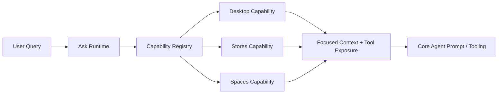

# SOP Agent Framework

The SOP Agent Framework (`ai/agent`) is a powerful system for building autonomous agents that can execute complex workflows, interact with databases, and orchestrate multi-step tasks.

## Core Concepts

### 1. Scripts ("Natural Language Programming")
Scripts (formerly Scripts) are the building blocks of agent behavior. They are JSON-based functional scripts that define a sequence of steps.
*   **Compiled Instructions**: Scripts are parsed and executed by the `Service`.
*   **Inspectable**: Tools and steps are defined in a registry, allowing for validation and introspection.

### 2. Swarm Computing (Async Execution)
The framework supports "Swarm Computing" by allowing steps to run in parallel.
*   **Async Steps**: Any step can be marked as `"is_async": true`.
*   **Transaction Isolation**: Async steps are **detached** from the parent transaction. They must start their own transaction if they need to write to the database. This prevents race conditions and allows for "In-Flight Data Merging" at the storage layer.
*   **Nested Swarms**: A step of type `call_script` can be run asynchronously even if the parent script is in a transaction. The nested script will start with a detached context and can establish its own transaction (e.g., on a different database), enabling powerful hierarchical agent swarms.
*   **Safeguards**: For non-script steps (like `command` or `set`), the system enforces synchronous execution if an active transaction exists to prevent accidental data corruption.
*   **Error Propagation**: By default, if an async step fails, it cancels the entire group. You can override this with `"continue_on_error": true`.

### 3. Transaction Inheritance (Subroutines)
If a nested script is run **synchronously** (`"is_async": false`) and does **not** specify a different database, it acts as a **Subroutine**.
*   **Inheritance**: It inherits the parent's active transaction.
*   **Atomicity**: Operations in the subroutine are part of the parent's atomic unit of work. If the subroutine fails, the parent transaction rolls back.

### 4. Saga Pattern (Multi-Database Workflows)
SOP encourages the **Saga Pattern** for workflows that span multiple databases. Instead of a single distributed transaction (which is complex and brittle), you chain scripts where each script operates on a specific database.

*   **Database-Scoped Scripts**: A script can specify a `"database"` field.
*   **Automatic Transaction Wrapping**: When a script specifies a database, the system automatically:
    1.  Switches the context to that database.
    2.  Starts a new transaction (`ForWriting`).
    3.  Commits the transaction if the script succeeds.
    4.  Rolls back if it fails.

### 4. Tool Registry
Tools are no longer hardcoded strings. They are defined in a structured `Registry`.
*   **Definition**: Tools have a Name, Description, Argument Schema, and a Go Handler function.
*   **Discovery**: Agents can dynamically list and inspect available tools to generate their system prompts.

### 5. Plug-and-Play Capabilities for Ask
Ask now supports a modular capability layer that keeps domain behavior out of the core runtime and makes it easy to add or remove capabilities without changing the orchestration engine.
*   **Capability Contract**: Each domain module implements a small interface that can classify requests, contribute domain-relevance signals, and provide focused context, tools, and instructions for Ask.
*   **Classification-First Composition**: Ask consults capabilities early in the pipeline. Each capability can mark the request as primary, supporting, or fallback-relevant so the runtime can compose the relevant prompt material before execution.
*   **Additive Participation**: Mixed-domain requests can involve multiple capabilities at once. For example, a query may need Stores and Spaces context together, or Stores plus CommandLine context, rather than forcing a single winner.
*   **Routing State**: The runtime passes lightweight routing input such as domain and gate information, rather than relying on implicit context state inside the core Ask pipeline.
*   **Entitlements and Enablement**: Capabilities can declare premium or default-enabled behavior, and the registry filters them according to the active entitlement map.
*   **Runtime Extension**: New domains can be introduced by registering a capability implementation, enabling support for web research, custom verticals, or other services without branching the core Ask pipeline.
*   **Shared Runtime**: The same capability-aware runtime is used by the daemon and httpserver entry points, keeping behavior consistent across both surfaces.
*   **Deployment Scope**: Coding-workflow capabilities should remain local-runtime scoped. HQ/site-server deployments should not expose them as a general capability path, while end-user host runtimes or local daemons may register them for local editing and repo-aware workflows.



### 6. Explicit Transaction Management
While automatic transaction wrapping (Saga Pattern) is recommended for most cases, you can still manage transactions explicitly using the `manage_transaction` tool. This is useful when:
*   **Minimizing Lock Time**: You want to perform heavy AI processing or external API calls *outside* of a transaction, and only wrap the database writes.
*   **Multiple Transactions**: A single script needs to perform multiple independent commits.
*   **Inherited Context**: You are running a script without a specific `database` field and want to control the transaction on the inherited database connection.

### 7. Generalized Workflow Capability
The shared general workflow module is a distinct architectural layer from the coding workflow capability. The layout is:
*   **Shared general workflow module**: owns task classification, context assembly, planning, continuation-aware state, and the execution-result contract.
*   **Coding workflow capability**: one domain-facing adapter that routes code-editing and repo-oriented requests into the shared module.
*   **Stores and Spaces capabilities**: other domain-facing adapters that can also route generation and analysis requests through the same module.

This shared model supports three reusable task modes:
*   **Code**: repository edits, symbol-aware changes, patch application, and test validation.
*   **Generation**: structured artifact creation such as JSON, LEGO-style scripts, and other schema-driven outputs used in Stores and Spaces.
*   **Analysis**: table/record inspection, chunked data exploration, hypothesis formation, and solution discovery.

The important design point is that the general workflow engine is not “the coding workflow capability.” It is the reusable foundation, and the coding workflow capability is simply one consumer of that foundation.

### Workflow instruction payloads should be data-driven
For workflows such as “fix failing tests,” the execution guidance should be owned by the workflow definition rather than hardcoded in the runtime. The runtime should treat instructions, verification rules, and iteration policy as structured workflow data that is injected into each queued turn.

In practice, the workflow should describe:
*   **Step instructions**: what the LLM must do for that turn.
*   **Required context**: which files, errors, or prior results to include.
*   **Success criteria**: what counts as completion for that step.
*   **Iteration policy**: when to loop back, how many times, and what conditions stop the loop.
*   **Expected tools**: which tools are expected or preferred for the step.

The current implementation already supports queue-based orchestration, but the richer prompt payload layer is still incomplete. The mitigation plan is to move test-debugging guidance from runtime special-casing into the workflow schema and inject it through the work queue so the LLM sees the same structured policy for every workflow execution.

**See [Workflow Lifecycle Assessment](../../../docs/WORKFLOW_LIFECYCLE_ASSESSMENT.md)** for the complete implementation guide covering workflow authoring, compilation, preload, runtime access, and quality tools following the KB/Space loading pattern.

### Balanced TDD operating posture
The coding workflow should follow a balanced operating model:
*   **Design first**: understand the requirement, shape the change, and make the plan explicit before editing files.
*   **TDD as an assistive companion**: when a change involves implementation detail, draft or review a focused test case to help steer the design without making tests a hard gate.
*   **Keep the loop practical**: use tests to clarify expectations, reveal edge cases, and support iteration, but do not force a rigid test-first blocker for every small change.
*   **Explicit state only**: pass workflow inputs and state through explicit parameters such as Task, RunState, and ContextPack rather than using ambient context or hidden runtime state.
*   **Entitlement-gated access**: make late-bound expertise retrieval available as a capability that is gated by plan or entitlement, so premium users can activate expert grounding while free users fall back to normal Ask behavior.

### Late-bound expertise retrieval for coding workflows
The Ask flow should stay lean and conversational during early reasoning, then optionally consult a Coding Space only when the model is about to generate code, patch files, or take action.
*   **Late binding**: expertise retrieval happens near the generation step rather than at the very start of the conversation.
*   **Focused signal**: the retrieval should be narrow and high-signal, based on the current task, repo context, and active file or artifact.
*   **Coding Space as expertise**: the Coding Space can hold repo best practices, reusable patterns, and implementation guidance that improves the quality of generated code without overloading the base prompt.
*   **Domain-neutral expertise**: the same late-bound expertise layer can also carry reusable engineering guidance such as coding best practices, QA and testing practices, code review standards, and implementation quality heuristics.
*   **Future multi-KB selection**: the same mechanism can later support selecting one, two, or more relevant spaces or KBs dynamically, so the system stays grounded without diluting the reasoning with too much irrelevant context.

### 8. Dual-Layer Memory Architecture
The agent is designed with a cognitive memory model that separates transient context from persistent knowledge.

#### Coding workflow memory payloads and retrieval
The coding workflow now emits structured payloads that are durable in LTM and retrievable through two complementary mechanisms:

*   **Path-based retrieval**: uses category paths derived from repo structure, file position, module ownership, and AST leaf identity. This is a direct, non-vectorized lookup by path.
*   **Semantic-category retrieval**: uses nested conceptual categories that cut across files and modules for planning, debugging, and pattern reuse. This is a semantic, vectorized lookup by category meaning.

This means the coding workflow should persist one canonical payload with:
*   repository/module/file identity,
*   AST or tree-sitter-derived leaf and symbol context,
*   task intent and outcome,
*   evidence snippets and test results,
*   both a deterministic category path and semantic category tags.

The storage layer should then register that same payload under two different index routes: a precise path index and a semantic nested-category index. Both routes point to the same document so the workflow gets deterministic recall and broader conceptual recall without duplicating the full payload.

#### Short-Term Memory (Context)
*   **Implementation**: `RunnerSession` (`ai/agent/memory_shortterm.go`).
*   **Behavior**: Stores the active conversation history (`History`), temporary variables (`Variables`), and the current database transaction (`Transaction`).
*   **Scope**: Bound to the WebSocket session. It is volatile and disappears when the user disconnects.

#### Long-Term Memory (Knowledge)
*   **V1 Implementation**: Originally implemented as `KnowledgeBase` in `ai/agent/memory_longterm.go`. Used a dedicated B-Tree named `memory` (via `agent.KnowledgeStore`) to explicitly persist learned instructions, domain terms, and tool overrides.
*   **V2 Implementation (Current)**: Omni Protocol introduces a **generic blueprint** approach (`Expertise KB + Memory (STM/LTM)`) to managing knowledge:
    *   **Omni**: Driven by the **Core Playbook** (static system architectural rules) + **Memory System**. Omni can also be configured with custom KBs to act as supplementary data lookups.
    *   **Avatars**: Can have their own **Custom KB** (domain-specific rules) + **Memory System** for discrete user interactions.
*   The generic architecture divides into two tiers:
    1.  **Expertise KB (e.g. Core Playbook)**: A static Vector Space compiled from text files that teaches the agent *how* to operate.
    2.  **Memory System (LTM KB / MRU / STM)**: An active layer embedding live feedback, transient constraints, and conversational context automatically.
*   **Storage**: Dynamic Vector Spaces embedded inside the **System Database**.
*   **Behavior**: Stores foundational frameworks in the Core Playbook, and conversational adjustments natively inside the LTM KB (powering self-correction, which is just one of Omni's many advanced capabilities).
*   **Architecture & Flexibility**:
    *   **Omni / Butler Architecture**: The LLM does not ingest all rules statically at boot. Instead, it dynamically switches "Vector KBs" (like a Butler accessing different rooms) to retrieve knowledge natively via vector queries.
    *   **Contextual Tool Injection**: The orchestrator searches the Core Playbook (e.g., searching for `<ToolName> Tool Operations`) to load instructions natively, while consulting the active Memory System (LTM KB) for session-specific behavior edits.
    *   **User-Driven Privacy Scopes**: The scoping of the knowledge base heavily relies on the Omni protocol's separation of memory tiers. The Core Playbook provides globally shared expertise, while the user's Memory System (STM and LTM KB) remain strictly private and do not cross-pollinate between users.
    *   **Domain-Specific KBs**: Alternatively, you can provision separate Vector KBs for different domains (e.g., `finance_kb`, `legal_kb`). This creates isolated "Expert Copilots" with deep, specialized knowledge that doesn't leak into other domains.
    *   **Environment Isolation**: Each environment (Dev, Staging, Prod) can have its own Core Playbook. This allows developers to test or over-ride rules or vocabulary in Dev without affecting Production knowledge.

---

## Script Schema

A `Script` consists of metadata and a list of `Steps`.

```json
{
  "name": "example_script",
  "description": "Demonstrates async and db features",
  "parameters": ["user_id"],
  "database": "users_db", // Optional: Target DB for this script
  "steps": [ ... ]
}
```

### Common Step Fields
All steps support the following optional fields to improve readability and control:
*   `name`: A unique identifier for the step (useful for logs and future jumps).
*   `description`: A human-readable explanation of the step's intent.

### Step Types

| Type | Description | Key Fields |
| :--- | :--- | :--- |
| `ask` | Ask the LLM a question | `prompt`, `output_variable` |
| `set` | Set a variable | `variable`, `value` |
| `if` | Conditional logic | `condition`, `then`, `else` |
| `loop` | Iterate over a list | `list`, `iterator`, `steps` |
| `fetch` | Retrieve data from B-Tree | `source`, `resource`, `variable` |
| `command` | Execute a registered tool | `command`, `args` |
| `script` | Run a nested script | `script_name`, `script_args` |

### Async & Error Handling Fields

*   `"is_async": true`: Runs the step in a background goroutine.
*   `"continue_on_error": true`: If this step fails, do not stop the rest of the script.

## System Tools for Script Authoring
The Agent can manage its own scripts using the following registered tools:
*   **`create_script`**: Initialize a new empty script with a description.
*   **`save_script`**: Save (overwrite) a complete script structure.
*   **`save_step`**: Append a single step to the end of a script. This supports a "stream of thought" authoring process where the agent builds a program incrementally.
*   **`insert_step` / `update_step`**: Edit existing logic in place.

---

## Examples

### 1. Async Execution (Swarm)

Run two heavy tasks in parallel.

```json
{
  "name": "parallel_processing",
  "steps": [
    {
      "type": "command",
      "command": "heavy_computation",
      "args": {"id": "1"},
      "is_async": true
    },
    {
      "type": "command",
      "command": "heavy_computation",
      "args": {"id": "2"},
      "is_async": true
    }
  ]
}
```

### 2. Saga Pattern (Multi-DB)

Orchestrate a workflow across two databases using nested scripts.

**Script 1: Update User (on `users_db`)**
```json
{
  "name": "update_user",
  "database": "users_db",
  "parameters": ["uid"],
  "steps": [
    { "type": "command", "command": "update_record", "args": {"id": "{{.uid}}"} }
  ]
}
```

**Script 2: Log Audit (on `audit_db`)**
```json
{
  "name": "log_audit",
  "database": "audit_db",
  "parameters": ["action"],
  "steps": [
    { "type": "command", "command": "insert_log", "args": {"msg": "{{.action}}"} }
  ]
}
```

**Script 3: Orchestrator (Saga)**
```json
{
  "name": "user_update_saga",
  "steps": [
    {
      "type": "script",
      "script_name": "update_user",
      "script_args": {"uid": "123"}
    },
    {
      "type": "script",
      "script_name": "log_audit",
      "script_args": {"action": "User 123 updated"}
    }
  ]
}
```

In this example:
1.  `update_user` runs in a transaction on `users_db`.
2.  If it succeeds, `log_audit` runs in a transaction on `audit_db`.
3.  If `update_user` fails, `log_audit` never runs.
4.  If `log_audit` fails, `update_user` is already committed (Saga pattern). You could add a compensation step to undo it if needed.

### 3. Batch Processing (Explicit Transactions)

Process a large list of items in batches, committing every few steps to avoid long-held locks or massive transactions.

```json
{
  "name": "batch_processing",
  "steps": [
    // Batch 1
    { "type": "command", "command": "process_item", "args": {"id": "1"} },
    { "type": "command", "command": "process_item", "args": {"id": "2"} },
    { "type": "command", "command": "manage_transaction", "args": {"action": "commit"} },
    
    // Batch 2 (Transaction automatically renewed after commit)
    { "type": "command", "command": "process_item", "args": {"id": "3"} },
    { "type": "command", "command": "process_item", "args": {"id": "4"} },
    { "type": "command", "command": "manage_transaction", "args": {"action": "commit"} }
  ]
}
```

This pattern ensures that if Batch 2 fails, Batch 1 remains committed.

## Adding a New Capability
A new domain capability can be added by implementing the capability interface and registering it with the shared registry. The pattern is intentionally small so teams can extend Ask without hard-coding logic into the main runtime.

The interface is intentionally narrow and explicit:
*   `Classify` tells Ask how the capability should participate in the request. It can mark the capability as primary, supporting, or fallback-relevant.
*   `BuildContext` and `BuildInstructions` provide the focused prompt material that should be injected into Ask.
*   `ExposeTools` contributes tool definitions when the capability should surface extra actions.

```go
package mydomain

import "github.com/sharedcode/sop/ai/agent/capabilities"

type Capability struct{}

func NewCapability() *Capability { return &Capability{} }

func (c *Capability) ID() string { return "mydomain" }
func (c *Capability) Name() string { return "My Domain" }
func (c *Capability) Entitlement() capabilities.Entitlement {
    return capabilities.Entitlement{EnabledByDefault: true, Tier: "base"}
}
func (c *Capability) Classify(query string, state capabilities.RoutingState) capabilities.ClassificationResult {
    if state.Domain == "My Domain" {
        return capabilities.ClassificationResult{Relevant: true, Score: 10, Mode: capabilities.CapabilityModePrimary}
    }
    return capabilities.ClassificationResult{}
}
func (c *Capability) BuildContext(query string, state capabilities.RoutingState) string {
    return "Structured Context: My Domain"
}
func (c *Capability) ExposeTools() []capabilities.ToolDefinition { return nil }
func (c *Capability) BuildInstructions(query string, state capabilities.RoutingState) string { return "" }
```

Register it when building the agent:

```go
ag := agent.NewCopilotAgent(cfg, databases, systemDB,
    agent.WithCapability(mydomain.NewCapability()),
)
```

This keeps the core Ask pipeline stable while letting new domains plug in independently.

## Shared Continuity & Carryover Module Strategy
The long-term design should treat continuity as a general pipeline capability rather than an Ask-only feature. The intent is for the same continuity machinery to strengthen Ask, coding workflows, stores, spaces, and future capabilities whenever they use memory, prompt context, or multi-turn state.

A fuller architecture sketch is available in [CONTINUITY_MODULE_DESIGN.md](CONTINUITY_MODULE_DESIGN.md).

### Design direction
The current Ask runtime already demonstrates a useful continuity pattern, but it is still partly coupled to the Ask pipeline and its MRU/prompt wiring. The broader strategy is to make continuity a shared layer that:
*   unifies compact and live carryover behavior across capabilities;
*   preserves richer semantic continuity than provider-side continuation alone;
*   treats provider state as a transport mechanism while the shared layer owns reasoning continuity and fallback reconstruction.

### Architectural boundary
The shared continuity layer should own:
*   a general continuity state contract;
*   policy and reset decisions;
*   compact summary generation;
*   memory-backed fallback injection;
*   capability-specific hooks for contributing signals such as facts, recipes, tool patterns, or domain context.

### Strategic plan
1.  Keep Ask as the first proving ground for the pattern, because it already has strong continuity behavior and clear prompt integration points.
2.  Establish a shared continuity abstraction that can be consumed by multiple capabilities without requiring each one to reimplement its own policy.
3.  Let coding workflow and later domain capabilities contribute their outcomes into the same continuity stream so the agent can carry forward not just conversational context, but also task-level learnings.
4.  Preserve provider-side continuation as an optional enhancement rather than the sole source of continuity.

### Guiding principles
*   Continuity should improve the system broadly, not just the Ask experience.
*   Shared state should remain lightweight and explicit so it can be inspected and reasoned about.
*   Memory and prompt construction should be aligned so continuity is visible across turns rather than being implicit or duplicated.
*   New capabilities should be able to opt into the same continuity model instead of inventing parallel patterns.

### Revisit criteria
This direction should be revisited when:
*   the same continuity behavior is needed in more than one capability beyond Ask;
*   the shared layer can produce better continuity summaries than the current Ask-specific path;
*   provider continuation and memory-backed fallback are both contributing cleanly without duplication.

---

## Data Engine & MOAT Features

The SOP Agent Framework includes a specialized **Data Admin Agent** that provides "bare metal" data manipulation capabilities. This implementation represents a significant competitive advantage (MOAT) due to its unique architecture.

### 1. Direct B-Tree Navigation (No Abstraction Layers)
Unlike traditional SQL engines that rely on thick layers of abstraction (SQL parsers, query optimizers, execution plans, storage engine APIs), SOP's tools interact **directly with the B-Tree cursors**.
*   **Efficiency**: Eliminates the overhead of query planning and intermediate object allocation.
*   **Control**: The agent has fine-grained control over navigation (`Next`, `Previous`, `FindOne`), allowing for optimizations that generic SQL optimizers often miss.

### 2. Zero-Copy Result Streaming (Cursor-to-Socket)
The `select` and `join` tools implement a rare and highly efficient **Zero-Copy Streaming** architecture.
*   **No Buffering**: Unlike standard ORMs or database drivers that load results into a massive slice or memory buffer before returning, SOP streams data **directly from the B-Tree cursor to the output stream**.
*   **Cursor-Driven**: As the B-Tree iterator advances (`Next()`), the current item is immediately serialized and flushed to the response (e.g., HTTP socket or console).
*   **Constant Memory**: This allows the agent to process, join, or select **millions of records** with a constant, minimal memory footprint (O(1) space complexity), regardless of the result set size.

### 3. 3-Way Merge Join Optimization
The `join` tool implements a sophisticated **Merge Join** strategy when joining on Primary Keys.
*   **Synchronized Scanning**: Iterates through both the Left and Right B-Trees simultaneously.
*   **Smart Seeking**: If one cursor falls behind, it doesn't just "scan" to catch up. It uses the B-Tree's `FindOne` capability to **jump** directly to the target key, skipping vast ranges of irrelevant data.
*   **Full Join Support**: Efficiently handles **Inner**, **Left**, **Right**, and **Full Outer** joins in a single pass, a capability rarely found in embedded or lightweight engines.

### 4. Smart Index Utilization
The `select` tool bridges the gap between "Point Lookups" and "Table Scans".
*   **Operator Awareness**: It analyzes filter criteria (e.g., `{"age": {"$gt": 25}}`).
*   **Index Seeking**: Instead of starting at the beginning of the table, it uses the B-Tree index to **seek** directly to the first matching record (e.g., the first user with age > 25) before beginning the scan.

### 5. Actionable Queries (Bulk Operations)
The engine supports performing actions directly within the query execution pipeline, enabling **high-performance, bare-metal bulk operations** without the need for "Select-then-Update" round trips.

*   **Bulk Delete**: The `select` tool accepts `action="delete"`. It iterates through the result set and removes items in-place.
    *   *Optimality*: Uses direct B-Tree cursor manipulation. It employs a "Peek-Next-Delete" strategy to ensure the cursor remains valid, achieving **O(N)** performance where N is the number of items to delete, with zero memory overhead for buffering.
*   **Bulk Update**: The `select` tool accepts `action="update"` and an `update_values` map. It merges the new values into the existing record and updates it in a single pass.
    *   *Efficiency*: Updates happen in-place. If the update doesn't change the key, it avoids expensive re-balancing.
*   **Join-Based Actions**: The `join` tool supports `action="delete_left"` and `action="update_left"`.
    *   *Complex Logic*: You can delete or update records in the Left table based on complex join conditions with the Right table (e.g., "Delete all Users who have no Orders" via a Left Join).
    *   *Performance*: These actions benefit from the same **Merge Join** and **Index Seeking** optimizations as standard queries. This allows for massive bulk updates across related tables with **optimal** I/O patterns.

### 6. Transaction Safety & Auto-Rollback
To ensure data integrity even when using powerful bulk operations or complex multi-step scripts:

*   **Auto-Rollback**: The Agent Runner enforces a "Clean Slate" policy. If a top-level script finishes execution (successfully or with an error) and leaves a transaction open (e.g., a user forgot to call `commit`), the runner **automatically rolls back** the transaction.
*   **Warning**: A warning is logged to the output, alerting the user that their uncommitted changes were discarded.
*   **Benefit**: This prevents "dangling transactions" from locking resources or leaking uncommitted state into subsequent agent interactions.

---

## Testing & Development

### Pipeline Integration Test Harness
We have a dedicated integration test harness for verifying the full RAG pipeline (Service + DataAdminAgent) end-to-end without running the full HTTP server. This is useful for debugging agent logic, tool execution, and session history recording.

**File**: `ai/agent/pipeline_integration_test.go`

**Features**:
*   **Real LLM Integration**: Uses the configured Gemini model to generate real plans.
*   **Stub Mode**: Runs with `StubMode: true`, so it simulates DB operations without side effects.
*   **Full Pipeline**: Tests the `Service` -> `Pipeline` -> `DataAdminAgent` flow.
*   **History Verification**: Verifies that `last-tool` correctly captures complex tool arguments (like scripts).

**How to Run**:
```bash
# Run the specific test with your API key configured in config
go test -v ./ai/agent -run TestServiceIntegration_LastTool
```
