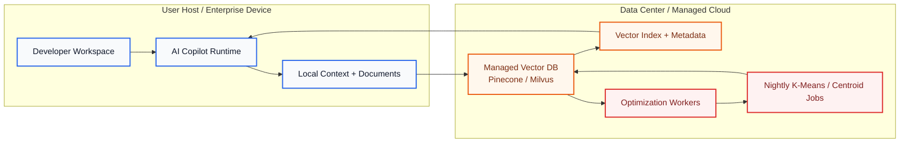
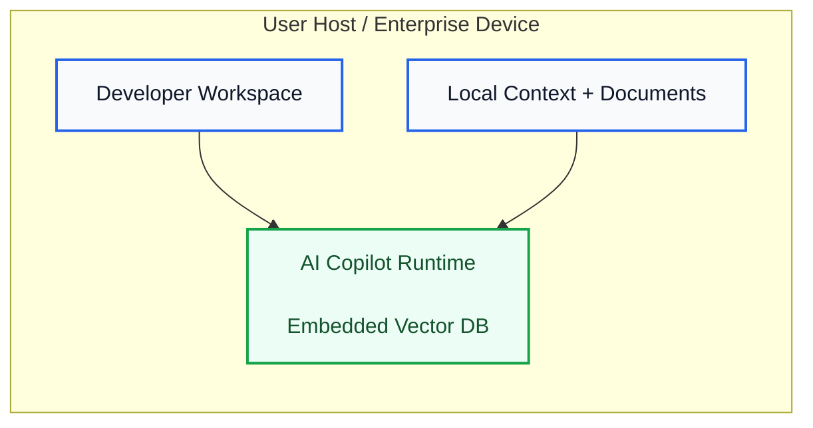

# Fleet Learning and Copilot Federation

Northstar's fleet learning approach is designed to help teams improve the quality of their AI Copilot experience without turning every interaction into a shared data pool.

The idea is simple: each workspace can learn from its own repositories, coding patterns, and workflow history, and then optionally contribute a small set of validated signals to a broader shared model of good practice. The system is built around explicit control, not automatic data collection.

## What this capability does

Fleet learning helps Copilot become more consistent over time by drawing on patterns that have already proven useful in similar contexts. In practice, that can mean better suggestions for code structure, repository navigation, and task handling when the relevant patterns are already available and approved for sharing.

This is not intended as a broad, opaque training program. It is a focused way to improve guidance for real workflows while keeping the experience grounded in the user's own environment.

## Privacy-first architecture

We designed this feature to respect the boundaries of the workspace first.

- Local learning stays local by default.
- Sharing is opt-in and governed by clear controls.
- Sensitive content is screened before anything is considered for broader use.
- Users can review what is shared and choose which categories of signals are allowed to participate.

That means the system can improve over time without requiring teams to surrender their judgment or their data by default.

### Current hosted setup: managed vector services in a data center

This is the current model at a high level: the user environment sends context into a managed vector service hosted in a data center, while separate worker nodes perform overnight optimization jobs such as K-Means centroid updates.

### Embedded setup: vector database runs on the user host

This is the preferred model: the vector database lives inside the AI Copilot runtime on the user host, and vectorization is simply part of the normal database operation that powers retrieval. There is no separate data center requirement and no dedicated optimization cluster needed for the core experience.

### Why this approach is more sustainable

- Lower infrastructure cost and fewer vendor dependencies.
- Less operational overhead because there is no separate vector cluster to manage.
- Lower energy demand because the workload stays lightweight and local.
- Better alignment with privacy-first deployment: the data stays close to the user environment.

## How federation works in practice

The federation model is intentionally narrow:

1. A workspace learns from its own local activity.
2. It evaluates whether a pattern is useful, safe, and relevant.
3. If the user has opted in, only the approved signal is shared.
4. The receiving environment can use that signal to improve guidance without needing the full underlying context.

This approach is meant to be transparent and auditable. Teams can understand what was shared, why it was shared, and how it influenced the experience.

## Transparency and user ownership

We believe transparency should be part of the product experience, not an afterthought. Every action the AI takes should be understandable, auditable, and reviewable by the user.

Users should have clear control over the data generated through AI interactions and workflows. That includes ownership of the artifacts they create, the ability to inspect how the system handled a task, and the ability to manage what is retained, shared, or removed. In our view, the user should remain the steward of their own work and the data that comes from it.

That principle shapes how we approach federation and fleet learning. The goal is not to collect more data by default, but to make useful improvements while preserving visibility, consent, and user control.

## Storage and ownership model

In HQ, fleet-learning and federation content is treated as product workflow state rather than platform control state. That means the shared content and related workspace artifacts belong with the user-facing data domain, while system-level control information such as sessions, RBAC, and entitlement policy remains in the system database.

Scripts are handled the same way:

- system/runtime scripts stay with system-owned control state
- user or workflow scripts stay with the user-facing data domain

At the moment, fleet learning and federation do not require scripts as part of the core flow, so they do not need a separate scripting layer in the initial design.

## What we believe

We think useful AI should get better over time without becoming invasive. Fleet learning is most valuable when it helps people work more effectively while preserving trust, consent, and clear boundaries around what leaves a workspace.

This is an area we continue to refine carefully. Our goal is to make AI assistance more useful, not more intrusive.
