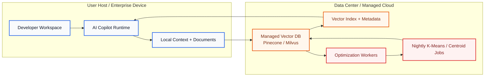
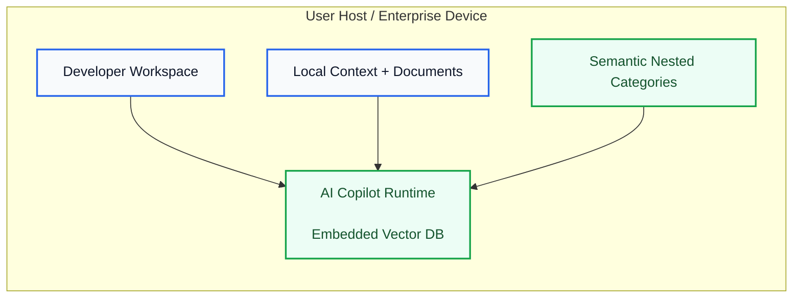
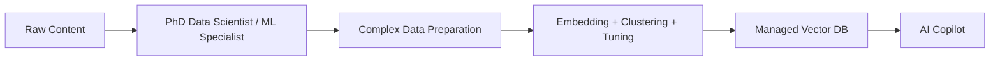
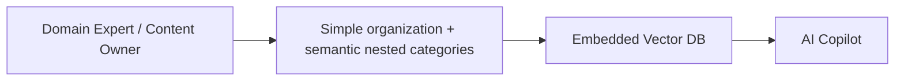

# Fleet Learning and Copilot Federation

Northstar's fleet learning approach is designed to help teams improve the quality of their AI Copilot experience without turning every interaction into a shared data pool.

The idea is simple: each workspace can learn from its own repositories, coding patterns, and workflow history, and then optionally contribute a small set of validated signals to a broader shared model of good practice. The system is built around explicit control, not automatic data collection.

## What this capability does

Fleet learning helps Copilot become more consistent over time by drawing on patterns that have already proven useful in similar contexts. In practice, that can mean better suggestions for code structure, repository navigation, and task handling when the relevant patterns are already available and approved for sharing.

This is not intended as a broad, opaque training program. It is a focused way to improve guidance for real workflows while keeping the experience grounded in the user's own environment.

## Privacy-first architecture

We designed this feature to respect the boundaries of the workspace first.

- Local learning stays local by default.
- Sharing is opt-in and governed by clear controls.
- Sensitive content is screened before anything is considered for broader use.
- Users can review what is shared and choose which categories of signals are allowed to participate.

That means the system can improve over time without requiring teams to surrender their judgment or their data by default.

### Current hosted setup: managed vector services in a data center

This is the current model at a high level: the user environment sends context into a managed vector service hosted in a data center, while separate worker nodes perform overnight optimization jobs such as K-Means centroid updates.

### Embedded setup: vector database runs on the user host <svg viewBox="0 0 24 24" width="10" height="10" aria-hidden="true" style={{fill: '#22c55e', flexShrink: 0}}><path d="M12 2a10 10 0 1 0 10 10A10.01 10.01 0 0 0 12 2Zm0 2a7.99 7.99 0 0 1 6.97 4.03A8.38 8.38 0 0 0 14.5 8.5c-1.2 0-2.3.34-3.27.94A6.96 6.96 0 0 1 12 4Zm-3.8 3.3a6.97 6.97 0 0 1 2.5-.8c.4 0 .79.04 1.17.12a8.53 8.53 0 0 0-1.87 2.2A6.97 6.97 0 0 1 8.2 7.3Zm-1.4 2.74A6.98 6.98 0 0 1 11 6.03c.2.43.36.89.46 1.37A9.2 9.2 0 0 0 7.8 10.04Zm10.79 3.8a8.25 8.25 0 0 1-2.97 2.57 6.95 6.95 0 0 1-4.5-.53c.76-.81 1.3-1.78 1.59-2.87a10.05 10.05 0 0 0 4.24 1.07c.56 0 1.1-.05 1.64-.24Zm-2.76 4.12a7.94 7.94 0 0 1-5.57-.95 8.35 8.35 0 0 0 2.47-1.7c.74-.77 1.24-1.77 1.56-2.9a8.95 8.95 0 0 1 1.54 5.55Z" /><path d="M6.5 14.5a7.93 7.93 0 0 0 4.1 2.2 9.42 9.42 0 0 0-.7-2.1 8.16 8.16 0 0 0-3.4-.1Z" /></svg>

This is the preferred model: the vector database lives inside the AI Copilot runtime on the user host, and vectorization is simply part of the normal database operation that powers retrieval. There is no separate data center requirement and no dedicated optimization cluster needed for the core experience.

### Why this storage model stays real-time

The key advantage is not just that the system stores vectors, but that it stores them in a category-aware, graph-friendly structure that supports live updates and fast routing. Content is organized into meaningful branches, the same underlying item can be surfaced through multiple relevant paths, and retrieval can merge those signals without duplicating the user-visible result. That keeps the system responsive for Copilot and agent workflows in the moment.

This is also why the design is much more practical than trying to force the same workload into SQLite, Postgres, or similar relational engines. A relational model would need heavy join-heavy traversal, index churn, and repeated re-ranking work just to emulate this behavior. On a local host, that quickly turns retrieval into an index-maintenance problem rather than a real-time service. The embedded architecture keeps the hot path close to the data structure that actually powers search, so it can stay low-latency and predictable under live usage.

### Resilient local vectorization and repair

Fleet learning inherits the same durability model as the embedded KnowledgeBase layer. Writes are committed first, and semantic vectorization is treated as a recoverable follow-up step. If a category or item cannot be vectorized immediately, the system stores that target in a repair queue and retries it later instead of blocking the workflow or dropping the update.

That matters for local Copilot and agent workflows because the runtime can continue to learn, retrieve, and reason from the persisted content even when the local embedder or storage path is temporarily unavailable. The repair pass later brings the semantic index back into consistency without requiring manual intervention.

For the daemon on the user host, the policy is intentionally conservative. The first vectorization failures are treated as skip-and-continue events. If the same targets keep failing over time, the daemon escalates to a recovery prompt that asks the user whether to continue ignoring the issue, rebuild the indexes, or clear stale semantic indexes and rebuild them from the persisted content. In non-daemon environments, the SetupWizard can create a recovery disk or folder that hosts a persistent local queue store for pending vectorization work, allowing the system to automate self-healing after restarts and to preserve progress across sessions.

### Benchmark PoC: retrieval quality using industry-style vector DB metrics

To validate this architecture as a concrete proof of concept, we run a standalone retrieval benchmark that mirrors the evaluation approach commonly used by vector databases such as Milvus and Pinecone: top-k retrieval quality, precision at rank, recall at rank, mean reciprocal rank, and nDCG at rank 3. The benchmark uses a deterministic, privacy-safe dataset and evaluates both exact and fuzzy retrieval behavior over nested categories.

The latest benchmark results from the repository quality harness show that richer KnowledgeBase search using semantic nested categories improves retrieval quality across the core scenarios. That makes the benchmark a direct measure of how well the system routes content through meaningful conceptual branches before vectors are compared.

| Scenario | Storage | Query | P@1 | P@3 | Recall@3 | MRR | nDCG@3 |
| --- | ---: | --- | ---: | ---: | ---: | ---: | ---: |
| Known nested category | 7 categories / 11 items | postgres failover | 1.00 | 1.00 | 1.00 | 1.00 | 1.00 |
| Text-only leaf inference | 7 categories / 11 items | postgres failover | 1.00 | 1.00 | 1.00 | 1.00 | 1.00 |
| Fuzzy cross-leaf retrieval | 7 categories / 11 items | redis cache outage | 1.00 | 1.00 | 1.00 | 1.00 | 1.00 |
| Monitoring path retrieval | 7 categories / 11 items | monitoring dashboard alerting | 1.00 | 0.50 | 0.50 | 1.00 | 0.67 |
| Security synonym retrieval | 7 categories / 11 items | auth token rotation | 1.00 | 0.50 | 0.50 | 1.00 | 0.67 |
| Backup / restore cross-leaf | 7 categories / 11 items | database backup restore | 1.00 | 0.33 | 1.00 | 1.00 | 1.00 |
| Aggregate | 7 categories / 11 items | — | 1.00 | 0.72 | 0.83 | 1.00 | 0.89 |

This is an early PoC benchmark rather than a full vendor comparison, but it demonstrates that the embedded KnowledgeBase architecture can deliver strong retrieval quality under the same metrics that are commonly used to assess vector search quality in production systems. The same harness can be reused against Pinecone, Milvus, or other backends once those services are available for side-by-side evaluation.

### Why semantic nested categories are the organizing layer

Even managed vector systems such as Pinecone or Milvus benefit from structure. They perform best when data is grouped into meaningful namespaces, collections, or concept paths; otherwise the index becomes just a flat cloud of vectors. Our approach makes that requirement explicit and lightweight: semantic nested categories are the organizing layer.

Semantic nested categories do three jobs at once:

- they turn raw text into a hierarchy-aware path,
- they give retrieval a sensible branch to search first,
- they let the system decide when a crowded branch should become a child category or a new parent category.

That makes vectorization and retrieval simpler in practice. Instead of depending on a large data-science pipeline or a team of ML specialists to shape the index, a domain expert can author content and define the conceptual hierarchy that guides the system toward the right place in the structure.

### From specialist-heavy workflows to domain-expert-friendly operations

The current generation of vector systems often depends on specialized ML talent to prepare data, tune embeddings, manage clustering, and maintain quality over time. That drives up both the hiring burden and the operational cost.

Our approach shifts that work toward a simpler, more general data-organization workflow. A domain expert or a person who already understands the content can organize it into categories and let the embedded vector database handle the underlying vectorization and structure automatically.

The important distinction is that this is not a “taxonomy-free” vector system. Even Pinecone and Milvus require some degree of structure to achieve high precision. Our architecture makes that requirement elegant and low-friction: semantic nested categories provide the organizing layer, and they are human-authorable, density-aware, and compatible with rule-based, hybrid, or LLM-assisted strategies.

In practice, this means we do not need a PhD-level ML specialist to make the system useful. The core operating loop is the KnowledgeBase retrieval layer itself: it uses semantic nested categories as the routing prior, and it can be automated through rule-based logic, hybrid logic, or LLM-assisted classification. The developer wires that abstraction into the product experience, and the domain expert provides the concepts and judgment that keep the taxonomy grounded in the real world. That is the core reason this model can reduce manpower and deep-expertise requirements without giving up quality.

#### Current model: specialist-led vector operations

#### Northstar model: domain-expert-led organization with embedded vector intelligence

This reduces the need for deep data-science talent, shortens the path to value, and lowers the total cost of ownership for enterprise AI systems. The result is cleaner retrieval, better branch-level precision, and a much smaller operational burden than a specialist-led vector stack.

### Why this approach is more sustainable

- Lower infrastructure spend: there is no need to maintain a separate managed vector cluster or pay for always-on cloud capacity.
- No data-center idle load: vector indexing and retrieval stay on the user host instead of drawing power for cooling, lighting, and standby infrastructure.
- Less network transmission overhead: embeddings and retrieval traffic stay local, avoiding the energy cost of repeatedly moving large vector payloads across the internet.
- Better use of existing hardware: local workloads reuse the compute already running for the user’s normal work instead of requiring dedicated cloud resources for background indexing.
- Lower operational burden: the architecture removes the need to operate and monitor a remote vector service and its background optimization jobs.
- Stronger privacy posture: sensitive content stays close to the user environment, reducing exposure and simplifying compliance expectations.
- Fewer security layers to maintain: keeping the vector store embedded reduces the need for extra cloud-only controls around data movement and storage.
- Lower organizational overhead: teams do not need to rely on specialized ML operators just to keep retrieval and indexing working.
- More predictable cost profile: the system scales with local usage patterns rather than requiring continuous cloud spend for peak or idle capacity.

## How federation works in practice

The federation model is intentionally narrow. At the federation boundary, we do not transmit raw documents or full workspace context. We share only approved, privacy-safe signals and metadata that describe a pattern, category, or outcome, with enough structure for another Copilot to improve its guidance without receiving the original content.

1. A workspace learns from its own local activity.
2. It evaluates whether a pattern is useful, safe, and relevant.
3. If the user has opted in, only an approved, scrubbed signal is shared.
4. The receiving environment can use that signal to improve guidance without needing the full underlying context.

This approach is meant to be transparent and auditable at the local layer. In the local daemon and UI, the user has complete visibility into federation activity/data, with the data organized clearly and surfaced through high-level summaries and direct control knobs for review and management.

## Transparency and user ownership

We believe transparency should be part of the product experience, not an afterthought. Every action the AI takes should be understandable, auditable, and reviewable by the user.

Users should have clear control over the data generated through AI interactions and workflows. That includes ownership of the artifacts they create, the ability to inspect how the system handled a task, and the ability to manage what is retained, shared, or removed. In our view, the user should remain the steward of their own work and the data that comes from it.

That principle shapes how we approach federation and fleet learning. The goal is not to collect more data by default, but to make useful improvements while preserving visibility, consent, and user control.

## Storage and ownership model

In HQ, fleet-learning and federation content is treated as product workflow state rather than platform control state. That means the shared content and related workspace artifacts belong with the user-facing data domain, while system-level control information such as sessions, RBAC, and entitlement policy remains in the system database.

Scripts are handled the same way:

- system/runtime scripts stay with system-owned control state
- user or workflow scripts stay with the user-facing data domain

At the moment, fleet learning and federation do not require scripts as part of the core flow, so they do not need a separate scripting layer in the initial design.

## What we believe

We think useful AI should get better over time without becoming invasive. Fleet learning is most valuable when it helps people work more effectively while preserving trust, consent, and clear boundaries around what leaves a workspace.

This is an area we continue to refine carefully. Our goal is to make AI assistance more useful, not more intrusive.
