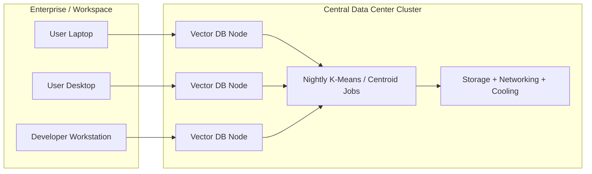
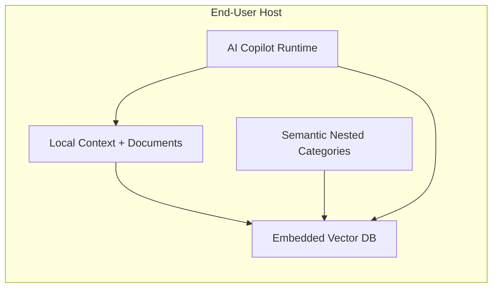

# Green Earth Tech

Northstar's Green Earth Tech story is simple: keep the vector database close to the user and the AI runtime instead of paying for a permanent data-center cluster to run indexing, clustering, and optimization around the clock.

The result is a more efficient architecture for retrieval, lower electricity demand, better privacy, and less dependence on centralized infrastructure.

## Why this matters

Traditional vector systems often split the workload across three layers:

- the end-user app or workspace,
- a remote vector database service,
- a central optimization cluster that runs nightly jobs such as K-Means updates.

That design keeps servers, storage, networking, and cooling running even when the user is simply working on a document, a repository, or a task.

Our model moves the retrieval layer onto the user host. The same device that runs the AI Copilot also runs the embedded vector database and semantic category structure.

## Enterprise architecture comparison

### Traditional vector database with data-center cluster

### Embedded vector database on the end-user host

The second architecture removes the need for a dedicated central vector cluster for the core experience. The intelligence stays close to the workspace and the user device.

## Energy estimate

The following numbers are illustrative and depend on workload, hardware, and whether the local device would be on anyway. They are intended as a planning range rather than a precise vendor benchmark.

Assume a modest enterprise deployment serving 1,000 active users.

| Model | Typical facility draw | Approx. annual electricity |
| --- | ---: | ---: |
| Traditional vector service with a dedicated cluster | 200-400 kW continuous | 1,750-3,500 MWh/year |
| Embedded host-based vector DB | 20-60 kW across active hosts | 175-525 MWh/year |

That suggests a savings range of roughly 70% to 95% for the serving path alone, or about 1,250 to 3,000 MWh per year for the example above.

In practical terms, this means:

- fewer servers running 24/7,
- less cooling and power-distribution overhead,
- less electricity spent on nightly re-indexing jobs,
- less infrastructure that must be provisioned just to keep semantic retrieval alive.

## The sustainability thesis

This is the core Green Earth Tech claim:

> Moving vectorization and semantic retrieval to the user host eliminates the need for a large, always-on data-center cluster for many AI workloads, cutting electricity use substantially while keeping the experience local, private, and responsive.

That is why this approach is not just a software architecture choice. It is also a lower-energy operating model for AI.
