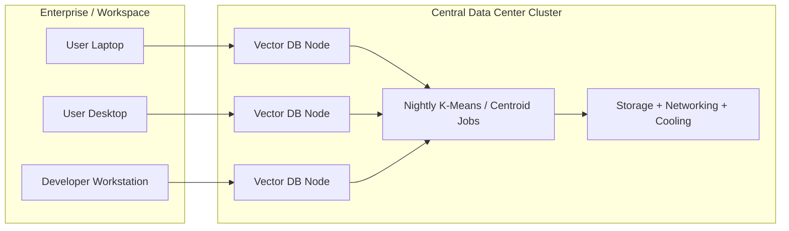
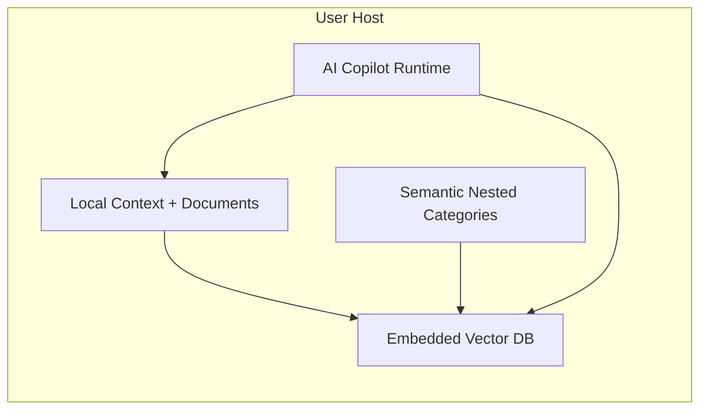

# Green Earth Tech

Northstar's Green Earth Tech story is simple: keep the vector database close to the user and the AI runtime, but make it lightweight enough to run efficiently on the host without the overhead of a permanent data-center cluster. The new vector database is deliberately compact, avoids heavy K-Means centroid re-optimization, and uses semantic nested categories to deliver sustained, linear-scale routing and categorization. In this design, semantic relationships are interpreted through surrounding context rather than through expensive, continuously re-optimized global clusters.

The result is a more efficient architecture for retrieval, lower electricity demand, less network bandwidth use, better privacy, and less dependence on centralized infrastructure.

## Why this matters

Traditional vector systems often split the workload across three layers:

- the end-user app or workspace,
- a remote vector database service,
- a central optimization cluster that runs nightly jobs such as K-Means updates.

That design keeps servers, storage, networking, and cooling running even when the user is simply working on a document, a repository, or a task. The user device is still involved, but the heavy shared infrastructure is centralized and kept online continuously.

Our model moves the retrieval layer onto the user host. The same device that runs the AI Copilot also runs a compact embedded vector database and semantic category structure that are designed to be efficient by construction rather than sustained through expensive background optimization.

## Enterprise architecture comparison

### Traditional vector database with data-center cluster

### Embedded vector database on the user host

The new architecture removes the need for a dedicated central vector cluster for the core experience. The intelligence stays close to the workspace and the user device.

## Energy estimate

The following numbers are illustrative and depend on workload, hardware, and whether the local device would be on anyway. They are intended as a planning range rather than a precise vendor benchmark.

Assume a modest enterprise deployment serving 1,000 active users. The comparison below is intentionally framed as an incremental power delta for the vector retrieval path, not a full end-to-end accounting of every workstation or laptop draw. In the traditional model, the same user hosts still consume power for the app and workspace workload; the additional burden is the continuously running shared vector infrastructure. In the embedded model, that burden shifts onto the active user hosts, and the shared fleet overhead is reduced.

| Model | Illustrative incremental draw for the vector retrieval path | Approx. annual electricity |
| --- | ---: | ---: |
| Traditional vector service with a dedicated cluster | 200-400 kW continuous in shared infrastructure | 1,750-3,500 MWh/year |
| Embedded host-based vector DB | 20-60 kW across active hosts (host-side delta) | 175-525 MWh/year |

That suggests a savings range of roughly 70% to 95% for the shared infrastructure path alone, or about 1,250 to 3,000 MWh per year for the example above, depending on how much of the host workload would have happened anyway.

In practical terms, this means:

- fewer servers running 24/7,
- less cooling and power-distribution overhead,
- less electricity spent on nightly re-indexing jobs,
- less infrastructure that must be provisioned just to keep semantic retrieval alive,
- less data movement over the network because retrieval stays local to the user host, plus better data privacy.

## The sustainability thesis

This is the core Green Earth Tech claim:

> Moving vectorization and semantic retrieval to the user host eliminates the need for a large, always-on data-center cluster for many AI workloads because the system is built around a lightweight retrieval engine that uses static category centervectors as part of a relativity triangulation algorithm, avoiding the periodic K-Means centroid re-optimization that normally burdens large-scale vector systems.

That is why this approach is not just a software architecture choice. It is also a lower-energy operating model for AI.
