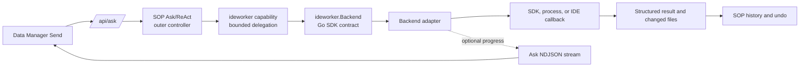
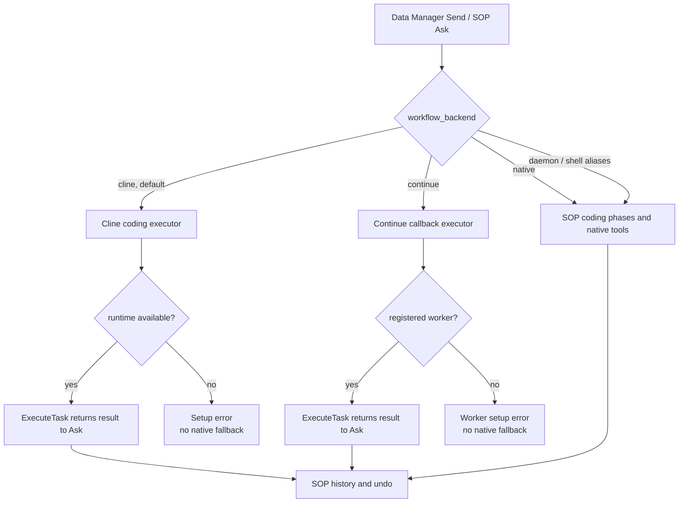
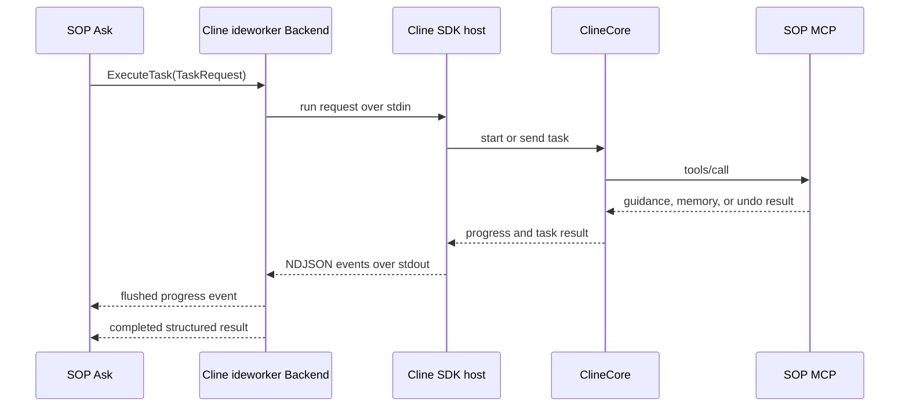
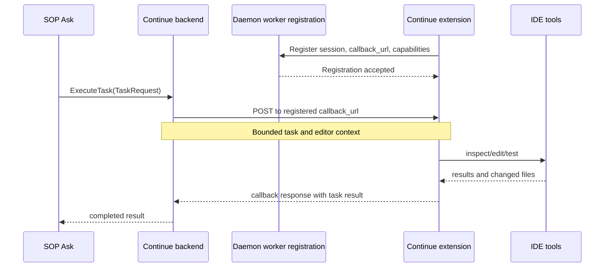

# Integrating a Coding Agent

**Status:** Current developer guide. Cline SDK is the shipping daemon backend; Continue is retained as a compatibility reference.

This guide explains how to connect another coding agent to SOP Ask without adding another chat controller or UI action. The [IDE Copilot Backends](./ide-copilot-backend.md) page describes the shared architecture; the repository's `docs/IDE_COPILOT_INTEGRATION_GUIDE.md` maps these steps to source files and tests.

## SDK Extension Boundary

The supported extension point is the exported Go `ideworker.Backend` interface. In an embedded Go application, implement it and inject it into the copilot:

```go
copilot := agent.NewCopilotAgent(cfg, databases, systemDB)
copilot.InjectIDEWorkerBackend(myBackend)
```

The daemon's `newConfiguredIDEWorkerBackend` is internal deployment selection, not a public plugin registry. The Cline host's stdin/stdout NDJSON and Continue's callback routes are adapter transports, not wire protocols a custom backend must implement. An external agent needs an adapter mapping its protocol to the Go interface.

MCP has a specific role here: Cline uses MCP as a client to call SOP's authenticated tools. SOP does not invoke Cline through MCP in the current design, and MCP does not register or select backends.

## Contract Tradeoffs

- This is an in-process Go extension point, not a cross-language plugin protocol or runtime backend-discovery system.
- `ideworker.ExecutionResult` is canonical, but `ExecuteTask` currently returns its JSON representation as a string for compatibility with existing boundaries. Serialize that schema; do not introduce backend-specific result formats. Replacing the string with a typed result would require a deliberate API migration.
- Live progress is optional and arrives through `ai.CtxKeyEventStreamer`. Embeddings without an Ask event stream should rely on status and cancellation methods instead; the backend must not assume an HTTP response writer.
- The Cline host's stdin/stdout NDJSON remains private to that adapter. It is not the SDK's wire protocol.

## Request Flow



Ask decides whether to delegate and owns the broader workflow. A backend executes one bounded coding task and returns control to Ask. Do not move multi-step workflow orchestration into the backend.

In the daemon, an available Cline backend explicitly owns repository coding execution for that turn: Ask offers the delegation tool, hides overlapping native coding phases and file/shell/Git mutation tools, waits for Cline's structured result, and does not auto-advance its native coding plan. If Cline is unavailable, the native coding workflow remains the fallback. PostgreSQL and Splunk automation tools remain separate.

## Two Integration Examples

| Backend | Pattern | Use it to learn |
|---|---|---|
| Cline SDK (current) | Daemon-managed Node host using newline-delimited JSON over stdin/stdout. It starts a Cline session once and sends follow-ups within the same workstream. | Process supervision, session/config isolation, progress forwarding, cancellation, SOP MCP tools, and workspace diff capture. |
| Continue (compatibility) | IDE extension registers a callback endpoint; the daemon delegates work to the IDE-resident worker. | IDE callback transport, editor context, registration, and auth handoff. It is not the shipping copilot path. |

The Ask-visible `delegate_continue_task` tool name is retained for compatibility; it does not make Continue a runtime dependency. See [Continue Facade Architecture](./continue-facade-architecture.md) for its historical status.

The daemon selects exactly one coding executor with `workflow_backend`: `cline` (default), `continue`, or `native` (SOP's in-house phase/tool runtime). Legacy `daemon` and `shell` values alias `native`. Cline and Continue modes fail with setup/worker guidance when unavailable; native coding is an explicit choice, not an automatic fallback. Continue bridge routes are mounted only in `continue` mode.



### Cline SDK and MCP Boundaries

The task path and MCP tool path are intentionally separate. SOP invokes Cline through its backend adapter; the Cline host calls SOP MCP tools when it needs platform capabilities.



The daemon binds Cline's SOP MCP calls to the current workstream and SOP session. A bounded task-context store supplies authoritative guidance and validation without depending on Continue state; session identity is checked when reading or mutating that context. The host also returns Cline usage metadata: per-task token/cost deltas and accumulated session totals for root and aggregate usage. Usage collection is best-effort.

Changed-file capture prefers Git enumeration and falls back to a non-symlink-following filesystem walk outside Git repositories. The scan skips generated directories and is bounded to 2,000 file entries, 1 MiB per file, 16 MiB total, and 2 MiB of Git listing output. A truncated scan suppresses diff inference to avoid treating unobserved files as deletions; result metadata reports snapshot completeness. Oversized inline diffs are truncated with metadata.

### Continue Callback Boundary

Continue is retained as a compatibility example of an IDE-resident worker. The callback transports a bounded task to the extension; the extension owns editor tools, while SOP Ask remains the controller.



## Add a Backend

1. **Choose where execution runs.** Use an SDK or supervised process when the daemon owns the agent runtime. Use a callback when the agent must access IDE-only state or tools. Keep transport and provider details behind the adapter.
2. **Implement the shared interface.** Implement `InspectSession`, `ExecuteTask`, `StartTask`, `GetTaskStatus`, and `CancelTask` from `ideworker.Backend`. Report only capabilities the backend can complete end to end.
3. **Keep request identity explicit.** `WorkstreamID` scopes tactical continuity, `SessionID` associates work with SOP, and `RequestID` identifies one delegated operation. Do not use a request ID as long-lived session state. Keep application parameters on `TaskRequest`; use context for cancellation and request-scoped infrastructure.
4. **Inject or select it.** Embedded Go applications use `CopilotAgent.InjectIDEWorkerBackend`. Daemon maintainers use internal construction/selection in `newConfiguredIDEWorkerBackend` (`lib/sop/cmd/sop-daemon/ide_worker_bridge.go`). Keep the Ask-facing `ideworker.Capability` backend-neutral.
5. **Handle progress and cancellation.** Preserve `context.Context` through the underlying SDK/process. For synchronous coding delegation, return the completed result to Ask and stream bounded updates through `ai.CtxKeyEventStreamer`; never write directly to the HTTP response from the backend. Keep asynchronous task routes detached from their short-lived HTTP request context, with explicit cancellation and an upper timeout. The Ask response is flushed NDJSON, with each record shaped as `{ "type": "progress", "payload": ... }`.
6. **Return structured changes.** Return an `ExecutionResult` containing status, summary, modified files, diffs or artifact references, and metadata. Record workspace changes through SOP so its undo/history stays canonical; keep agent checkpoints task-local.
7. **Protect the boundary.** Validate workspace roots and callback URLs, keep provider credentials out of argv and logs, and never substitute daemon authentication for provider or IDE authentication.
8. **Test before advertising.** Cover runtime availability, request mapping, capabilities, progress events, completion/failure, cancellation, workstream isolation, and restore behavior. Use a fake process or callback so routine tests do not require provider credentials.

## Progress Event

Cline emits start, live activity, completion/failure, and cancellation through the existing Ask stream. An event contains a stable delegation ID and a compact status snapshot:

```json
{
  "type": "progress",
  "payload": {
    "source": "ide_worker",
    "backend": "cline",
    "event": "delegation_status",
    "delegation_id": "request-id",
    "status": "running",
    "phase": "execution",
    "activity_kind": "investigating",
    "activity_label": "Investigating workspace...",
    "message": "Reading relevant files",
    "updated_at": "2026-10-04T12:00:00Z"
  }
}
```

Progress events do not replace the final assistant response. Serialize writes if an event can arrive from a background worker while Ask is streaming model output.

## Validation

From the repository root, focused checks include:

```sh
go test ./lib/sop/ai/agent/domains/ideworker/...
go test ./lib/sop/cmd/sop-daemon -run 'TestCline|TestContinue'
go test ./lib/sop/tools/sopbackend -run 'TestSetupStream'
npm --prefix tools/cline-sdk-host run build
```

These checks do not replace a real-provider and Data Manager test. Cline's runtime, packaging, and release checks are in the repository's `docs/CLINE_COPILOT_INTEGRATION_PLAN.md`.